# รายงานวิเคราะห์ระบบจัดการพนักงานและเงินเดือนร้าน Haris

## บทที่ 1 บทนำ

### 1.1 บทนำ

ร้าน Haris ดำเนินกิจการร้านอาหารหลายสาขา การจัดทำเงินเดือนจึงต้องนำข้อมูลจากหลายส่วนมาพิจารณาร่วมกัน ได้แก่ ประวัติการจ้างและสังกัดของพนักงาน วันและเวลาทำงาน การลา การทำงานล่วงเวลา เงินทดรองจ่าย เงินกู้ และหนี้ของพนักงาน ข้อมูลเหล่านี้เปลี่ยนได้ระหว่างเดือนและอาจมีผลต่อการคำนวณในวันที่ต่างกัน เช่น การย้ายสาขา การเปลี่ยนตำแหน่ง หรือการปรับค่าตอบแทน การคำนวณจากข้อมูลปัจจุบันเพียงชุดเดียวจึงไม่เพียงพอสำหรับการอธิบายยอดเงินเดือนย้อนหลัง

จาก [Business Process เดิมใน FigJam](https://www.figma.com/board/WeisjoAMbg0KwJugBoGn0Y/Haris-SA?node-id=8-1295) ฝ่ายทรัพยากรบุคคลรวบรวมข้อมูลจากสาขาแล้วนำไฟล์ Excel ของเดือนก่อนมาจัดทำรอบใหม่ ขั้นตอนดังกล่าวต้องลบข้อมูลรายเดือนเดิม กรอกข้อมูลที่ได้รับเพิ่มเติม ตรวจยอดรายบุคคลและจัดทำสรุปก่อนจ่ายเงินเดือน ต่อจากนั้นทีม IT จึงใช้ข้อมูลเงินเดือนจัดทำและส่งสลิปให้พนักงาน กระบวนการนี้พึ่งพาการส่งต่อข้อมูลและการตรวจด้วยมือหลายจุด

โครงการ Haris Payroll จัดทำเป็นระบบเว็บสำหรับรวบรวมข้อมูลและควบคุมขั้นตอนตั้งแต่การจัดการพนักงานจนถึงการปิดรอบเงินเดือน ผู้ใช้ประกอบด้วยพนักงาน หัวหน้าแผนก ผู้จัดการสาขา ฝ่ายทรัพยากรบุคคล/บัญชี และเจ้าของร้าน แต่ละบทบาทเข้าถึงข้อมูลตามหน้าที่และขอบเขตที่ได้รับ ระบบใช้ข้อมูลการทำงานและรายการทางการเงินที่บันทึกไว้เป็นต้นทางในการคำนวณค่าจ้างรายวัน รายได้ รายการหัก และยอดสุทธิ

หลักสำคัญของการออกแบบคือการรักษาข้อเท็จจริงย้อนหลัง ประวัติสังกัดและค่าตอบแทนบันทึกตามช่วงวันที่มีผล บันทึกการทำงานเก็บสาขาของวันที่เกิดรายการ ผลการอนุมัติมีประวัติการตัดสินใจ และรอบเงินเดือนที่ล็อกแล้วไม่ถูกแก้ยอดโดยตรง หากพบข้อผิดพลาดภายหลังต้องใช้รายการปรับปรุงที่ตรวจสอบได้ การกำหนดวิธีดังกล่าวช่วยให้ผู้รับผิดชอบอธิบายได้ว่าเงินเดือนแต่ละรายการเกิดจากข้อมูลและกฎใด ณ เวลาที่คำนวณ

รายงานนี้วิเคราะห์กระบวนการเดิมและกระบวนการใหม่ตาม FigJam แล้วเชื่อมโยงกับ Use Case, แบบจำลองข้อมูล, โครงสร้างระบบ, ส่วนติดต่อผู้ใช้ และการทดสอบ โดยใช้ `haris-payroll-postgresql.dbml` เป็นหลักสำหรับชื่อตารางและความสัมพันธ์ ส่วนการอธิบายสิ่งที่ระบบทำได้ในปัจจุบันตรวจจากโค้ดของโครงการ รายการใน FigJam ที่ยังเป็นแนวทางออกแบบจะระบุแยกจากความสามารถที่มี API แล้ว

### 1.2 ปัญหา

แผนภาพกระบวนการเดิมทำเครื่องหมายปัญหาด้วยสามสี ได้แก่ **สีเหลือง: เสี่ยงลบข้อมูลผิด**, **สีเขียว: เสี่ยงกรอกข้อมูลผิด** และ **สีฟ้าอมเขียว: ใช้เวลาสรุปข้อมูลมาก** ทั้งสามปัญหาเกี่ยวข้องกัน เพราะไฟล์รายเดือนเป็นทั้งพื้นที่บันทึกข้อมูล พื้นที่คำนวณ และแหล่งข้อมูลสำหรับจัดทำเอกสารผลลัพธ์

| ปัญหาจาก As is | สาเหตุในขั้นตอนเดิม | ผลกระทบต่อการจัดทำเงินเดือน | แนวทางที่ใช้ใน To be |
|---|---|---|---|
| ลบข้อมูลผิด | คัดลอกไฟล์ของเดือนก่อนแล้วล้างข้อมูลที่เปลี่ยนทุกเดือน | ข้อมูลขาด ลา สาย OT หรือรายการหักเก่าอาจค้างอยู่ หรือข้อมูลที่ต้องเก็บอาจถูกลบ | แยกรอบเงินเดือนและเก็บข้อมูลต้นทางเป็นระเบียนตามวันหรือช่วงวันที่มีผล |
| กรอกข้อมูลผิด | รับข้อมูลจากสาขาแล้วกรอกซ้ำด้วยมือในไฟล์กลาง | ตัวเลขและสถานะอาจไม่ตรงกับข้อมูลต้นทาง ทำให้ต้องตรวจย้อนหลายฝ่าย | ให้ผู้รับผิดชอบบันทึกในระบบตามบทบาท ตรวจรูปแบบและสิทธิ์ก่อนบันทึก และเก็บประวัติการอนุมัติ |
| ใช้เวลาสรุปข้อมูลมาก | รวมรายการรายคนและยอดรายเดือนจากหลายส่วน | การตรวจยอดจ่ายและจัดทำเอกสารล่าช้า โดยเฉพาะเมื่อมีรายการย้อนหลัง | ระบบอ่านข้อมูลที่อนุมัติแล้ว คำนวณเป็นรายการแยกประเภท และแสดงเหตุที่ยังล็อกรอบไม่ได้ |

ปัญหาแรกไม่จำกัดอยู่ที่การลบเซลล์ผิด แต่รวมถึงการไม่รู้ว่าค่าที่คงอยู่ในไฟล์เป็นของรอบใด หากใช้ไฟล์เดือนก่อนเป็นต้นแบบโดยไม่มีหลักฐานของการเปลี่ยนแปลง ผู้ตรวจสอบอาจแยกไม่ได้ว่ายอดที่ปรากฏมาจากข้อมูลปัจจุบันหรือข้อมูลที่หลงเหลืออยู่ โครงสร้างรอบเงินเดือนและการเก็บข้อมูลต้นทางแยกจากผลคำนวณจึงเป็นเงื่อนไขสำคัญของระบบใหม่

ปัญหาการกรอกซ้ำมีผลมากเมื่อข้อมูลหนึ่งรายการถูกส่งผ่านหลายฝ่าย เช่น ข้อมูลการลาและ OT ต้องสัมพันธ์กับวันทำงาน สังกัดของพนักงาน และผู้มีสิทธิ์อนุมัติ หากสถานะที่ได้รับไม่ตรงกัน การคำนวณเงินเดือนอาจนำรายการที่ยังไม่อนุมัติไปใช้ ระบบใหม่จึงต้องตรวจสิทธิ์ที่ backend บันทึกผลการพิจารณา และไม่อนุมานว่า OT จ่ายได้เพียงเพราะพนักงานออกงานช้า

ปัญหาการสรุปยอดเกี่ยวข้องกับการอธิบายที่มาของเงิน ไม่ใช่เฉพาะความเร็วในการบวกตัวเลข ผลเงินเดือนควรแยกรายได้กับรายการหัก ระบุแหล่งข้อมูลที่นำมาคำนวณ และตรวจความครบถ้วนก่อนปิดรอบ เมื่อรอบถูกล็อกแล้ว ค่าที่ใช้คำนวณต้องคงอยู่เพื่อเปรียบเทียบกับสลิปและรายงานภายหลัง

## บทที่ 2 การวิเคราะห์กระบวนการทำงาน

### 2.1 Business Process เดิม (As is)

[ภาพที่ 2.1 Business Process เดิม](https://www.figma.com/board/WeisjoAMbg0KwJugBoGn0Y/Haris-SA?node-id=8-1295) แสดงงานของฝ่ายทรัพยากรบุคคล ทีม IT และพนักงาน รวมถึงตำแหน่งของปัญหาที่ทำเครื่องหมายด้วยสี

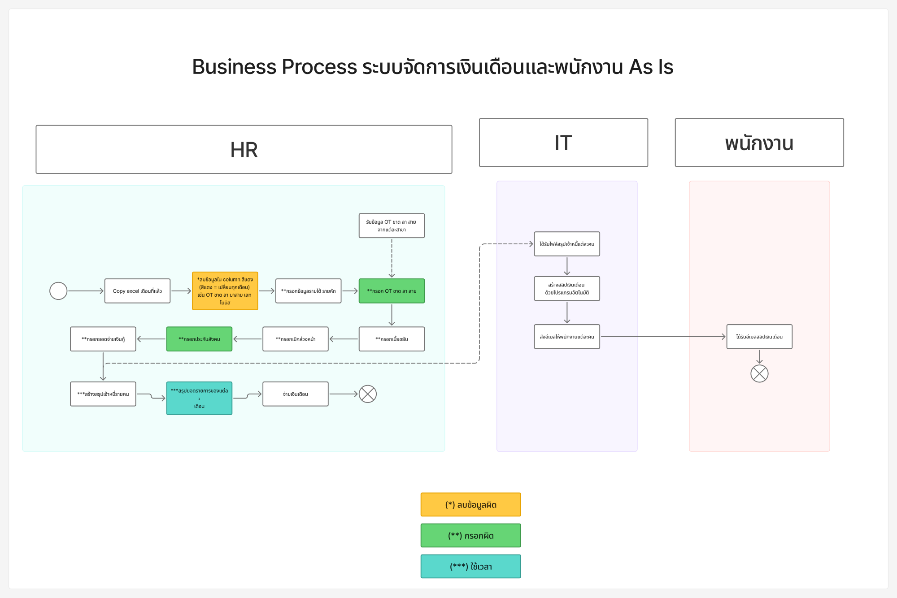

#### 2.1.1 คำอธิบาย Business Process เดิม

กระบวนการเริ่มเมื่อฝ่ายทรัพยากรบุคคลนำไฟล์ Excel ของรอบก่อนมาใช้เป็นต้นแบบ แล้วล้างข้อมูลรายเดือนที่ต้องกรอกใหม่ หลังจากนั้นแต่ละสาขาส่งข้อมูลการทำงานของพนักงาน เช่น OT การขาดงาน การลา และการมาสาย ฝ่ายทรัพยากรบุคคลนำข้อมูลดังกล่าวไปบันทึกในไฟล์เงินเดือนพร้อมรายการรายได้และรายการหักที่เกี่ยวข้อง ก่อนสรุปยอดรายบุคคลและยอดรวมประจำเดือน

| ลำดับ | ผู้รับผิดชอบ | ข้อมูลเข้า | กิจกรรม | ผลลัพธ์ |
|:---:|---|---|---|---|
| 1 | ฝ่ายทรัพยากรบุคคล | ไฟล์เงินเดือนรอบก่อน | คัดลอกไฟล์เพื่อเริ่มรอบใหม่ | ไฟล์ทำงานของเดือนปัจจุบัน |
| 2 | ฝ่ายทรัพยากรบุคคล | ไฟล์ที่คัดลอก | ล้างช่องข้อมูลรายเดือนที่ต้องเปลี่ยน | โครงไฟล์สำหรับกรอกข้อมูลใหม่ |
| 3 | สาขาและฝ่ายทรัพยากรบุคคล | ข้อมูลลงเวลา ขาด ลา สาย และ OT | ส่งต่อและรวบรวมข้อมูลของพนักงาน | ชุดข้อมูลการทำงานประจำรอบ |
| 4 | ฝ่ายทรัพยากรบุคคล | ชุดข้อมูลจากสาขา | กรอกข้อมูลการทำงานและปรับรายการรายได้/หัก | ยอดคำนวณเบื้องต้นรายคน |
| 5 | ฝ่ายทรัพยากรบุคคล | เงินทดรอง ค่างวดเงินกู้ หนี้ และค่าหักอื่น | ตรวจและบันทึกรายการทางการเงิน | ยอดหักและยอดสุทธิรายคน |
| 6 | ฝ่ายทรัพยากรบุคคล | ยอดเงินเดือนรายคน | สรุปเจ้าหนี้และยอดประจำเดือน ตรวจความถูกต้อง แล้วดำเนินการจ่าย | ผลเงินเดือนที่ใช้จ่ายจริง |
| 7 | ทีม IT | ผลเงินเดือนที่สรุปแล้ว | ใช้โปรแกรมสร้างสลิปและส่งทางอีเมล | เอกสารเงินเดือนสำหรับพนักงาน |
| 8 | พนักงาน | สลิปที่ได้รับ | รับและตรวจรายละเอียดเงินเดือน | ทราบผลเงินเดือนของตน |

ในขั้นตอนที่ 1–2 ไฟล์ของรอบก่อนถูกนำกลับมาแก้ไข จึงเกิดความเสี่ยงจากข้อมูลเดิมค้างอยู่ ขั้นตอนที่ 3–5 ต้องรับข้อมูลจากหลายแหล่งและกรอกด้วยมือ ทำให้ตรวจความตรงกันได้ยาก ส่วนขั้นตอนที่ 6 ต้องรวมยอดรายคนและยอดทั้งร้านก่อนส่งต่อให้ทีม IT ขั้นตอนเหล่านี้สอดคล้องกับกล่องสีเหลือง สีเขียว และสีฟ้าอมเขียวใน FigJam ตามลำดับ

#### 2.1.2 ปัญหาของ Business Process เดิม

**การล้างข้อมูลจากไฟล์เดิม** เป็นจุดเสี่ยงแรก เพราะข้อมูลบางประเภทมีผลเฉพาะเดือน แต่บางประเภทเป็นข้อมูลประวัติที่ควรคงอยู่ หากลบผิด รายการสำคัญอาจหายไป หากลบไม่ครบ ข้อมูลเดิมอาจถูกนำไปรวมในเดือนใหม่ กระบวนการเดิมไม่มีการแยกรอบและบันทึกประวัติการเปลี่ยนแปลงในรูปแบบที่ตรวจสอบได้อย่างเป็นระบบ

**การบันทึกข้อมูลซ้ำ** ทำให้ฝ่ายทรัพยากรบุคคลต้องตีความข้อมูลที่ได้รับจากสาขาและกรอกอีกครั้ง ความผิดพลาดอาจเกิดที่วันที่ ประเภทคำขอ จำนวนวันหรือชั่วโมง และจำนวนเงิน การส่งต่อแบบนี้ทำให้ผู้บันทึกข้อมูลต้นทางกับผู้กรอกเงินเดือนเป็นคนละฝ่าย จึงต้องใช้เวลาเพิ่มเติมเมื่อต้องสอบทานความคลาดเคลื่อน

**การสรุปยอดด้วยมือ** ทำให้ผู้ตรวจต้องอ่านรายการหลายส่วนเพื่อหาที่มาของยอดสุทธิ เช่น เงินทดรองที่อนุมัติแล้ว เงินกู้ที่ครบกำหนดงวด และหนี้ที่เกิดเป็นรายการครั้งต่อครั้ง หากไม่มีความสัมพันธ์ระหว่างรายการต้นทางกับผลคำนวณ การตรวจย้อนหลังหลังจ่ายเงินเดือนจะยากขึ้น

กระบวนการเดิมยังแยกการสร้างและส่งสลิปไปยังทีม IT จึงต้องส่งข้อมูลผลเงินเดือนออกจากขั้นตอนคำนวณอีกครั้ง รายงานนี้ใช้ข้อสังเกตดังกล่าวเป็นความต้องการของกระบวนการใหม่ แต่ไม่ได้สมมติว่าระบบเดิมมีฐานข้อมูลหรือ API สำหรับตรวจสอบเหตุการณ์เหล่านี้

### 2.2 Business Process ใหม่ (To be)

[ภาพที่ 2.2 Business Process ใหม่](https://www.figma.com/board/WeisjoAMbg0KwJugBoGn0Y/Haris-SA?node-id=4-1432) แสดงงานของเจ้าของร้าน ผู้จัดการสาขา ฝ่ายบัญชี/ทรัพยากรบุคคล ระบบ และพนักงาน การออกแบบให้แต่ละฝ่ายบันทึกหรือพิจารณาข้อมูลในจุดที่รับผิดชอบ ก่อนนำข้อมูลที่ผ่านการตรวจมาใช้คำนวณเงินเดือน

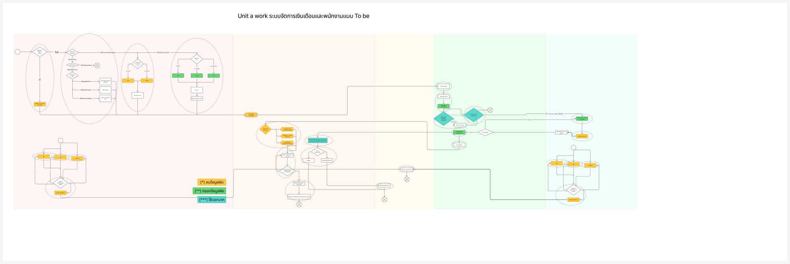

#### 2.2.1 คำอธิบาย Business Process ใหม่

ขั้นแรก เจ้าของร้านและผู้มีสิทธิ์ส่วนกลางจัดเตรียมข้อมูลร้าน สาขา แผนก ตำแหน่ง ประเภทการลา และค่าตั้งต้นการคำนวณ เช่น อัตราหักกรณีมาสายหรือขาดงาน อัตรา OT และอัตราประกันสังคม ค่าตั้งต้นที่เปลี่ยนตามเวลาเก็บวันที่เริ่มและสิ้นสุดที่มีผล เพื่อลดการนำกฎปัจจุบันไปใช้กับรอบเก่าโดยไม่ตั้งใจ

ฝ่ายทรัพยากรบุคคลจัดการประวัติพนักงานและสังกัด เมื่อรับพนักงานใหม่ ระบบสร้างระเบียนพนักงานพร้อมสังกัดแรกตามข้อมูลที่กำหนด หากย้ายสาขา เปลี่ยนตำแหน่ง เงินเดือนฐาน หรือสวัสดิการ ระบบปิดช่วงข้อมูลเดิมแล้วสร้างช่วงใหม่ ประวัตินี้ใช้ประกอบการเลือกค่าตอบแทนตามวันทำงานและการจำกัดขอบเขตข้อมูลของผู้มีสิทธิ์

ระหว่างเดือน ผู้รับผิดชอบในสาขาบันทึกวันและเวลาทำงานของพนักงาน พนักงานยื่นคำขอลาและ OT ในระบบ ผู้อนุมัติตรวจตามขอบเขตบทบาท หัวหน้าแผนกอนุมัติคำขอลาได้ไม่เกินสามวัน ส่วนผู้จัดการสาขามีสิทธิ์พิจารณาตามขอบเขตสาขา การอนุมัติหรือปฏิเสธบันทึกเป็นประวัติ และ OT จะนำมาจ่ายได้เมื่อมีผลอนุมัติชัดเจนเท่านั้น

ฝ่ายบัญชี/ทรัพยากรบุคคลดูแลเงินทดรอง เงินกู้พร้อมงวดชำระ และรายการหนี้ที่เกิดเป็นธุรกรรม ไม่ลบประวัติหนี้เพื่อเริ่มเดือนใหม่ เมื่อใกล้สิ้นรอบ ฝ่ายดังกล่าวสร้างรอบเงินเดือน ตรวจข้อมูลต้นทาง แล้วสั่งคำนวณตัวอย่าง ระบบแสดงผลรายคนแยกรายได้กับรายการหัก พร้อมแจ้งข้อมูลที่ยังไม่ครบหรือสถานะที่ขัดขวางการล็อกรอบ

เมื่อข้อมูลครบ ระบบคำนวณซ้ำจากข้อมูลล่าสุดในธุรกรรมเดียวก่อนล็อกรอบ ระเบียนเงินเดือนเก็บค่าที่ใช้คำนวณเป็น snapshot และรักษาที่มาของรายการเงินเดือน หากพบข้อผิดพลาดหลังล็อก ผู้มีสิทธิ์ต้องสร้างรายการปรับปรุงที่บันทึกเหตุผลและนำไปใช้กับรอบถัดไป แทนการแก้ตัวเลขของรอบเดิม

| ระยะงาน | ผู้รับผิดชอบหลัก | การควบคุมในระบบ | ข้อมูลที่ส่งต่อ |
|---|---|---|---|
| เตรียมข้อมูล | เจ้าของร้าน, HR | ตรวจรหัสซ้ำ ช่วงวันที่มีผล และบทบาทพร้อมขอบเขต | ข้อมูลองค์กร พนักงาน และค่าตั้งต้น |
| บันทึกงานประจำวัน | ผู้จัดการสาขา/หัวหน้าแผนก, พนักงาน | ตรวจสิทธิ์ สาขา วันซ้ำ และสถานะคำขอ | ลงเวลา ลา และ OT |
| จัดการรายการเงิน | HR/บัญชี | ตรวจเกณฑ์เงินทดรอง งวดเงินกู้ และประวัติหนี้ | รายการที่มีผลต่อยอดสุทธิ |
| คำนวณตัวอย่าง | HR/บัญชี | แจ้ง blocker แสดงรายการคำนวณและแหล่งข้อมูล | ผลรายคนสถานะ previewed เมื่อไม่มี blocker |
| ล็อกรอบ | HR/บัญชี, เจ้าของร้าน | ตรวจข้อมูลล่าสุด เก็บ snapshot และป้องกันการแก้ย้อน | รอบและผลเงินเดือนที่ล็อกแล้ว |
| แจ้งผลและตรวจสอบ | พนักงาน, HR/บัญชี, เจ้าของร้าน | จำกัดสิทธิ์สลิป ส่งออก CSV จากรอบล็อกและเก็บ audit | ข้อมูลสลิป รายงาน และหลักฐานการกระทำ |

แนวทางนี้ตอบปัญหาสีเหลืองด้วยการแยกรอบและรักษาประวัติ ตอบปัญหาสีเขียวด้วยการบันทึกข้อมูลที่ต้นทางพร้อมตรวจสิทธิ์และสถานะ และตอบปัญหาสีฟ้าอมเขียวด้วยการคำนวณและสรุปจากระเบียนที่เชื่อมถึงกัน อย่างไรก็ดี FigJam ยังมีแนวคิดการจ่ายผ่าน QR PromptPay การสร้าง PDF และการส่งอีเมลอัตโนมัติ ซึ่งไม่ควรนำไปอธิบายว่าใช้งานได้แล้วใน backend ปัจจุบัน ปัจจุบันมีการส่งออก CSV โอนเงินและประกันสังคม ส่วนสลิปบันทึก metadata และรายการส่งแบบจำลอง

### 2.3 Business Process ที่สัมพันธ์กับ Use Case

[Use Case Diagram ของ Haris](https://www.figma.com/board/WeisjoAMbg0KwJugBoGn0Y/Haris-SA?node-id=203-961) อธิบายหน้าที่หลักของผู้ใช้ในกระบวนการใหม่ รายงานนี้จัดหน้าที่เหล่านั้นเป็น UC01–UC14 เพื่อเชื่อม Business Process กับ API และตารางข้อมูลเดียวกัน ทั้งนี้หนึ่งขั้นตอนใน Business Process อาจประกอบด้วยหลาย Use Case และหนึ่ง Use Case อาจใช้ข้อมูลจากหลายขั้นตอน

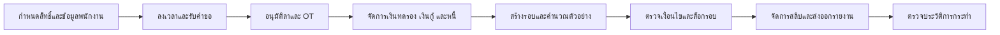

ข้อมูลที่ไหลจากขั้นตอนหนึ่งสู่อีกขั้นตอนหนึ่งไม่ได้เป็นเพียงยอดรวม ตัวอย่างเช่น UC04 เก็บประวัติสังกัดที่ UC05 ใช้ตรวจบันทึกประจำวัน UC06–UC07 ระบุผลอนุมัติที่ UC10 ใช้คำนวณ UC08 ให้รายการเงินที่ UC10–UC11 ต้องหัก และ UC11 สร้างผลล็อกที่ UC12–UC13 ใช้จัดทำผลลัพธ์ การเชื่อมโยงนี้อ้างตารางตาม DBML เดียวกัน ไม่สร้าง entity เพิ่มเฉพาะในแผนภาพ

### 2.4 ตารางการจับคู่ระหว่าง Business Process และ Use Case Diagram

| ขั้นตอน Business Process ใหม่ | ผู้ดำเนินการ | Use Case | ตารางหลักตาม DBML | ผลที่ต้องตรวจ |
|---|---|---|---|---|
| เข้าสู่ระบบและกำหนดสิทธิ์ | ผู้ใช้ทุกบทบาท, HR/เจ้าของร้าน | UC01–UC02 | `user_accounts`, `roles`, `user_account_roles` | บัญชีเปิดใช้งานและเข้าถึงข้อมูลตาม scope |
| ตั้งค่าองค์กรและรับพนักงาน | HR/เจ้าของร้าน | UC03–UC04 | `shops`, `branches`, `departments`, `positions`, `employees`, `employment_assignments` | สังกัดและค่าตอบแทนมีช่วงวันที่ไม่ทับซ้อน |
| บันทึกเวลาทำงาน | หัวหน้าแผนก/ผู้จัดการสาขา/HR | UC05 | `work_day_records`, `branch_schedules` | หนึ่งระเบียนต่อพนักงานต่อวันและเก็บสาขาของวันนั้น |
| ยื่นและพิจารณาการลา | พนักงานและผู้อนุมัติ | UC06 | `leave_requests`, `leave_request_days`, `leave_quotas`, `leave_approval_actions` | วันลาไม่ทับซ้อน โควตาและประวัติตัดสินใจตรงกัน |
| ยื่นและพิจารณา OT | พนักงานและผู้อนุมัติ | UC07 | `overtime_records`, `overtime_approval_actions` | เฉพาะ OT ที่อนุมัติจึงนำไปจ่าย |
| จัดการเงินทดรอง เงินกู้ และหนี้ | HR/บัญชี | UC08 | `advance_requests`, `loans`, `loan_installments`, `debt_transactions` | รายการหักมีหลักฐานและไม่ลบประวัติ |
| ตั้งค่าและสร้างรอบเงินเดือน | HR/บัญชี, เจ้าของร้าน | UC09 | `payroll_configurations`, `payroll_periods` | ร้านและรอบไม่ซ้ำ ค่าตั้งต้นมีช่วงวันที่ถูกต้อง |
| คำนวณตัวอย่าง | HR/บัญชี, เจ้าของร้าน | UC10 | `payroll_records`, `payroll_items` และข้อมูลต้นทาง | แสดงรายได้ รายการหัก ยอดสุทธิ และ blocker |
| ล็อกรอบและจัดการข้อผิดพลาดย้อนหลัง | HR/บัญชี, เจ้าของร้าน | UC11 | `payroll_periods`, `payroll_records`, `payroll_adjustments` | เก็บ snapshot และแก้ผ่าน adjustment |
| ดูข้อมูลสลิปและรายการส่ง | พนักงาน, HR/บัญชี | UC12 | `payslips`, `email_delivery_logs` | จำกัดสิทธิ์รายบุคคลและแยก metadata จากไฟล์จริง |
| ส่งออกรายงาน | HR/บัญชี, เจ้าของร้าน | UC13 | `payroll_records`, `employee_bank_accounts` | CSV อ่านจากรอบล็อกและใช้ฐานประกันสังคมตามเงินเดือนฐาน |
| ตรวจสอบประวัติ | HR/บัญชี, เจ้าของร้าน | UC14 | `audit_logs` | ระบุผู้กระทำ เวลา และเป้าหมายโดยไม่เปิดเผยข้อมูลลับ |

ตารางนี้ใช้ชื่อตารางตาม DBML เป็นตัวเชื่อมไปยัง ER Diagram ในบทที่ 4 ส่วน Use Case Description ในบทที่ 3 ระบุขั้นตอนปกติและกรณีผิดปกติของแต่ละงาน หากภาพ FigJam กับ API ปัจจุบันต่างกัน จะระบุความต่างไว้ใน Use Case ที่เกี่ยวข้อง

## บทที่ 3 การวิเคราะห์และออกแบบ Use Case

### 3.1 ก่อนการปรับปรุง

การวิเคราะห์ Use Case ก่อนการปรับปรุงพิจารณาจากงานที่แต่ละฝ่ายปฏิบัติจริง ไม่สมมติว่าร้านมีซอฟต์แวร์เงินเดือนที่รวมทุกขั้นตอนอยู่แล้ว ฝ่ายสาขาเป็นแหล่งข้อมูลเวลาและคำขอ ฝ่าย HR รวมข้อมูลลงไฟล์ Excel และทีม IT จัดทำสลิปเพื่อส่งต่อให้พนักงาน ความสัมพันธ์ของผู้มีส่วนเกี่ยวข้องกับกิจกรรมจึงใช้เป็นฐานเปรียบเทียบความรับผิดชอบ ก่อนกำหนดขอบเขตของระบบใหม่

เมื่อข้อมูลเดียวกันต้องผ่านหลายฝ่าย ความถูกต้องของยอดเงินขึ้นกับการคัดลอกไฟล์ การกรอกซ้ำ และการตรวจสอบด้วยคน ดังนั้นภาพและตารางในหัวข้อนี้แสดงการสร้าง อ่าน และแก้ไขข้อมูลตามกระบวนการ ไม่อ้างว่าเป็นสิทธิ์ของระบบเดิมหรือเป็นคำสั่งฐานข้อมูลจริง

#### 3.1.1 Use Case Diagram

ภาพต่อไปเป็นผังสรุปผู้เกี่ยวข้องและกิจกรรมในกระบวนการเดิม เพื่อเปรียบเทียบกับระบบใหม่ ไม่ใช่ UML Use Case Diagram ของซอฟต์แวร์เดิมที่มีการพัฒนาเป็นระบบเดียว

แผนภาพต่อไปนี้สรุปบทบาทและการส่งต่อข้อมูลตาม [Business Process เดิม](https://www.figma.com/board/WeisjoAMbg0KwJugBoGn0Y/Haris-SA?node-id=8-1295) โดยแสดงเฉพาะงานที่จำเป็นต่อการจัดทำเงินเดือน

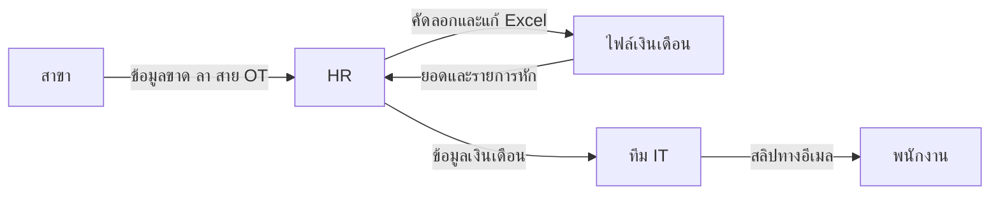

#### 3.1.2 CRUD Table

ตารางนี้ใช้ **กลุ่มข้อมูลเชิงตรรกะ** แทนตารางฐานข้อมูล เพราะกระบวนการเดิมพึ่งพาไฟล์ Excel และการส่งข้อมูลระหว่างฝ่าย

| กิจกรรม | ข้อมูลพนักงาน | ข้อมูลเวลาและคำขอ | ไฟล์เงินเดือน | สรุปเจ้าหนี้ | สลิป |
|---|:---:|:---:|:---:|:---:|:---:|
| คัดลอกและล้างข้อมูลรอบก่อน | R | — | C/U | — | — |
| รับและกรอกข้อมูลจากสาขา | R | C/R/U | U | — | — |
| กรอกรายได้และรายการหัก | R | R | U | C/U | — |
| ตรวจยอดและจ่ายเงินเดือน | R | R | R | R | — |
| สร้างและส่งสลิป | R | — | R | — | C/R |

#### 3.1.3 คำอธิบายประกอบตาราง CRUD

`C` หมายถึงสร้างข้อมูล, `R` หมายถึงอ่านข้อมูล และ `U` หมายถึงแก้ไขข้อมูล การล้างช่องในไฟล์เดิมเป็นการแก้ข้อมูล (`U`) ที่อาจทำให้ค่าของเดือนก่อนถูกนำมาใช้ผิดรอบ ตารางนี้ไม่แสดง `D` เพราะไม่มีหลักฐานว่ามีขั้นตอนลบระเบียนฐานข้อมูลในกระบวนการเดิม

### 3.2 หลังการปรับปรุง

ระบบใหม่กำหนดขอบเขตงานตั้งแต่ดูแลข้อมูลพนักงานและสิทธิ์ บันทึกข้อมูลปฏิบัติงาน พิจารณาการลาและ OT จนถึงการคำนวณ ล็อกรอบ และออกรายงานเงินเดือน การดำเนินการแต่ละอย่างเชื่อมกับระเบียนต้นทาง จึงตรวจสอบได้ว่าผลเงินเดือนรายคนเกิดจากสังกัด วันทำงาน และรายการการเงินใด

แบบ To be ใน FigJam ใช้บทบาทเชิงธุรกิจ เช่น เจ้าของ ผู้จัดการสาขา และฝ่ายบัญชี ส่วนการบังคับสิทธิ์ใน backend ใช้บทบาท `EMPLOYEE`, `SUPERVISOR`, `BRANCH_MANAGER`, `HR` และ `OWNER` ในรายงานนี้งานฝ่ายบัญชีถูกอธิบายภายใต้ผู้มีสิทธิ์จัดการ payroll ตาม implementation ปัจจุบัน โดยไม่สร้างบทบาทฐานข้อมูลใหม่จากภาพกระบวนการเพียงอย่างเดียว

แผนภาพ Use Case ฉบับ FigJam ใช้แสดงขอบเขตความต้องการ โดยรายการสร้าง PDF ส่งอีเมลจริง และจ่ายผ่าน QR เป็นงานตามแบบ To be ซึ่งยังไม่ครบใน backend ปัจจุบัน รายการ UC01–UC14 ด้านล่างเป็นการจัดกลุ่มสำหรับอธิบายระบบที่ตรวจได้จาก DBML และ API

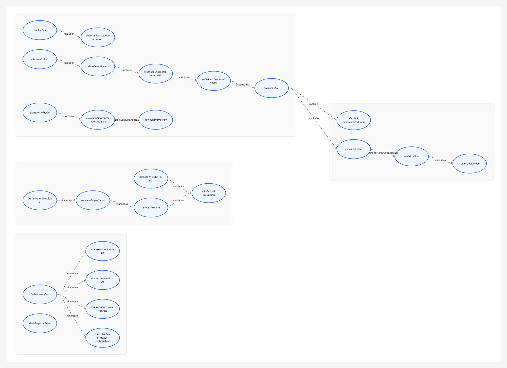

#### 3.2.1 Use Case Diagram

การใช้งานระบบแบ่งตามบทบาท Employee, Supervisor, Branch Manager, HR และ Owner ผู้ใช้หนึ่งบัญชีอาจได้รับหลายบทบาท แต่ทุกคำขอต้องตรวจขอบเขตสิทธิ์ที่ backend ก่อนเข้าถึงข้อมูล

ภาพสรุปต่อไปจัดกลุ่ม actor และงานหลักจาก FigJam ให้ตรงกับ UC01–UC14 ที่ใช้ในรายงาน; เส้นในภาพสรุปนี้แสดงการเกี่ยวข้องกับงาน ไม่ใช่ความสัมพันธ์ `include`/`extend` ที่เป็นข้อบังคับของ API

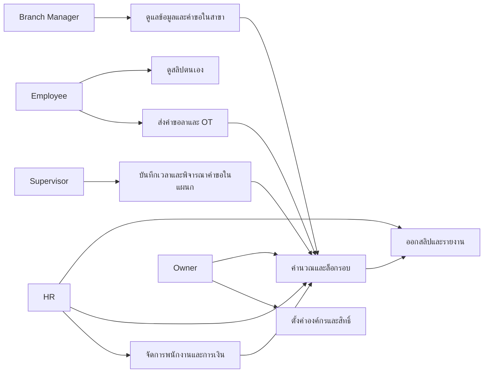

#### 3.2.2 CRUD Table

ตารางแสดงการทำงานหลักกับกลุ่มระเบียนหลังปรับปรุง ไม่ใช่รายการสิทธิ์ของทุก endpoint การอนุญาตจริงพิจารณาบทบาท ขอบเขต และสถานะของระเบียน

| Use Case | พนักงาน/สังกัด | ลงเวลา | ลา/OT | การเงิน | เงินเดือน | สลิป/รายงาน | Audit |
|---|:---:|:---:|:---:|:---:|:---:|:---:|:---:|
| UC02–UC04 จัดการบัญชี องค์กร และพนักงาน | C/R/U | — | — | — | — | — | C |
| UC05 บันทึกเวลาทำงาน | R | C/R/U | — | — | — | — | C |
| UC06–UC07 พิจารณาการลาและ OT | R | R/U | C/R/U | — | — | — | C |
| UC08 จัดการรายการทางการเงิน | R | R | — | C/R/U | — | — | C |
| UC09–UC11 คำนวณ ล็อก และปรับปรุงเงินเดือน | R | R | R | R/U | C/R/U | — | C |
| UC12–UC13 ออกสลิปและรายงาน | R | — | — | R | R | C/R | C |
| UC14 ตรวจสอบ Audit | — | — | — | — | — | — | R |

#### 3.2.3 คำอธิบายประกอบตาราง CRUD

การแก้ไข (`U`) ในตารางหมายถึงการเปลี่ยนสถานะหรือเพิ่มรายการแก้ไขตามกฎของแต่ละ workflow ไม่หมายถึงการเขียนทับประวัติที่อนุมัติแล้วหรือรอบเงินเดือนที่ล็อกแล้ว ระบบใช้การปิดใช้งาน การเพิ่มแถวประวัติ และการกลับรายการตามประเภทข้อมูล แทนการลบข้อมูลสำคัญโดยตรง

### 3.3 Use Case

Use Case ต่อไปนี้อธิบายขอบเขตระบบ Haris Payroll ตามแบบจำลองและเอกสารโครงการ ส่วนความพร้อมใช้งานของแต่ละหน้าระบุในบทที่ 8 ผู้ใช้ทุกกรณีต้องผ่านการยืนยันตัวตนและการตรวจสิทธิ์ที่ backend ยกเว้น UC01

#### 3.3.1 UC01 เข้าสู่ระบบ

##### 3.3.1.1 Use Case Description

| รายการ | รายละเอียด |
|---|---|
| รหัสและชื่อ | UC01 — เข้าสู่ระบบ |
| วัตถุประสงค์ | ยืนยันตัวตนและเริ่ม session เพื่อให้ระบบแสดงงานตามบทบาทและขอบเขตที่ได้รับ |
| Actor หลัก | ผู้ใช้ทุกบทบาท |
| เหตุการณ์เริ่มต้น | ผู้ใช้กดเข้าสู่ระบบ |
| เงื่อนไขก่อนเริ่ม | มีบัญชีสถานะ active และทราบชื่อผู้ใช้กับรหัสผ่าน |
| ขั้นตอนหลัก 1 | ผู้ใช้กรอกชื่อผู้ใช้และรหัสผ่านในแบบฟอร์ม |
| ขั้นตอนหลัก 2 | หน้าจอส่ง POST /api/v1/auth/login |
| ขั้นตอนหลัก 3 | ระบบตรวจข้อมูลรับเข้า ตรวจรหัสผ่าน สถานะบัญชี และเงื่อนไขการล็อกบัญชี |
| ขั้นตอนหลัก 4 | หากผ่าน ระบบสร้าง session และส่ง cookie กลับไปยัง browser |
| ขั้นตอนหลัก 5 | หน้าจออ่าน GET /api/v1/auth/me เพื่อแสดงตัวตน บทบาท และขอบเขตการเข้าถึง |
| ทางเลือกและข้อผิดพลาด | หากข้อมูลไม่ถูกต้องหรือบัญชีใช้ไม่ได้ ระบบคืนข้อผิดพลาดที่ไม่เปิดเผยว่าชื่อผู้ใช้มีอยู่หรือไม่; เมื่อหมดอายุ session ต้องยืนยันตัวตนใหม่ |
| เงื่อนไขหลังสิ้นสุด | มี session ที่ใช้ตรวจสิทธิ์ในคำขอต่อไป; ไม่มีการส่งรหัสผ่านกลับไปยัง client |
| กฎธุรกิจที่เกี่ยวข้อง | สิทธิ์จริงตรวจที่ backend ทุกคำขอ ไม่อาศัยเพียงการซ่อนปุ่มในหน้าจอ |
| API ที่ตรวจพบ | `POST /api/v1/auth/login, GET /api/v1/auth/me, POST /api/v1/auth/logout` |

##### 3.3.1.2 Sequence Diagram

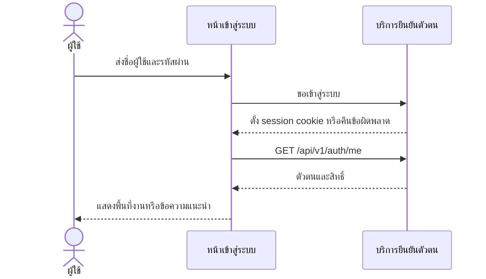

##### 3.3.1.3 Collaboration Diagram

`1 ผู้ใช้ → หน้าเข้าสู่ระบบ: กรอกข้อมูล` → `2 หน้าเข้าสู่ระบบ → บริการยืนยันตัวตน: ตรวจสอบ` → `3 บริการยืนยันตัวตน → หน้าเข้าสู่ระบบ: ผลลัพธ์` → `4 หน้าเข้าสู่ระบบ → ผู้ใช้: แสดงสถานะ`

#### 3.3.2 UC02 จัดการบัญชีและสิทธิ์

##### 3.3.2.1 Use Case Description

| รายการ | รายละเอียด |
|---|---|
| รหัสและชื่อ | UC02 — จัดการบัญชีและสิทธิ์ |
| วัตถุประสงค์ | ดูแลตัวตนของผู้ใช้และกำหนดสิทธิ์ตามสาขาหรือแผนกอย่างตรวจสอบย้อนหลังได้ |
| Actor หลัก | HR, Owner |
| เหตุการณ์เริ่มต้น | ผู้ดูแลสร้างบัญชี เปลี่ยนสถานะ หรือเพิ่ม/เพิกถอนบทบาท |
| เงื่อนไขก่อนเริ่ม | ผู้ดำเนินการเป็น HR หรือ Owner ตามข้อกำหนดของ service; บัญชีและข้อมูลพนักงานที่อ้างอิงมีอยู่ |
| ขั้นตอนหลัก 1 | ผู้ดูแลค้นบัญชีหรือสร้างบัญชีใหม่ โดยอาจเชื่อมกับระเบียนพนักงาน |
| ขั้นตอนหลัก 2 | ระบบตรวจชื่อผู้ใช้ซ้ำและความสัมพันธ์ระหว่างบัญชีกับพนักงาน |
| ขั้นตอนหลัก 3 | ผู้ดูแลเลือกบทบาทพร้อมขอบเขตที่เหมาะกับประเภทสิทธิ์ |
| ขั้นตอนหลัก 4 | ระบบตรวจว่าผู้ดำเนินการมีสิทธิ์มอบบทบาทนั้นและขอบเขตสัมพันธ์กับสาขา/แผนก |
| ขั้นตอนหลัก 5 | บันทึกการเปลี่ยนแปลง เหตุผล และผู้ดำเนินการ ก่อนคืนข้อมูลบัญชีที่ไม่เปิดเผยรหัสผ่าน |
| ทางเลือกและข้อผิดพลาด | ปฏิเสธการเชื่อมพนักงานที่มีบัญชีแล้ว การให้สิทธิ์เกินขอบเขต การเพิกถอน Owner คนสุดท้าย และการใช้บัญชีสถานะ disabled; บัญชี locked ใช้คำสั่ง unlock เฉพาะ |
| เงื่อนไขหลังสิ้นสุด | บทบาทและสถานะใหม่มีผลต่อการตรวจสิทธิ์คำขอถัดไป; ประวัติการเปลี่ยนแปลงตรวจสอบได้ |
| กฎธุรกิจที่เกี่ยวข้อง | บทบาท EMPLOYEE ไม่ระบุสาขา/แผนก, SUPERVISOR ระบุทั้งสอง, BRANCH_MANAGER ระบุสาขา, HR/OWNER ใช้ขอบเขตทุกสาขา |
| API ที่ตรวจพบ | `GET/POST /api/v1/accounts, PATCH /api/v1/accounts/:accountId/status, POST /api/v1/accounts/:accountId/roles, DELETE /api/v1/accounts/:accountId/roles/:grantId` |

##### 3.3.2.2 Sequence Diagram

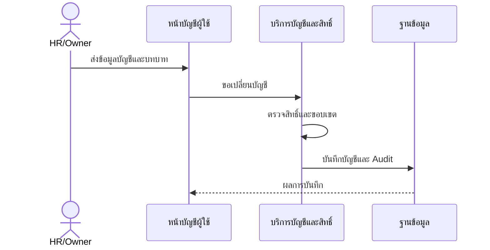

##### 3.3.2.3 Collaboration Diagram

`1 ผู้ดูแล → หน้าบัญชี: ส่งคำสั่ง` → `2 หน้าบัญชี → Service: ตรวจและดำเนินการ` → `3 Service → ฐานข้อมูล: บันทึกแบบมี Audit` → `4 Service → หน้าบัญชี: แจ้งผล`

#### 3.3.3 UC03 จัดการโครงสร้างองค์กร

##### 3.3.3.1 Use Case Description

| รายการ | รายละเอียด |
|---|---|
| รหัสและชื่อ | UC03 — จัดการโครงสร้างองค์กร |
| วัตถุประสงค์ | จัดเก็บโครงสร้างร้าน สาขา แผนก และตำแหน่งเพื่อใช้อ้างอิงในการจ้างงานและสิทธิ์ |
| Actor หลัก | HR, Owner |
| เหตุการณ์เริ่มต้น | ผู้ดูแลเพิ่ม แก้ไข หรือปิดใช้งานข้อมูลโครงสร้าง |
| เงื่อนไขก่อนเริ่ม | ผู้ดำเนินการได้รับสิทธิ์บริหารข้อมูลหลัก; ข้อมูลแม่ที่ต้องอ้างอิงมีอยู่ |
| ขั้นตอนหลัก 1 | ผู้ดูแลเลือกชนิดข้อมูลและระบุรหัส ชื่อ และความสัมพันธ์ตามแบบฟอร์ม |
| ขั้นตอนหลัก 2 | ระบบตรวจความถูกต้องของรหัสและความสัมพันธ์ เช่น แผนกต้องอยู่ในสาขาที่ระบุ |
| ขั้นตอนหลัก 3 | ระบบบันทึกระเบียนใหม่หรือแก้ข้อมูลที่อนุญาต |
| ขั้นตอนหลัก 4 | กรณีเลิกใช้ ผู้ดูแลระบุเหตุผลและเปลี่ยนสถานะเป็นไม่ใช้งาน |
| ขั้นตอนหลัก 5 | ระบบคืนข้อมูลล่าสุดและบันทึกเหตุการณ์ที่เกี่ยวข้อง |
| ทางเลือกและข้อผิดพลาด | หากรหัสซ้ำหรือข้อมูลแม่ไม่ถูกต้อง ระบบปฏิเสธ; รายการที่ถูกใช้อ้างอิงในประวัติต้องไม่ถูกลบทิ้ง |
| เงื่อนไขหลังสิ้นสุด | โครงสร้างองค์กรพร้อมให้การบันทึกพนักงานและสิทธิ์อ้างอิง โดยประวัติเดิมยังอ่านได้ |
| กฎธุรกิจที่เกี่ยวข้อง | ความสัมพันธ์เชิงโครงสร้างและสิทธิ์ต้องสอดคล้องกัน; การปิดใช้งานไม่ลบผลเงินเดือนย้อนหลัง |
| API ที่ตรวจพบ | `GET/POST/PATCH /api/v1/shops`, `/api/v1/branches`, `/api/v1/departments`, `/api/v1/positions`; คำสั่งปิดใช้งานเป็น `POST .../:id/deactivate` |

##### 3.3.3.2 Sequence Diagram

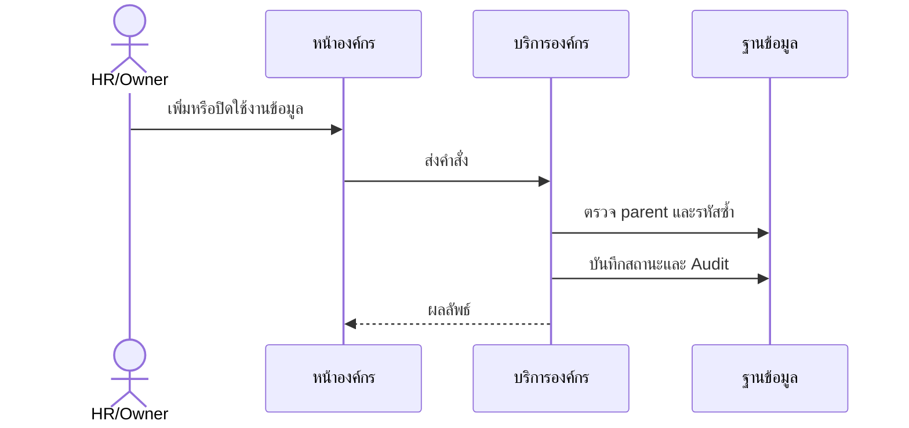

##### 3.3.3.3 Collaboration Diagram

`1 ผู้ดูแล → หน้าองค์กร: ระบุข้อมูล` → `2 หน้าองค์กร → Service: ตรวจโครงสร้าง` → `3 Service → ฐานข้อมูล: บันทึก` → `4 Service → ผู้ดูแล: แจ้งผล`

#### 3.3.4 UC04 จัดการพนักงานและประวัติการจ้าง

##### 3.3.4.1 Use Case Description

| รายการ | รายละเอียด |
|---|---|
| รหัสและชื่อ | UC04 — จัดการพนักงานและประวัติการจ้าง |
| วัตถุประสงค์ | เก็บข้อมูลพนักงานและประวัติสังกัด/ค่าตอบแทนที่มีผลตามวัน โดยไม่เขียนทับอดีต |
| Actor หลัก | HR, Owner; บทบาทอื่นอ่านได้ตามขอบเขต |
| เหตุการณ์เริ่มต้น | รับพนักงานใหม่ หรือย้ายสาขา เปลี่ยนแผนก ตำแหน่ง เงินเดือน หรือสวัสดิการ |
| เงื่อนไขก่อนเริ่ม | มีสาขา แผนก และตำแหน่งที่ใช้ได้; ผู้ดำเนินการมีสิทธิ์จัดการพนักงาน |
| ขั้นตอนหลัก 1 | ผู้ดำเนินการกรอกข้อมูลพนักงานและวันเริ่มจ้าง |
| ขั้นตอนหลัก 2 | กรณีรับเข้า ระบบตรวจรหัสพนักงานและข้อมูลอ้างอิงก่อนบันทึกพนักงานกับสังกัดแรก |
| ขั้นตอนหลัก 3 | กรณีเปลี่ยนสังกัดหรือค่าตอบแทน ผู้ดำเนินการระบุวันเริ่มมีผลใหม่ |
| ขั้นตอนหลัก 4 | ระบบตรวจว่าช่วงวันที่ใหม่ไม่ทับช่วงเดิม และปิดช่วงที่สิ้นผล |
| ขั้นตอนหลัก 5 | ระบบสร้าง employment_assignments แถวใหม่และแสดงประวัติเรียงตามวันมีผล |
| ทางเลือกและข้อผิดพลาด | หากช่วงวันที่ซ้อนกัน ข้อมูลอ้างอิงไม่ถูกต้อง หรือมีผลต่อรอบเงินเดือนที่ล็อกแล้ว ระบบปฏิเสธ; การเปลี่ยนสถานะพนักงานใช้คำสั่งเฉพาะ |
| เงื่อนไขหลังสิ้นสุด | พนักงานมีข้อมูลล่าสุดที่ใช้ปฏิบัติงานและยังตรวจสังกัด/ค่าจ้างของวันเก่าได้ |
| กฎธุรกิจที่เกี่ยวข้อง | หนึ่งพนักงานมีหลายช่วงสังกัดได้ แต่ช่วงที่มีผลต้องไม่ซ้อนกัน; user_accounts เป็นผู้กระทำ ไม่ใช่ระเบียนพนักงาน |
| API ที่ตรวจพบ | `POST /api/v1/employees/onboard, GET/POST /api/v1/employees/:employee_id/assignments, PATCH /api/v1/employees/:employee_id/status` |

##### 3.3.4.2 Sequence Diagram

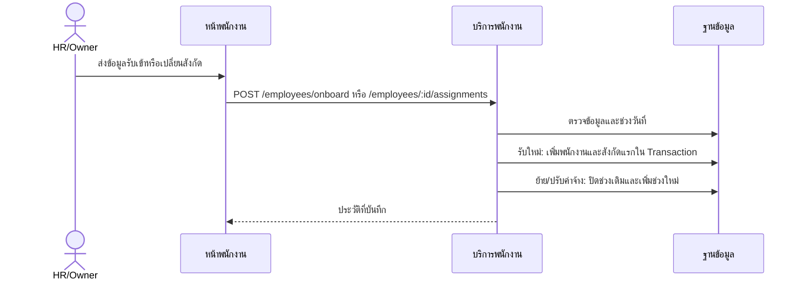

##### 3.3.4.3 Collaboration Diagram

`1 HR → หน้าพนักงาน: ระบุข้อมูล` → `2 หน้าพนักงาน → Service: ตรวจช่วงวันที่` → `3 Service → ฐานข้อมูล: เพิ่มประวัติใหม่` → `4 Service → HR: แสดงผล`

#### 3.3.5 UC05 บันทึกเวลาทำงาน

##### 3.3.5.1 Use Case Description

| รายการ | รายละเอียด |
|---|---|
| รหัสและชื่อ | UC05 — บันทึกเวลาทำงาน |
| วัตถุประสงค์ | เก็บหลักฐานการทำงานรายวันซึ่งใช้คำนวณค่าจ้างและการหักเงิน |
| Actor หลัก | Supervisor, Branch Manager, HR, Owner |
| เหตุการณ์เริ่มต้น | ผู้มีสิทธิ์บันทึกหรือแก้ไขการทำงานของพนักงานในวันที่กำหนด |
| เงื่อนไขก่อนเริ่ม | พนักงานมีสังกัดที่มีผลในวันนั้นและผู้ดำเนินการเข้าถึงสาขาหรือแผนกได้ |
| ขั้นตอนหลัก 1 | ผู้ดูแลเลือกพนักงาน วันที่ สาขา และสถานะการทำงาน |
| ขั้นตอนหลัก 2 | ระบุเวลาเข้าออก จำนวนนาทีสาย และหมายเหตุเท่าที่กรณีต้องใช้ |
| ขั้นตอนหลัก 3 | ระบบตรวจสังกัดตามวันที่บันทึก กำหนดการสาขา และความถูกต้องของสถานะ |
| ขั้นตอนหลัก 4 | ระบบตรวจว่าไม่มี work_day_records ของพนักงานคนนี้ในวันเดียวกัน |
| ขั้นตอนหลัก 5 | บันทึกสาขา ณ วันทำงานและผู้ดำเนินการ แล้วคืนรายการที่จัดเก็บ |
| ทางเลือกและข้อผิดพลาด | ปฏิเสธรายการซ้ำ สาขาไม่ตรงสังกัด สถานะไม่สอดคล้องกับข้อมูลเวลา หรือการแก้ข้อมูลที่ถูกรอบเงินเดือนล็อกแล้ว |
| เงื่อนไขหลังสิ้นสุด | มีหลักฐานวันทำงานที่ไม่ซ้ำและพร้อมเป็นข้อมูลต้นทางของ payroll |
| กฎธุรกิจที่เกี่ยวข้อง | ค่าจ้างคำนวณรายวัน; วันขาดและมาสายเป็นรายการหัก ส่วนวันลาที่อนุมัติต้องแยกให้เห็นว่าไม่หัก |
| API ที่ตรวจพบ | `GET/POST /api/v1/work-day-records, PATCH /api/v1/work-day-records/:id` |

##### 3.3.5.2 Sequence Diagram

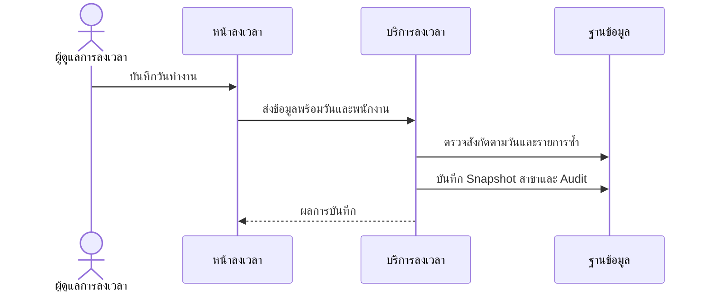

##### 3.3.5.3 Collaboration Diagram

`1 ผู้ดูแล → หน้าลงเวลา: ส่งรายการ` → `2 หน้า → Service: ตรวจสิทธิ์/วัน` → `3 Service → ฐานข้อมูล: บันทึก` → `4 Service → ผู้ดูแล: แจ้งผล`

#### 3.3.6 UC06 ขอและพิจารณาการลา

##### 3.3.6.1 Use Case Description

| รายการ | รายละเอียด |
|---|---|
| รหัสและชื่อ | UC06 — ขอและพิจารณาการลา |
| วัตถุประสงค์ | ให้พนักงานยื่นคำขอและผู้มีอำนาจพิจารณาการลา โดยโควตาและวันทำงานสอดคล้องกัน |
| Actor หลัก | Employee ผู้ขอ; Supervisor, Branch Manager, HR, Owner ผู้พิจารณา |
| เหตุการณ์เริ่มต้น | ยื่นหรือพิจารณาคำขอลา |
| เงื่อนไขก่อนเริ่ม | มีประเภทลาและพนักงานที่มีสิทธิ์; วันลาอยู่ในช่วงที่ยังไม่ล็อกเงินเดือน |
| ขั้นตอนหลัก 1 | ผู้ขอเลือกประเภทลา ช่วงวัน และเหตุผล แล้วส่งคำขอ |
| ขั้นตอนหลัก 2 | ระบบขยายช่วงวันที่และตรวจคำขอที่ซ้อนกันก่อนบันทึกสถานะรอพิจารณา |
| ขั้นตอนหลัก 3 | ผู้อนุมัติเปิดคำขอและตรวจจำนวนวัน ขอบเขตสิทธิ์ และโควตาที่เกี่ยวข้อง |
| ขั้นตอนหลัก 4 | ผู้อนุมัติอนุมัติหรือปฏิเสธ; การอนุมัติอาจระบุประเภทลาสุดท้ายที่ต่างจากคำขอ |
| ขั้นตอนหลัก 5 | ระบบบันทึกประวัติการตัดสิน อัปเดตโควตาและวันทำงานใน transaction เดียว |
| ทางเลือกและข้อผิดพลาด | Supervisor อนุมัติคำขอเกิน 3 วันไม่ได้; วันซ้อน โควตาไม่พอ คำขอที่ไม่รอพิจารณา หรือวันที่ล็อกแล้วถูกปฏิเสธ |
| เงื่อนไขหลังสิ้นสุด | คำขอมีผลการพิจารณาพร้อมประวัติ; payroll ใช้ข้อมูลอนุมัติและวันทำงานที่ตรงกัน |
| กฎธุรกิจที่เกี่ยวข้อง | การลาอนุมัติแล้วไม่หักค่าจ้างตามกฎโครงการ; ประวัติการตัดสินเป็นแบบเพิ่มรายการ ไม่แก้ย้อนหลัง |
| API ที่ตรวจพบ | `POST/PATCH /api/v1/leave-requests, POST /api/v1/leave-requests/:id/approve หรือ /reject, GET /api/v1/leave-requests/:id/history` |

##### 3.3.6.2 Sequence Diagram

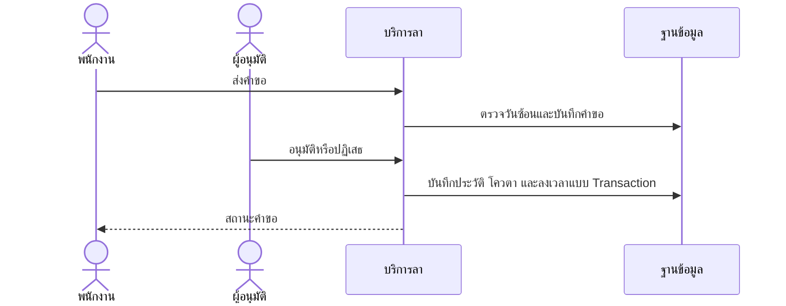

##### 3.3.6.3 Collaboration Diagram

`1 พนักงาน → บริการลา: ยื่นคำขอ` → `2 บริการลา → ฐานข้อมูล: ตรวจวันและบันทึก` → `3 ผู้อนุมัติ → บริการลา: ตัดสินใจ` → `4 บริการลา → ฐานข้อมูล: เก็บประวัติและผลที่เกี่ยวข้อง`

#### 3.3.7 UC07 ขอและพิจารณา OT

##### 3.3.7.1 Use Case Description

| รายการ | รายละเอียด |
|---|---|
| รหัสและชื่อ | UC07 — ขอและพิจารณา OT |
| วัตถุประสงค์ | พิจารณาค่าล่วงเวลาจากคำขอที่มีหลักฐานและอนุมัติอย่างชัดเจน |
| Actor หลัก | Employee ผู้ขอ; ผู้อนุมัติตามขอบเขต |
| เหตุการณ์เริ่มต้น | ยื่นหรือพิจารณาคำขอ OT |
| เงื่อนไขก่อนเริ่ม | พนักงานมีสังกัดในวันที่ทำงาน; ประเภท OT สัมพันธ์กับวันและหลักฐานการทำงาน |
| ขั้นตอนหลัก 1 | ผู้ขอระบุวันที่ ประเภท OT จำนวนชั่วโมงหรือหน่วยวัน และเหตุผล |
| ขั้นตอนหลัก 2 | ระบบตรวจความสอดคล้องกับวันทำงาน วันหยุดประจำสัปดาห์ หรือวันหยุดนักขัตฤกษ์ |
| ขั้นตอนหลัก 3 | บันทึกคำขอโดยยังไม่เพิ่มรายได้ใน payroll |
| ขั้นตอนหลัก 4 | ผู้อนุมัติตรวจขอบเขตและเลือกอนุมัติหรือปฏิเสธพร้อมหมายเหตุ |
| ขั้นตอนหลัก 5 | ระบบเพิ่มประวัติการตัดสิน; payroll อ่านเฉพาะรายการสถานะอนุมัติ |
| ทางเลือกและข้อผิดพลาด | หากประเภท OT ไม่ตรงบริบท ไม่มีสิทธิ์ หรือวันอยู่ในรอบที่ล็อกแล้ว ระบบปฏิเสธ; เวลาออกช้าจากบันทึกลงเวลาอย่างเดียวไม่สร้างค่าล่วงเวลา |
| เงื่อนไขหลังสิ้นสุด | มีสถานะคำขอและประวัติการตัดสินที่ใช้ตรวจรายการรายได้ได้ |
| กฎธุรกิจที่เกี่ยวข้อง | รองรับ hourly, rest_day และ public_holiday; การจ่าย OT ต้องมีการอนุมัติ |
| API ที่ตรวจพบ | `POST /api/v1/overtime-records, POST /api/v1/overtime-records/:id/approve หรือ /reject, GET /api/v1/overtime-records/:id/history` |

##### 3.3.7.2 Sequence Diagram

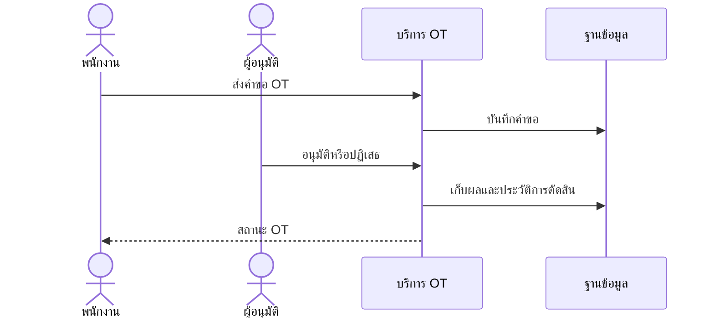

##### 3.3.7.3 Collaboration Diagram

`1 พนักงาน → บริการ OT: ยื่นคำขอ` → `2 ผู้อนุมัติ → บริการ OT: ตัดสิน` → `3 บริการ OT → ฐานข้อมูล: เก็บสถานะและประวัติ` → `4 Payroll → บริการ OT: อ่านเฉพาะรายการอนุมัติ`

#### 3.3.8 UC08 จัดการเงินทดรอง เงินกู้ และหนี้

##### 3.3.8.1 Use Case Description

| รายการ | รายละเอียด |
|---|---|
| รหัสและชื่อ | UC08 — จัดการเงินทดรอง เงินกู้ และหนี้ |
| วัตถุประสงค์ | บริหารเงินทดรอง เงินกู้และหนี้พนักงาน โดยเชื่อมยอดหักกับเงินเดือนอย่างตรวจสอบได้ |
| Actor หลัก | HR, Owner; Employee ยื่นคำขอเงินทดรองเมื่อมีหน้า self-service |
| เหตุการณ์เริ่มต้น | มีคำขอทดรอง สัญญาเงินกู้ หรือธุรกรรมหนี้ใหม่ |
| เงื่อนไขก่อนเริ่ม | พนักงานมีข้อมูลค่าจ้างและวันทำงานที่ใช้ตรวจเกณฑ์; ผู้ดำเนินการอยู่ในขอบเขตสิทธิ์ |
| ขั้นตอนหลัก 1 | ผู้มีสิทธิ์ยื่นคำขอทดรองหรือบันทึกเงินกู้และกำหนดจำนวนงวด |
| ขั้นตอนหลัก 2 | ระบบบันทึกคำขอหรือสัญญา พร้อมแยกสถานะรอพิจารณาจากรายการที่มีผล |
| ขั้นตอนหลัก 3 | สำหรับเงินทดรอง ผู้อนุมัติตรวจวันที่ยื่น จำนวนวันทำงาน เพดานตามเงินเดือนฐาน และผลสุทธิที่คาดการณ์ |
| ขั้นตอนหลัก 4 | สำหรับหนี้ ผู้ดูแลบันทึก charge หรือ adjustment พร้อมประเภทและเหตุผล |
| ขั้นตอนหลัก 5 | เมื่อคำนวณเงินเดือน ระบบนำเฉพาะรายการที่มีผลและถึงกำหนดไปหัก พร้อมระบุแหล่งที่มา |
| ทางเลือกและข้อผิดพลาด | คำขอทดรองก่อนวันที่ 20, ทำงานไม่ถึง 20 วัน, เกินครึ่งเงินเดือนฐาน หรือทำให้สุทธิติดลบถูกปฏิเสธ; การแก้หนี้ใช้ reverse แทนลบรายการเดิม |
| เงื่อนไขหลังสิ้นสุด | มีประวัติการอนุมัติ งวดชำระ และธุรกรรมหนี้ที่ใช้กระทบยอดได้ |
| กฎธุรกิจที่เกี่ยวข้อง | เงินกู้หักตามงวด; หนี้ค่าอาหารบันทึกเป็นธุรกรรมรายครั้งและต้องรักษาประวัติ |
| API ที่ตรวจพบ | `POST /api/v1/advance-requests และ /:id/approve; POST /api/v1/loans; POST /api/v1/debt-transactions และ /:id/reverse` |

##### 3.3.8.2 Sequence Diagram

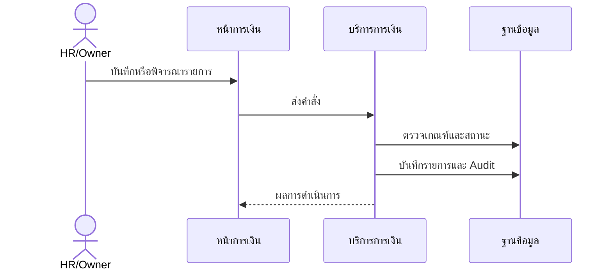

##### 3.3.8.3 Collaboration Diagram

`1 HR → หน้าการเงิน: ส่งคำสั่ง` → `2 หน้า → Service: ตรวจเกณฑ์` → `3 Service → ฐานข้อมูล: เก็บรายการและประวัติ` → `4 Payroll → Service: อ่านรายการที่ใช้หัก`

#### 3.3.9 UC09 ตั้งค่าระบบเงินเดือนและสร้างรอบ

##### 3.3.9.1 Use Case Description

Use Case นี้สอดคล้องกับตัวอย่าง “สร้างรอบเงินเดือน” ใน [Use Case Description บน FigJam](https://www.figma.com/board/WeisjoAMbg0KwJugBoGn0Y/Haris-SA?node-id=76-3219) แต่ใช้สิทธิ์และเงื่อนไขตามระบบปัจจุบัน

| รายการ | รายละเอียด |
|---|---|
| รหัสและชื่อ | UC09 — ตั้งค่าระบบเงินเดือนและสร้างรอบ |
| วัตถุประสงค์ | กำหนดค่าคำนวณที่มีผลตามเวลาและเปิดรอบเงินเดือนใหม่ |
| Actor หลัก | HR, Owner |
| เหตุการณ์เริ่มต้น | ฝ่ายเงินเดือนเริ่มการจัดทำเงินเดือนของปีและเดือน |
| เงื่อนไขก่อนเริ่ม | มีร้านสถานะใช้งาน และผู้ดำเนินการมีสิทธิ์แก้ไข payroll |
| ขั้นตอนหลัก 1 | ผู้ดูแลตรวจค่าตั้งต้นที่จะใช้ เช่น ค่า OT และกฎรายการหัก โดยเลือกช่วงวันที่มีผล |
| ขั้นตอนหลัก 2 | หากจำเป็นจึงเพิ่ม payroll_configurations โดยตรวจช่วงวันที่ไม่ทับซ้อนตาม key/ขอบเขต |
| ขั้นตอนหลัก 3 | ฝ่ายเงินเดือนระบุร้าน ปี เดือน วันเริ่มและวันสิ้นสุดรอบ |
| ขั้นตอนหลัก 4 | ระบบตรวจลำดับวันและตรวจว่าร้านนี้ยังไม่มีรอบของปี/เดือนเดียวกัน |
| ขั้นตอนหลัก 5 | บันทึก payroll_periods สถานะ draft และ audit ภายใน transaction |
| ทางเลือกและข้อผิดพลาด | ปฏิเสธร้านที่ไม่ใช้งาน รอบซ้ำ วันที่สิ้นสุดก่อนวันเริ่ม หรือ configuration ที่ช่วงมีผลทับกัน |
| เงื่อนไขหลังสิ้นสุด | รอบ draft พร้อมให้คำนวณตัวอย่าง โดยยังไม่มีข้อมูลเงินเดือนที่ล็อกแล้ว |
| กฎธุรกิจที่เกี่ยวข้อง | หนึ่งร้านมีได้หนึ่งรอบต่อปีและเดือน; configuration ต้องใช้ค่าที่มีผลในวันคำนวณ |
| API ที่ตรวจพบ | `GET/POST /api/v1/payroll/configurations, POST /api/v1/payroll/periods, GET /api/v1/payroll/periods/:period_id` |

##### 3.3.9.2 Sequence Diagram

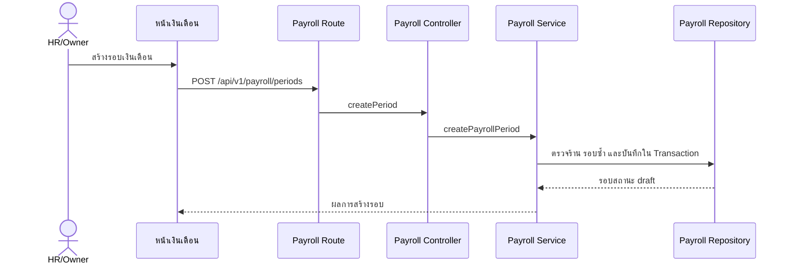

##### 3.3.9.3 Collaboration Diagram

`1 HR → หน้าเงินเดือน: ระบุร้านและเดือน` → `2 หน้า → Route: ส่งคำขอ` → `3 Route → Service: ตรวจสิทธิ์/ช่วงวัน` → `4 Service → Repository: บันทึกรอบ` → `5 Service → HR: แจ้งผล`

#### 3.3.10 UC10 คำนวณตัวอย่างเงินเดือน

##### 3.3.10.1 Use Case Description

ตัวอย่าง “เพิ่มพนักงานเข้ารอบเงินเดือน” ใน FigJam อธิบายความต้องการให้รวมพนักงานในรอบเดียวกัน ส่วน API ปัจจุบันดำเนินการนี้ระหว่างการคำนวณตัวอย่าง ไม่มี endpoint เพิ่มพนักงานเข้ารอบแยกต่างหาก

| รายการ | รายละเอียด |
|---|---|
| รหัสและชื่อ | UC10 — คำนวณตัวอย่างเงินเดือน |
| วัตถุประสงค์ | คำนวณและตรวจสอบรายได้/รายการหักรายคนก่อนปิดรอบ |
| Actor หลัก | HR, Owner |
| เหตุการณ์เริ่มต้น | ฝ่ายเงินเดือนสั่ง preview ของรอบ draft หรือ previewed |
| เงื่อนไขก่อนเริ่ม | มีรอบที่ยังไม่ locked และข้อมูลพนักงาน สังกัด วันทำงาน คำขอ และการเงินสำหรับช่วงรอบ |
| ขั้นตอนหลัก 1 | ฝ่ายเงินเดือนเลือกและสั่งคำนวณตัวอย่าง |
| ขั้นตอนหลัก 2 | ระบบเริ่ม transaction และอ่านข้อมูลต้นทางตามช่วงวันที่ โดยจัดลำดับการอ่านให้ลดความขัดแย้งของข้อมูล |
| ขั้นตอนหลัก 3 | ตรวจความครบถ้วนของวันทำงานและคำขอที่ยังรอพิจารณา |
| ขั้นตอนหลัก 4 | คำนวณผลรายคนจากค่าจ้าง รายได้ รายการหัก และตรวจว่า line items รวมตรงยอดสุทธิ |
| ขั้นตอนหลัก 5 | หากไม่มี blocker บันทึก payroll_records/payroll_items และเปลี่ยนรอบเป็น previewed; หากมี blocker คืนรายการเหตุให้แก้ไข |
| ทางเลือกและข้อผิดพลาด | ข้อมูลขาด คำขอค้าง ยอดรวมไม่ตรง หรือสุทธิติดลบเป็น blocker; เมื่อมี blocker ไม่บันทึกผลคำนวณใหม่ |
| เงื่อนไขหลังสิ้นสุด | มีรายการตัวอย่างและสถานะ previewed เมื่อผ่านการตรวจ หรือมีเหตุขัดข้องที่ระบุได้ |
| กฎธุรกิจที่เกี่ยวข้อง | การ preview ยังไม่ตัดยอดทดรอง/หนี้ที่ต้อง settle; ไม่มี endpoint เพิ่มพนักงานเข้ารอบแยกต่างหาก |
| API ที่ตรวจพบ | `POST /api/v1/payroll/periods/:period_id/preview, GET /api/v1/payroll/periods/:period_id` |

##### 3.3.10.2 Sequence Diagram

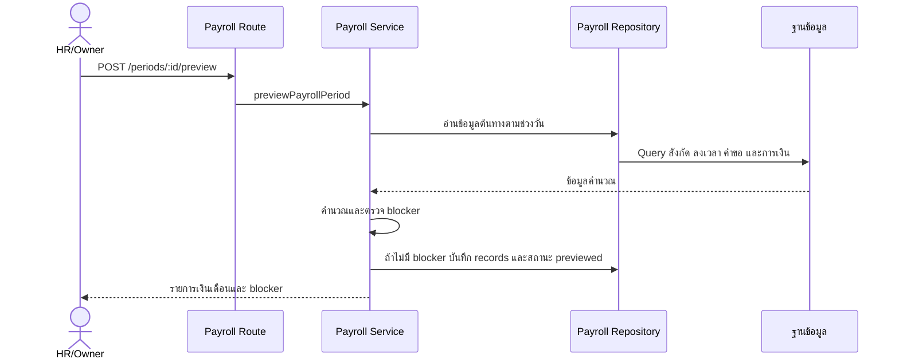

##### 3.3.10.3 Collaboration Diagram

`1 HR → Payroll Route: ขอ preview` → `2 Route → Service: ตรวจสิทธิ์` → `3 Service → Repository: อ่านข้อมูลตามวัน` → `4 Service → HR: ส่งผลและ blocker`

#### 3.3.11 UC11 ล็อกรอบและปรับปรุงเงินเดือน

##### 3.3.11.1 Use Case Description

| รายการ | รายละเอียด |
|---|---|
| รหัสและชื่อ | UC11 — ล็อกรอบและปรับปรุงเงินเดือน |
| วัตถุประสงค์ | ยืนยันผลเงินเดือนของรอบและรักษาความถูกต้องหลังปิดรอบ |
| Actor หลัก | HR, Owner |
| เหตุการณ์เริ่มต้น | ฝ่ายเงินเดือนสั่งล็อกรอบ หรือพบข้อผิดพลาดหลังล็อก |
| เงื่อนไขก่อนเริ่ม | ข้อมูลวันทำงานครบ ไม่มีคำขอค้าง และผลเงินเดือนทุกคนสุทธิไม่ติดลบ |
| ขั้นตอนหลัก 1 | ฝ่ายเงินเดือนตรวจผล preview และสั่ง lock |
| ขั้นตอนหลัก 2 | ระบบเริ่ม transaction อ่านข้อมูลต้นทางล่าสุดและล็อกแหล่งข้อมูลที่เกี่ยวข้อง |
| ขั้นตอนหลัก 3 | ระบบคำนวณซ้ำ ตรวจยอดรวมและ blocker ทุกชนิด |
| ขั้นตอนหลัก 4 | เมื่อผ่าน ระบบบันทึก snapshot ของ payroll_records/payroll_items, settle รายการการเงิน และเปลี่ยนรอบเป็น locked |
| ขั้นตอนหลัก 5 | หากพบข้อผิดพลาดภายหลัง ผู้มีสิทธิ์สร้าง payroll_adjustments อ้างผลเดิมและรอบอนาคต จากนั้นพิจารณาอนุมัติหรือปฏิเสธ |
| ทางเลือกและข้อผิดพลาด | หากข้อมูลต้นทางเปลี่ยนหรือมี blocker ระบบยกเลิก transaction; ห้ามแก้ payroll_records ที่ล็อกหรือใช้รอบเป้าหมายที่ล็อกแล้ว |
| เงื่อนไขหลังสิ้นสุด | รอบถูกตรึงและใช้เป็นฐานออกสลิป/รายงาน; การแก้ไขเกิดเป็นรายการปรับปรุงที่ติดตามได้ |
| กฎธุรกิจที่เกี่ยวข้อง | รอบ locked ไม่แก้ย้อนหลัง; adjustment ต้องอ้างรอบถัดไปที่เริ่มหลังรอบต้นทางและยังไม่ล็อก |
| API ที่ตรวจพบ | `POST /api/v1/payroll/periods/:period_id/lock, POST /api/v1/payroll/adjustments, POST /api/v1/payroll/adjustments/:adjustment_id/approve หรือ /reject` |

##### 3.3.11.2 Sequence Diagram

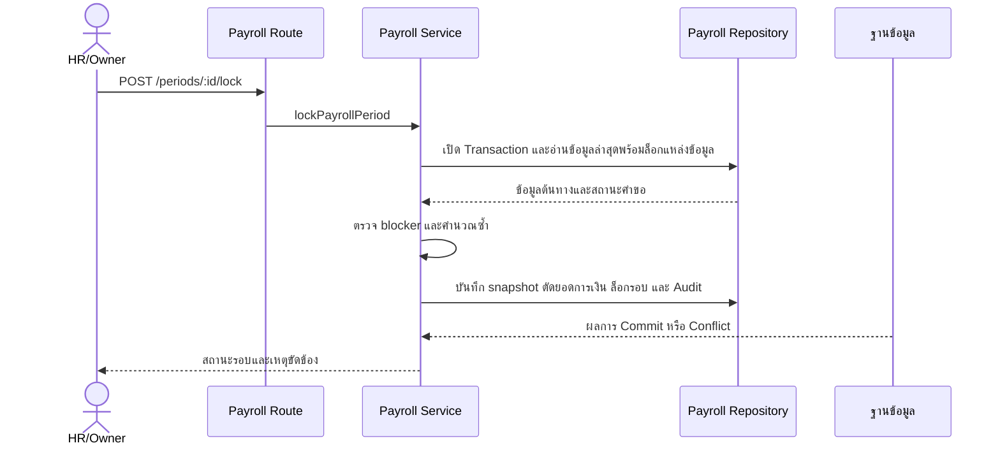

##### 3.3.11.3 Collaboration Diagram

`1 HR → Route: สั่งล็อก` → `2 Route → Service: ตรวจสิทธิ์` → `3 Service → Repository: คำนวณและล็อกแบบ Transaction` → `4 Repository → Service: ผล Commit` → `5 Service → HR: แจ้งสถานะ`

#### 3.3.12 UC12 ออกและดูสลิปเงินเดือน

##### 3.3.12.1 Use Case Description

| รายการ | รายละเอียด |
|---|---|
| รหัสและชื่อ | UC12 — ออกและดูสลิปเงินเดือน |
| วัตถุประสงค์ | สร้างและให้พนักงานเข้าถึงข้อมูลสลิปของตน พร้อมติดตามความพยายามส่ง |
| Actor หลัก | HR, Owner ผู้ออกสลิป; Employee ผู้ดูสลิปของตน |
| เหตุการณ์เริ่มต้น | ฝ่ายเงินเดือนขอสร้างสลิปจากผลเงินเดือนที่ล็อกแล้ว หรือพนักงานเปิดรายการสลิป |
| เงื่อนไขก่อนเริ่ม | มี payroll_record สถานะ locked และผู้เรียกมีสิทธิ์ตามบทบาท/เจ้าของข้อมูล |
| ขั้นตอนหลัก 1 | ผู้มีสิทธิ์เลือก payroll_record และสั่งสร้างสลิป |
| ขั้นตอนหลัก 2 | ระบบตรวจว่ารอบถูกล็อกและยังไม่มีสลิปที่ขัดกับกฎหนึ่ง record ต่อหนึ่งสลิป |
| ขั้นตอนหลัก 3 | ระบบสร้างข้อมูลสรุป จัดเก็บ metadata สลิป และบันทึก audit |
| ขั้นตอนหลัก 4 | พนักงานใช้ GET /api/v1/payslips/mine หรือ GET /api/v1/payslips/:id เพื่ออ่านเฉพาะของตน |
| ขั้นตอนหลัก 5 | ผู้มีสิทธิ์เรียกการส่งเพื่อบันทึกความพยายาม และอ่านประวัติ deliveries |
| ทางเลือกและข้อผิดพลาด | ปฏิเสธผลเงินเดือนที่ยังไม่ล็อก สลิปซ้ำ หรือการเข้าถึงสลิปของผู้อื่น; การยกเลิกสลิปใช้คำสั่ง void พร้อมประวัติ |
| เงื่อนไขหลังสิ้นสุด | มีระเบียนสลิปที่สัมพันธ์กับผลเงินเดือนและมีประวัติการส่งที่ตรวจสอบได้ |
| กฎธุรกิจที่เกี่ยวข้อง | backend ปัจจุบันเก็บ metadata/สรุปและบันทึกการส่งแบบจำลอง ยังไม่สร้าง PDF หรือส่งอีเมลผ่านผู้ให้บริการจริง |
| API ที่ตรวจพบ | `POST /api/v1/payslips/payroll-records/:record_id, GET /api/v1/payslips/mine, GET /api/v1/payslips/:id, POST /api/v1/payslips/:id/deliveries` |

##### 3.3.12.2 Sequence Diagram

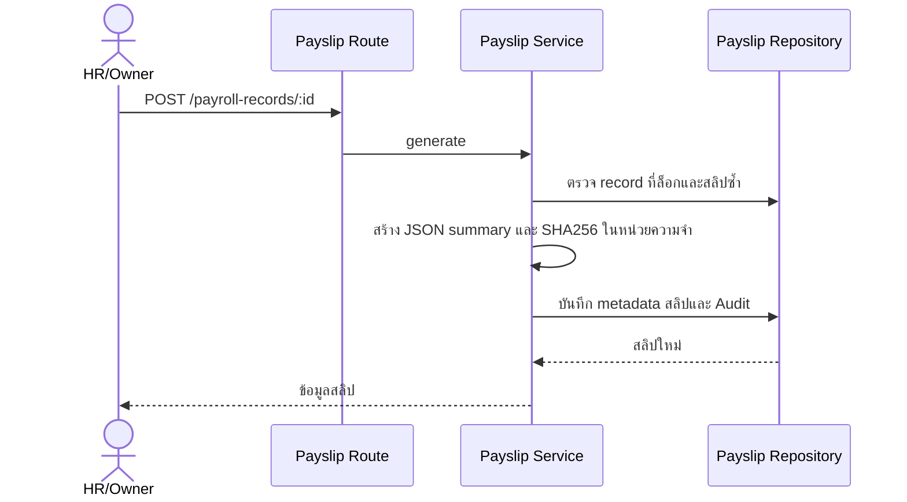

##### 3.3.12.3 Collaboration Diagram

`1 HR → Payslip Route: ขอออกสลิป` → `2 Route → Service: ตรวจสิทธิ์/สถานะ` → `3 Service → Repository: บันทึกหนึ่งสลิป` → `4 Service → HR: ส่งผล`

#### 3.3.13 UC13 ส่งออกรายงานเงินเดือน

##### 3.3.13.1 Use Case Description

| รายการ | รายละเอียด |
|---|---|
| รหัสและชื่อ | UC13 — ส่งออกรายงานเงินเดือน |
| วัตถุประสงค์ | ส่งออกข้อมูลเพื่อประกอบการโอนเงินและรายงานประกันสังคมจากผลเงินเดือนที่ล็อกแล้ว |
| Actor หลัก | HR, Owner |
| เหตุการณ์เริ่มต้น | ฝ่ายเงินเดือนเลือกชนิดรายงานและรอบ |
| เงื่อนไขก่อนเริ่ม | มี payroll_period locked และผู้เรียกมีสิทธิ์ด้าน payroll |
| ขั้นตอนหลัก 1 | ผู้ใช้งานเลือกรอบและรายงานที่ต้องการ |
| ขั้นตอนหลัก 2 | ระบบตรวจสิทธิ์และอ่าน payroll_records ของรอบที่ล็อกแล้ว |
| ขั้นตอนหลัก 3 | กรณีไฟล์ธนาคาร ระบบเลือกเฉพาะพนักงานที่มีบัญชีและถอดรหัสเลขบัญชีเพื่อใส่ในไฟล์ส่งออก |
| ขั้นตอนหลัก 4 | กรณีไฟล์ประกันสังคม ระบบส่งรหัสพนักงาน ชื่อ และเงินเดือนฐาน |
| ขั้นตอนหลัก 5 | ระบบจัดข้อมูลเป็น CSV และส่งให้ดาวน์โหลด พร้อมบันทึกการอ่านรายงาน |
| ทางเลือกและข้อผิดพลาด | หากไม่มีสิทธิ์ ระบบปฏิเสธ; สำหรับรอบที่ยังไม่ locked query ปัจจุบันจะคืนเฉพาะหัวตารางโดยไม่มีรายการ จึงต้องให้ผู้ใช้ตรวจสถานะรอบก่อนดาวน์โหลด; ผู้ไม่มีบัญชีธนาคารไม่อยู่ใน CSV ธนาคาร |
| เงื่อนไขหลังสิ้นสุด | ได้ไฟล์ CSV จากรายการที่ผ่านเงื่อนไข query โดยไม่แก้ผลเงินเดือน; ต้องตรวจจำนวนพนักงานและยอดรวมก่อนใช้ไฟล์จริง |
| กฎธุรกิจที่เกี่ยวข้อง | CSV ประกันสังคมปัจจุบันส่งออกฐานเงินเดือน ไม่ได้คำนวณยอดสมทบครบ; CSV ธนาคารมีเลขบัญชีเต็มจึงจำกัดสิทธิ์ และ query ปัจจุบันจำกัดผลไว้ 500 รายการ |
| API ที่ตรวจพบ | `GET /api/v1/reports/bank-transfer.csv?period_id=..., GET /api/v1/reports/social-security.csv?period_id=...` |

##### 3.3.13.2 Sequence Diagram

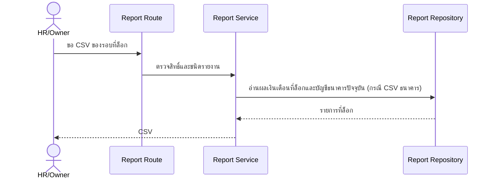

##### 3.3.13.3 Collaboration Diagram

`1 HR → Report Route: เลือกรอบ` → `2 Route → Service: ตรวจสิทธิ์` → `3 Service → Repository: อ่านข้อมูลที่ล็อก` → `4 Service → HR: ส่ง CSV`

#### 3.3.14 UC14 ตรวจสอบประวัติการทำรายการ

##### 3.3.14.1 Use Case Description

| รายการ | รายละเอียด |
|---|---|
| รหัสและชื่อ | UC14 — ตรวจสอบประวัติการทำรายการ |
| วัตถุประสงค์ | สืบค้นหลักฐานการกระทำเพื่อระบุผู้ดำเนินการ เวลา และระเบียนที่ได้รับผล |
| Actor หลัก | HR, Owner |
| เหตุการณ์เริ่มต้น | HR หรือ Owner ขอค้นประวัติ |
| เงื่อนไขก่อนเริ่ม | ผู้เรียกได้รับสิทธิ์อ่าน audit logs |
| ขั้นตอนหลัก 1 | ผู้ใช้กำหนดตัวกรอง เช่น ผู้กระทำ ชนิดการกระทำ หรือช่วงเวลา |
| ขั้นตอนหลัก 2 | หน้าจอส่ง GET /api/v1/audit-logs พร้อม query |
| ขั้นตอนหลัก 3 | ระบบยืนยันตัวตนและตรวจสิทธิ์อ่านประวัติ |
| ขั้นตอนหลัก 4 | repository ค้น audit_logs ตามตัวกรองและคืนผลตามหน้า |
| ขั้นตอนหลัก 5 | หน้าจอแสดงเวลา ผู้กระทำ การกระทำ และเป้าหมายตามข้อมูลที่ได้รับ |
| ทางเลือกและข้อผิดพลาด | หากไม่มีสิทธิ์ ระบบปฏิเสธ; ตัวกรองผิดรูปแบบต้องคืนข้อผิดพลาดที่ปลอดภัย |
| เงื่อนไขหลังสิ้นสุด | ผู้ตรวจสอบได้ข้อมูลการกระทำ โดยไม่มีการแก้ไขบันทึกย้อนหลัง |
| กฎธุรกิจที่เกี่ยวข้อง | ห้ามบันทึกรหัสผ่าน hash token หรือเลขบัญชีเต็มลง audit; ฟิลด์อ่อนไหวต้องถูกปกปิดก่อนบันทึก/แสดง |
| API ที่ตรวจพบ | `GET /api/v1/audit-logs` |

##### 3.3.14.2 Sequence Diagram

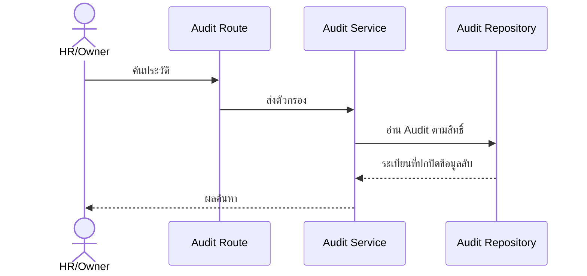

##### 3.3.14.3 Collaboration Diagram

`1 HR → Audit Route: ส่งตัวกรอง` → `2 Route → Service: ตรวจสิทธิ์` → `3 Service → Repository: ค้นข้อมูล` → `4 Service → HR: แสดงผลที่ปลอดภัย`

## บทที่ 4 การออกแบบฐานข้อมูล

บทนี้อธิบายโครงสร้างข้อมูลที่รองรับกระบวนการในบทที่ 2 และกรณีใช้งานในบทที่ 3 โดยใช้ [DBML ของโครงการ](../../haris-payroll-postgresql.dbml) เป็นแหล่งอ้างอิงหลักสำหรับชื่อตาราง ชนิดข้อมูล คีย์ และความสัมพันธ์ การออกแบบแยกข้อมูลผู้กระทำรายการ (`user_accounts`) ออกจากข้อมูลพนักงาน (`employees`) และเก็บข้อมูลที่มีผลต่อเงินเดือนเป็นประวัติ เพื่อให้ตรวจสอบการคำนวณย้อนหลังได้

### 4.1 ER Diagram

ER Diagram แบบ Peter Chen ใน [FigJam Haris-SA](https://www.figma.com/board/WeisjoAMbg0KwJugBoGn0Y/Haris-SA?node-id=289-2206) แสดงภาพรวม entity และความสัมพันธ์ของข้อมูลระบบจัดการพนักงานและเงินเดือน รูปที่ 4.1 นำภาพดังกล่าวมาใช้ประกอบการอธิบาย เมื่อตรวจเทียบรายการ entity และคู่คอลัมน์ที่อ้างอิง foreign key กับ DBML พบว่ามีครบ **36 ตารางและ 79 ความสัมพันธ์** เท่ากัน ข้อสรุปนี้ยืนยันความสอดคล้องระดับชื่อ entity/เส้นเชื่อม ไม่ได้ยืนยันว่าภาพแสดงคอลัมน์ ชนิดข้อมูล ความเป็นเอกลักษณ์ หรือเงื่อนไขบังคับครบถ้วน

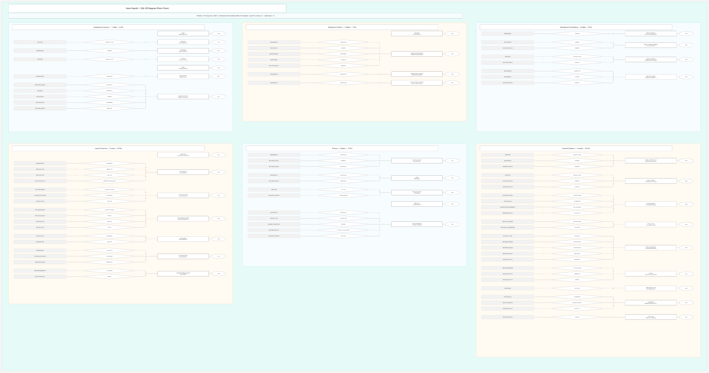

| ประเด็นตรวจเทียบ | ผลจาก ERD Peter Chen | นิยามที่ใช้ในรายงาน |
|---|---|---|
| Entity | ชื่อครบ 36 ตาราง | ใช้ชื่อและความหมายตาม DBML |
| Foreign key | คู่ตารางและคอลัมน์ครบ 79 คู่ | ใช้ `Ref` ใน DBML เพื่อระบุคอลัมน์จริง |
| Cardinality | ภาพแสดงความสัมพันธ์ระดับภาพรวม | ตรวจ `unique`, `not null` และ `Ref` ใน DBML เพิ่มเติม |
| Attribute และ constraint | ภาพไม่แสดงครบทุกฟิลด์ | ใช้ DBML และ migration เป็นแหล่งอ้างอิง |

ตัวอย่างที่ควรอ่านให้ถูกต้องคือ `user_accounts.employee_id` เป็น foreign key ที่เป็น `unique` และอนุญาตให้ว่าง จึงมีบัญชีผู้ใช้ที่ไม่ผูกพนักงานได้ ขณะที่พนักงานหนึ่งคนผูกบัญชีได้ไม่เกินหนึ่งบัญชี ส่วน `payslips.payroll_record_id` เป็น foreign key ที่ `not null` และ `unique` ผลเงินเดือนหนึ่งรายการจึงมีสลิปได้ไม่เกินหนึ่งรายการ และสลิปต้องอ้างผลเงินเดือนเสมอ ความสัมพันธ์ `payroll_periods`–`payroll_records` เป็นหนึ่งต่อหลาย แต่ `(payroll_period_id, employee_id)` มี unique constraint เพื่อป้องกันผลเงินเดือนซ้ำในรอบเดียวกัน

ข้อบังคับที่ DBML บรรยายแต่ไม่สามารถแทนด้วยสัญลักษณ์พื้นฐานของ ERD ได้แก่ ช่วงวันที่มีผลไม่ทับกันใน `employment_assignments`, `employee_weekly_holidays`, `branch_schedules` และ `payroll_configurations`, บัญชีธนาคารหลักที่ใช้งานอยู่ได้ไม่เกินหนึ่งบัญชีต่อพนักงาน, วันลาที่อนุมัติแล้วไม่ทับกัน, และการห้ามแก้ไขประวัติอนุมัติ รายการหนี้ และผลเงินเดือนที่ล็อกแล้วโดยตรง รายละเอียดการบังคับใช้จริงอยู่ใน migration และ service ของ backend

### 4.2 ER Diagram ที่มี Query

รูปที่ 4.2 แสดงเส้นทาง **การใช้ข้อมูลในการคำนวณ** เงินเดือน โดยแยกจาก foreign key จริง เส้นจากข้อมูลลงเวลา การลา OT และรายการเงินไปยังผลเงินเดือนแสดงว่าข้อมูลเหล่านั้นเป็นอินพุตของการคำนวณ มิได้หมายความว่ามี foreign key ตรงจากทุกตารางไปยัง `payroll_records`

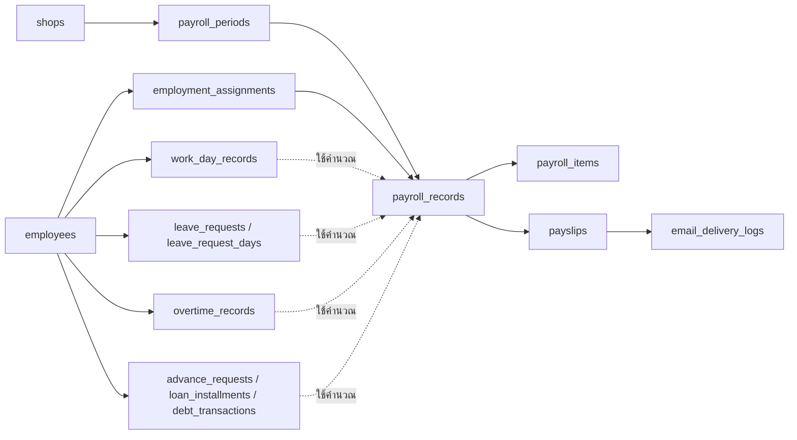

ข้อมูลสังกัดใน `employment_assignments` ต้องเลือกตามช่วงวันที่มีผล ไม่ใช้สังกัดปัจจุบันไปแทนอดีต `work_day_records.branch_id` เป็น snapshot ของสาขา ณ วันทำงาน `payroll_records` เก็บค่าเงินเดือนฐานและสวัสดิการขณะคำนวณ และ `payroll_items` เก็บรายการย่อยพร้อม `source_table`/`source_id` ในกรณีมีแหล่งต้นทาง การล็อกรอบตรวจความครบถ้วนและทำให้ผลที่ยืนยันแล้วแก้ไขตรงไม่ได้; การแก้ยอดภายหลังต้องผ่าน `payroll_adjustments` และนำไปใช้ในรอบใหม่

### 4.3 Query Table

| รหัส | วัตถุประสงค์และเงื่อนไขสำคัญ | ตารางที่เกี่ยวข้อง | Use Case |
|---|---|---|---|
| Q01 | ค้นสังกัดและค่าจ้างที่มีผล ณ วันที่ระบุ; ช่วงวันที่ต้องครอบคลุมวันเป้าหมาย | `employees`, `employment_assignments`, `branches`, `departments`, `positions` | UC04, UC05, UC10 |
| Q02 | อ่านวันทำงานของพนักงานในช่วงรอบ; ใช้สาขาที่บันทึกในวันนั้น | `work_day_records`, `employees`, `branches` | UC05, UC10, UC11 |
| Q03 | ตรวจคำขอลา วันลา โควตา และลำดับอนุมัติ; ใช้ผลอนุมัติที่มีผลจริง | `leave_requests`, `leave_request_days`, `leave_quotas`, `leave_approval_actions` | UC06, UC10 |
| Q04 | ตรวจ OT และผลอนุมัติก่อนนำจำนวนหน่วยไปคำนวณ | `overtime_records`, `overtime_approval_actions`, `work_day_records` | UC07, UC10 |
| Q05 | ตรวจเงินทดรอง งวดเงินกู้ และหนี้ที่ยังไม่ชำระในรอบ | `advance_requests`, `loans`, `loan_installments`, `debt_transactions` | UC08, UC10, UC11 |
| Q06 | อ่านกฎคำนวณที่มีผลกับร้าน/สาขาและช่วงวันที่ | `payroll_configurations`, `shops`, `branches` | UC09, UC10 |
| Q07 | อ่านผลเงินเดือนรายรอบและรายการย่อย; จำกัดสิทธิ์ตาม role scope | `payroll_periods`, `payroll_records`, `payroll_items`, `employees` | UC10, UC11, UC13 |
| Q08 | ตรวจเจ้าของสลิปก่อนอ่านข้อมูลสลิปและประวัติการส่ง | `user_accounts`, `employees`, `payroll_records`, `payslips`, `email_delivery_logs` | UC12 |
| Q09 | ตรวจรายการปรับยอดย้อนหลังและรอบที่นำยอดไปใช้ | `payroll_adjustments`, `payroll_records`, `payroll_periods`, `payroll_items` | UC11 |
| Q10 | ค้นหลักฐานการเปลี่ยนแปลง โดยปกปิดข้อมูลลับ | `audit_logs`, `user_accounts` | UC14 |

#### 4.3.1 ตัวอย่างคำสั่ง SQL ตามความสัมพันธ์จริง

ตัวอย่างต่อไปนี้ใช้ PostgreSQL แบบ bind parameter (`$1`, `$2`, …) โดยแสดงเฉพาะข้อมูลที่จำเป็นต่อการอธิบาย Query การตรวจสิทธิ์และกฎธุรกิจยังต้องทำใน service ก่อนส่งค่าพารามิเตอร์เข้าฐานข้อมูล

**Q01: สังกัดและค่าจ้าง ณ วันที่ทำงาน**

```sql
SELECT ea.id, ea.employee_id, ea.branch_id, ea.department_id,
       ea.position_id, ea.base_salary, ea.welfare_amount
FROM employment_assignments AS ea
WHERE ea.employee_id = $1
  AND ea.effective_from <= $2::date
  AND (ea.effective_to IS NULL OR ea.effective_to >= $2::date);
```

ผลลัพธ์ที่คาดคือหนึ่งช่วงที่มีผลสำหรับพนักงานหนึ่งคน ณ วันที่ระบุ การไม่ทับกันของช่วงวันที่ต้องบังคับที่ฐานข้อมูล/ธุรกรรม ไม่อาศัยคำสั่งอ่านข้อมูลเพียงอย่างเดียว

**Q02: บันทึกการทำงานในรอบเงินเดือน**

```sql
SELECT w.id, w.employee_id, w.branch_id, w.work_date, w.status,
       w.late_minutes, w.is_deductible, w.entry_source
FROM work_day_records AS w
WHERE w.employee_id = $1
  AND w.work_date BETWEEN $2::date AND $3::date
ORDER BY w.work_date;
```

`branch_id` ในผลลัพธ์เป็นสาขาที่บันทึกไว้ในวันนั้น จึงไม่ควร join ไปแทนที่ด้วยสาขาจาก `employment_assignments` ล่าสุด

**Q03–Q04: รายการลาและ OT ที่มีผลต่อการคำนวณ**

```sql
SELECT lrd.leave_date, lrd.day_amount, lrd.is_paid,
       lrd.is_deductible, lrd.quota_consumed, lr.final_leave_type_id
FROM leave_request_days AS lrd
JOIN leave_requests AS lr ON lr.id = lrd.leave_request_id
WHERE lr.employee_id = $1 AND lr.status = 'approved'
  AND lrd.leave_date BETWEEN $2::date AND $3::date
ORDER BY lrd.leave_date;

SELECT ot.overtime_date, ot.overtime_type, ot.hours, ot.day_units
FROM overtime_records AS ot
WHERE ot.employee_id = $1 AND ot.status = 'approved'
  AND ot.overtime_date BETWEEN $2::date AND $3::date
ORDER BY ot.overtime_date;
```

การอ่านเฉพาะสถานะ `approved` ช่วยแยกคำขอที่ยังรอพิจารณาออกจากข้อมูลคำนวณ การป้องกันวันลาทับซ้อน การใช้โควตา และการบันทึก approval action ต้องอยู่ในธุรกรรมอนุมัติเดียวกัน

**Q07: ผลเงินเดือนและรายการย่อยของพนักงานในหนึ่งรอบ**

```sql
SELECT pr.id AS payroll_record_id, pp.period_year, pp.period_month,
       pr.employee_id, pr.base_salary_snapshot, pr.welfare_snapshot,
       pr.total_earnings, pr.total_deductions, pr.net_pay,
       pi.item_type, pi.direction, pi.amount, pi.source_table, pi.source_id
FROM payroll_records AS pr
JOIN payroll_periods AS pp ON pp.id = pr.payroll_period_id
LEFT JOIN payroll_items AS pi ON pi.payroll_record_id = pr.id
WHERE pp.id = $1 AND pr.employee_id = $2
ORDER BY pi.id;
```

คำสั่งนี้คืนหลายแถวเมื่อมีหลาย `payroll_items` แต่มี `payroll_records` เพียงหนึ่งรายการต่อ `(payroll_period_id, employee_id)` ตาม unique constraint โปรแกรมต้องไม่รวมค่าระดับ record ซ้ำตามจำนวน item

**Q08: จำกัดการอ่านสลิปตามเจ้าของบัญชี**

```sql
SELECT ps.id, ps.file_storage_key, ps.status, pr.employee_id
FROM payslips AS ps
JOIN payroll_records AS pr ON pr.id = ps.payroll_record_id
JOIN user_accounts AS ua ON ua.employee_id = pr.employee_id
WHERE ps.id = $1 AND ua.id = $2;
```

ตัวอย่างนี้ใช้กับสิทธิ์พนักงานดูข้อมูลสลิปของตนเองเท่านั้น สิทธิ์ของ HR/Owner ต้องตรวจ role และ scope ฝั่ง server ก่อนใช้ query ที่เหมาะสม ระบบไม่ควรส่ง `file_storage_key` หรือข้อมูลบัญชีธนาคารให้ผู้ใช้ทั่วไปโดยตรง ปัจจุบัน backend ยังไม่มีไฟล์ PDF ให้เปิดหรือดาวน์โหลด

### 4.4 Table Structure

Data Dictionary ต่อไปนี้แสดง **ทุกคอลัมน์ของ 36 ตาราง** ตาม DBML ที่เป็นแบบจำลองเชิงตรรกะ ชนิดข้อมูลเป็น PostgreSQL; `PK` คือ primary key, `FK → ตาราง` คือ foreign key, `UQ` คือ unique และ `NN` คือไม่อนุญาตให้ว่าง หากไม่มี `NN` หมายถึงฟิลด์อาจเป็นค่าว่างได้ตาม DBML สำหรับข้อบังคับที่ซับซ้อน เช่น exclusion constraint, partial unique index และ trigger ให้อ้าง migration ที่ใช้งานจริง

#### 4.4.1 กลุ่มองค์กร บัญชีผู้ใช้ และขอบเขตสิทธิ์

| ตาราง | บทบาทของข้อมูล |
|---|---|
| `shops` | ข้อมูลร้านหลักที่ใช้กำหนดสาขาและรอบเงินเดือน |
| `branches` | สาขาภายใต้ร้านและเขตเวลาอ้างอิง |
| `departments` | แผนกของสาขา ใช้กำหนดสังกัดและขอบเขตสิทธิ์ |
| `positions` | ตำแหน่งงานภายใต้ร้าน |
| `employees` | ข้อมูลประจำตัวและสถานะการจ้างของพนักงาน |
| `user_accounts` | บัญชีสำหรับเข้าสู่ระบบซึ่งอาจเชื่อมกับพนักงานหนึ่งราย |
| `roles` | ชนิดบทบาทและระดับขอบเขตสิทธิ์ |
| `user_account_roles` | การมอบบทบาทให้บัญชี พร้อมขอบเขตสาขาหรือแผนก |

##### shops

**หน้าที่:** ข้อมูลร้านหลักที่ใช้กำหนดสาขาและรอบเงินเดือน

| คอลัมน์ | ชนิดข้อมูล | คีย์/ข้อกำหนด | ความหมาย |
|---|---|---|---|
| `id` | `bigint` | PK | รหัสระเบียน |
| `code` | `varchar(30)` | UQ, NN | รหัสอ้างอิง |
| `name` | `varchar(150)` | NN | ชื่อร้าน |
| `is_active` | `boolean` | NN | ระบุว่ายังเปิดใช้งาน |
| `created_at` | `timestamptz` | NN | เวลาสร้างระเบียน |
| `updated_at` | `timestamptz` | NN | เวลาแก้ไขล่าสุด |

##### branches

**หน้าที่:** สาขาภายใต้ร้านและเขตเวลาอ้างอิง

| คอลัมน์ | ชนิดข้อมูล | คีย์/ข้อกำหนด | ความหมาย |
|---|---|---|---|
| `id` | `bigint` | PK | รหัสระเบียน |
| `shop_id` | `bigint` | FK → `shops`, NN | รหัสร้าน |
| `code` | `varchar(30)` | NN | รหัสอ้างอิง |
| `name` | `varchar(150)` | NN | ชื่อสาขา |
| `address` | `text` | — | ที่อยู่ |
| `timezone` | `varchar(50)` | NN | เขตเวลาของสาขา |
| `is_active` | `boolean` | NN | ระบุว่ายังเปิดใช้งาน |
| `created_at` | `timestamptz` | NN | เวลาสร้างระเบียน |
| `updated_at` | `timestamptz` | NN | เวลาแก้ไขล่าสุด |

**ข้อกำหนด unique ร่วม:** (`shop_id`, `code`) ต้องไม่ซ้ำกัน

##### departments

**หน้าที่:** แผนกของสาขา ใช้กำหนดสังกัดและขอบเขตสิทธิ์

| คอลัมน์ | ชนิดข้อมูล | คีย์/ข้อกำหนด | ความหมาย |
|---|---|---|---|
| `id` | `bigint` | PK | รหัสระเบียน |
| `branch_id` | `bigint` | FK → `branches`, NN | รหัสสาขา |
| `code` | `varchar(30)` | NN | รหัสอ้างอิง |
| `name` | `varchar(100)` | NN | ชื่อแผนก |
| `is_active` | `boolean` | NN | ระบุว่ายังเปิดใช้งาน |
| `created_at` | `timestamptz` | NN | เวลาสร้างระเบียน |
| `updated_at` | `timestamptz` | NN | เวลาแก้ไขล่าสุด |

**ข้อกำหนด unique ร่วม:** (`branch_id`, `code`) ต้องไม่ซ้ำกัน

##### positions

**หน้าที่:** ตำแหน่งงานภายใต้ร้าน

| คอลัมน์ | ชนิดข้อมูล | คีย์/ข้อกำหนด | ความหมาย |
|---|---|---|---|
| `id` | `bigint` | PK | รหัสระเบียน |
| `shop_id` | `bigint` | FK → `shops`, NN | รหัสร้าน |
| `code` | `varchar(30)` | NN | รหัสอ้างอิง |
| `name` | `varchar(100)` | NN | ชื่อตำแหน่ง |
| `is_active` | `boolean` | NN | ระบุว่ายังเปิดใช้งาน |
| `created_at` | `timestamptz` | NN | เวลาสร้างระเบียน |
| `updated_at` | `timestamptz` | NN | เวลาแก้ไขล่าสุด |

**ข้อกำหนด unique ร่วม:** (`shop_id`, `code`) ต้องไม่ซ้ำกัน

##### employees

**หน้าที่:** ข้อมูลประจำตัวและสถานะการจ้างของพนักงาน

| คอลัมน์ | ชนิดข้อมูล | คีย์/ข้อกำหนด | ความหมาย |
|---|---|---|---|
| `id` | `bigint` | PK | รหัสระเบียน |
| `employee_code` | `varchar(30)` | UQ, NN | รหัสพนักงานสำหรับงานธุรกิจ |
| `national_id` | `varchar(20)` | UQ | เลขประจำตัวตามเอกสารทางราชการ |
| `passport_id` | `varchar(30)` | UQ | เลขหนังสือเดินทาง |
| `first_name` | `varchar(100)` | NN | ชื่อพนักงาน |
| `last_name` | `varchar(100)` | NN | นามสกุลพนักงาน |
| `phone` | `varchar(30)` | — | หมายเลขโทรศัพท์ |
| `personal_email` | `varchar(255)` | — | อีเมลส่วนบุคคล |
| `address` | `text` | — | ที่อยู่ |
| `hire_date` | `date` | NN | วันเริ่มจ้าง |
| `status` | `employee_status` | NN | สถานะการจ้าง |
| `terminated_at` | `date` | — | วันสิ้นสุดการจ้าง |
| `created_at` | `timestamptz` | NN | เวลาสร้างระเบียน |
| `updated_at` | `timestamptz` | NN | เวลาแก้ไขล่าสุด |


##### user_accounts

**หน้าที่:** บัญชีสำหรับเข้าสู่ระบบซึ่งอาจเชื่อมกับพนักงานหนึ่งราย

| คอลัมน์ | ชนิดข้อมูล | คีย์/ข้อกำหนด | ความหมาย |
|---|---|---|---|
| `id` | `bigint` | PK | รหัสระเบียน |
| `employee_id` | `bigint` | FK → `employees`, UQ | รหัสพนักงาน |
| `username` | `varchar(100)` | UQ, NN | ชื่อบัญชีเข้าสู่ระบบ |
| `password_hash` | `text` | NN | ค่าแฮชรหัสผ่าน ห้ามแสดงหรือบันทึกใน audit |
| `status` | `account_status` | NN | สถานะบัญชี |
| `failed_login_attempts` | `smallint` | NN | จำนวนครั้งที่เข้าสู่ระบบไม่สำเร็จ |
| `locked_until` | `timestamptz` | — | เวลาสิ้นสุดการล็อกบัญชี |
| `last_login_at` | `timestamptz` | — | เวลาเข้าสู่ระบบล่าสุด |
| `created_at` | `timestamptz` | NN | เวลาสร้างระเบียน |
| `updated_at` | `timestamptz` | NN | เวลาแก้ไขล่าสุด |

##### roles

**หน้าที่:** ชนิดบทบาทและระดับขอบเขตสิทธิ์

| คอลัมน์ | ชนิดข้อมูล | คีย์/ข้อกำหนด | ความหมาย |
|---|---|---|---|
| `id` | `bigint` | PK | รหัสระเบียน |
| `code` | `varchar(30)` | UQ, NN | รหัสอ้างอิง |
| `name` | `varchar(100)` | NN | ชื่อบทบาท |
| `scope` | `role_scope` | NN | ระดับขอบเขตสิทธิ์ |
| `is_active` | `boolean` | NN | ระบุว่ายังเปิดใช้งาน |

##### user_account_roles

**หน้าที่:** การมอบบทบาทให้บัญชี พร้อมขอบเขตสาขาหรือแผนก

| คอลัมน์ | ชนิดข้อมูล | คีย์/ข้อกำหนด | ความหมาย |
|---|---|---|---|
| `id` | `bigint` | PK | รหัสระเบียน |
| `user_account_id` | `bigint` | FK → `user_accounts`, NN | รหัสบัญชีผู้ใช้ |
| `role_id` | `bigint` | FK → `roles`, NN | รหัสบทบาท |
| `branch_id` | `bigint` | FK → `branches` | รหัสสาขา |
| `department_id` | `bigint` | FK → `departments` | รหัสแผนก |
| `granted_by_user_account_id` | `bigint` | FK → `user_accounts` | บัญชีผู้มอบสิทธิ์ |
| `granted_at` | `timestamptz` | NN | เวลามอบสิทธิ์ |

**ข้อกำหนด unique ร่วม:** (`user_account_id`, `role_id`, `branch_id`, `department_id`) ต้องไม่ซ้ำกัน

#### 4.4.2 กลุ่มประวัติการจ้างและข้อมูลรับเงิน

| ตาราง | บทบาทของข้อมูล |
|---|---|
| `employment_assignments` | ประวัติสังกัด ตำแหน่ง เงินเดือนฐาน และสวัสดิการตามช่วงวันที่ |
| `employee_bank_accounts` | บัญชีธนาคารสำหรับรับเงินเดือนโดยเก็บเลขบัญชีแบบเข้ารหัส |
| `employee_weekly_holidays` | วันหยุดประจำสัปดาห์ของพนักงานตามช่วงวันที่ |

##### employment_assignments

**หน้าที่:** ประวัติสังกัด ตำแหน่ง เงินเดือนฐาน และสวัสดิการตามช่วงวันที่

| คอลัมน์ | ชนิดข้อมูล | คีย์/ข้อกำหนด | ความหมาย |
|---|---|---|---|
| `id` | `bigint` | PK | รหัสระเบียน |
| `employee_id` | `bigint` | FK → `employees`, NN | รหัสพนักงาน |
| `branch_id` | `bigint` | FK → `branches`, NN | รหัสสาขา |
| `department_id` | `bigint` | FK → `departments`, NN | รหัสแผนก |
| `position_id` | `bigint` | FK → `positions`, NN | รหัสตำแหน่ง |
| `employment_type` | `employment_type` | NN | ประเภทการจ้าง |
| `base_salary` | `numeric(12,2)` | NN | เงินเดือนฐาน |
| `welfare_amount` | `numeric(12,2)` | NN | ค่าสวัสดิการ |
| `effective_from` | `date` | NN | วันเริ่มมีผล |
| `effective_to` | `date` | — | วันสิ้นสุดผล; ว่างได้หากยังมีผล |
| `is_primary` | `boolean` | NN | ระบุรายการหลัก |
| `created_by_user_account_id` | `bigint` | FK → `user_accounts` | บัญชีผู้สร้างข้อมูล |
| `created_at` | `timestamptz` | NN | เวลาสร้างระเบียน |
| `updated_at` | `timestamptz` | NN | เวลาแก้ไขล่าสุด |

##### employee_bank_accounts

**หน้าที่:** บัญชีธนาคารสำหรับรับเงินเดือนโดยเก็บเลขบัญชีแบบเข้ารหัส

| คอลัมน์ | ชนิดข้อมูล | คีย์/ข้อกำหนด | ความหมาย |
|---|---|---|---|
| `id` | `bigint` | PK | รหัสระเบียน |
| `employee_id` | `bigint` | FK → `employees`, NN | รหัสพนักงาน |
| `bank_code` | `varchar(20)` | NN | รหัสธนาคาร |
| `bank_name` | `varchar(100)` | NN | ชื่อธนาคาร |
| `account_holder_name` | `varchar(200)` | NN | ชื่อผู้ถือบัญชี |
| `account_number_ciphertext` | `text` | NN | เลขบัญชีที่เข้ารหัส |
| `account_number_last4` | `varchar(4)` | NN | เลขบัญชีสี่หลักท้ายสำหรับแสดงแบบปกปิด |
| `is_primary` | `boolean` | NN | ระบุรายการหลัก |
| `is_active` | `boolean` | NN | ระบุว่ายังเปิดใช้งาน |
| `created_at` | `timestamptz` | NN | เวลาสร้างระเบียน |
| `updated_at` | `timestamptz` | NN | เวลาแก้ไขล่าสุด |

##### employee_weekly_holidays

**หน้าที่:** วันหยุดประจำสัปดาห์ของพนักงานตามช่วงวันที่

| คอลัมน์ | ชนิดข้อมูล | คีย์/ข้อกำหนด | ความหมาย |
|---|---|---|---|
| `id` | `bigint` | PK | รหัสระเบียน |
| `employee_id` | `bigint` | FK → `employees`, NN | รหัสพนักงาน |
| `weekday` | `smallint` | NN | วันในสัปดาห์ โดย 0=อาทิตย์ ถึง 6=เสาร์ |
| `effective_from` | `date` | NN | วันเริ่มมีผล |
| `effective_to` | `date` | — | วันสิ้นสุดผล; ว่างได้หากยังมีผล |
| `created_at` | `timestamptz` | NN | เวลาสร้างระเบียน |
| `updated_at` | `timestamptz` | NN | เวลาแก้ไขล่าสุด |

#### 4.4.3 กลุ่มตารางปฏิบัติงานและข้อมูลลงเวลา

| ตาราง | บทบาทของข้อมูล |
|---|---|
| `branch_schedules` | เวลาเริ่มและสิ้นสุดงานปกติของสาขาตามช่วงวันที่ |
| `branch_schedule_overrides` | ตารางเวลาหรือการปิดทำการเฉพาะวัน |
| `holiday_calendars` | วันหยุดของร้าน |
| `work_day_records` | ผลการทำงานรายวันและสาขาที่เกิดเหตุการณ์จริง |

##### branch_schedules

**หน้าที่:** เวลาเริ่มและสิ้นสุดงานปกติของสาขาตามช่วงวันที่

| คอลัมน์ | ชนิดข้อมูล | คีย์/ข้อกำหนด | ความหมาย |
|---|---|---|---|
| `id` | `bigint` | PK | รหัสระเบียน |
| `branch_id` | `bigint` | FK → `branches`, NN | รหัสสาขา |
| `work_start_time` | `time` | NN | เวลาเริ่มงานปกติ |
| `standard_close_time` | `time` | NN | เวลาปิดงานปกติ |
| `late_grace_minutes` | `smallint` | NN | นาทีผ่อนผันก่อนถือว่าสาย |
| `effective_from` | `date` | NN | วันเริ่มมีผล |
| `effective_to` | `date` | — | วันสิ้นสุดผล; ว่างได้หากยังมีผล |
| `created_at` | `timestamptz` | NN | เวลาสร้างระเบียน |
| `updated_at` | `timestamptz` | NN | เวลาแก้ไขล่าสุด |

##### branch_schedule_overrides

**หน้าที่:** ตารางเวลาหรือการปิดทำการเฉพาะวัน

| คอลัมน์ | ชนิดข้อมูล | คีย์/ข้อกำหนด | ความหมาย |
|---|---|---|---|
| `id` | `bigint` | PK | รหัสระเบียน |
| `branch_id` | `bigint` | FK → `branches`, NN | รหัสสาขา |
| `schedule_date` | `date` | NN | วันที่ใช้ตารางเวลาเฉพาะ |
| `work_start_time` | `time` | — | เวลาเริ่มงานปกติ |
| `close_time` | `time` | — | เวลาปิดเฉพาะวัน |
| `is_closed` | `boolean` | NN | ระบุว่าสาขาปิดทำการ |
| `reason` | `varchar(255)` | — | เหตุผล |
| `created_by_user_account_id` | `bigint` | FK → `user_accounts` | บัญชีผู้สร้างข้อมูล |
| `created_at` | `timestamptz` | NN | เวลาสร้างระเบียน |
| `updated_at` | `timestamptz` | NN | เวลาแก้ไขล่าสุด |

**ข้อกำหนด unique ร่วม:** (`branch_id`, `schedule_date`) ต้องไม่ซ้ำกัน

##### holiday_calendars

**หน้าที่:** วันหยุดของร้าน

| คอลัมน์ | ชนิดข้อมูล | คีย์/ข้อกำหนด | ความหมาย |
|---|---|---|---|
| `id` | `bigint` | PK | รหัสระเบียน |
| `shop_id` | `bigint` | FK → `shops`, NN | รหัสร้าน |
| `holiday_date` | `date` | NN | วันที่เป็นวันหยุด |
| `name` | `varchar(150)` | NN | ชื่อวันหยุด |
| `is_active` | `boolean` | NN | ระบุว่ายังเปิดใช้งาน |
| `created_by_user_account_id` | `bigint` | FK → `user_accounts` | บัญชีผู้สร้างข้อมูล |
| `created_at` | `timestamptz` | NN | เวลาสร้างระเบียน |
| `updated_at` | `timestamptz` | NN | เวลาแก้ไขล่าสุด |

**ข้อกำหนด unique ร่วม:** (`shop_id`, `holiday_date`) ต้องไม่ซ้ำกัน

##### work_day_records

**หน้าที่:** ผลการทำงานรายวันและสาขาที่เกิดเหตุการณ์จริง

| คอลัมน์ | ชนิดข้อมูล | คีย์/ข้อกำหนด | ความหมาย |
|---|---|---|---|
| `id` | `bigint` | PK | รหัสระเบียน |
| `employee_id` | `bigint` | FK → `employees`, NN | รหัสพนักงาน |
| `branch_id` | `bigint` | FK → `branches`, NN | รหัสสาขา |
| `work_date` | `date` | NN | วันที่ทำงาน |
| `clock_in_at` | `timestamptz` | — | เวลาลงเข้างาน |
| `clock_out_at` | `timestamptz` | — | เวลาลงออกงาน |
| `status` | `work_day_status` | NN | สถานะการทำงานรายวัน |
| `late_minutes` | `integer` | NN | จำนวนนาทีที่มาสาย |
| `is_deductible` | `boolean` | NN | ระบุว่ามีผลเป็นรายการหัก |
| `entry_source` | `time_entry_source` | NN | แหล่งข้อมูลลงเวลา |
| `created_by_user_account_id` | `bigint` | FK → `user_accounts` | บัญชีผู้สร้างข้อมูล |
| `note` | `text` | — | หมายเหตุ |
| `created_at` | `timestamptz` | NN | เวลาสร้างระเบียน |
| `updated_at` | `timestamptz` | NN | เวลาแก้ไขล่าสุด |

**ข้อกำหนด unique ร่วม:** (`employee_id`, `work_date`) ต้องไม่ซ้ำกัน

#### 4.4.4 กลุ่มการลาและการทำงานล่วงเวลา

| ตาราง | บทบาทของข้อมูล |
|---|---|
| `leave_types` | ประเภทการลาและนโยบายการหักเงินหรือใช้โควตา |
| `leave_requests` | คำขอลาระดับรายการและผลพิจารณา |
| `leave_request_days` | รายละเอียดวันลาแต่ละวัน รวมจำนวนวันที่ใช้และการหักเงิน |
| `leave_quotas` | สิทธิ์วันลาที่มีและที่ใช้ในแต่ละปี |
| `leave_approval_actions` | ลำดับการพิจารณาคำขอลาที่แก้ย้อนหลังไม่ได้ |
| `overtime_records` | คำขอ OT ตามวัน ประเภท และจำนวนหน่วย |
| `overtime_approval_actions` | ลำดับการพิจารณา OT ที่แก้ย้อนหลังไม่ได้ |

##### leave_types

**หน้าที่:** ประเภทการลาและนโยบายการหักเงินหรือใช้โควตา

| คอลัมน์ | ชนิดข้อมูล | คีย์/ข้อกำหนด | ความหมาย |
|---|---|---|---|
| `id` | `bigint` | PK | รหัสระเบียน |
| `code` | `varchar(30)` | UQ, NN | รหัสอ้างอิง |
| `name_th` | `varchar(100)` | NN | ชื่อภาษาไทย |
| `quota_type` | `quota_type` | NN | วิธีกำหนดสิทธิ์วันลา |
| `quota_days` | `numeric(8,2)` | — | จำนวนวันลาตั้งต้น |
| `is_deductible` | `boolean` | NN | ระบุว่ามีผลเป็นรายการหัก |
| `requires_document` | `boolean` | NN | ระบุว่าต้องแนบเอกสาร |
| `allow_exceed` | `boolean` | NN | ระบุว่าอนุญาตให้เกินสิทธิ์ |
| `is_active` | `boolean` | NN | ระบุว่ายังเปิดใช้งาน |
| `created_at` | `timestamptz` | NN | เวลาสร้างระเบียน |
| `updated_at` | `timestamptz` | NN | เวลาแก้ไขล่าสุด |

##### leave_requests

**หน้าที่:** คำขอลาระดับรายการและผลพิจารณา

| คอลัมน์ | ชนิดข้อมูล | คีย์/ข้อกำหนด | ความหมาย |
|---|---|---|---|
| `id` | `bigint` | PK | รหัสระเบียน |
| `employee_id` | `bigint` | FK → `employees`, NN | รหัสพนักงาน |
| `original_leave_type_id` | `bigint` | FK → `leave_types`, NN | ประเภทลาที่ผู้ยื่นระบุเดิม |
| `final_leave_type_id` | `bigint` | FK → `leave_types` | ประเภทลาที่อนุมัติสุดท้าย |
| `start_date` | `date` | NN | วันเริ่มต้น |
| `end_date` | `date` | NN | วันสิ้นสุด |
| `requested_days` | `numeric(8,2)` | NN | จำนวนวันที่ขอ |
| `reason` | `text` | — | เหตุผล |
| `status` | `leave_request_status` | NN | สถานะคำขอลา |
| `is_retroactive` | `boolean` | NN | ระบุว่าเป็นคำขอย้อนหลัง |
| `submitted_by_user_account_id` | `bigint` | FK → `user_accounts`, NN | บัญชีผู้ยื่นคำขอ |
| `submitted_at` | `timestamptz` | — | เวลายื่นคำขอ |
| `decided_at` | `timestamptz` | — | เวลาตัดสินผล |
| `created_at` | `timestamptz` | NN | เวลาสร้างระเบียน |
| `updated_at` | `timestamptz` | NN | เวลาแก้ไขล่าสุด |

##### leave_request_days

**หน้าที่:** รายละเอียดวันลาแต่ละวัน รวมจำนวนวันที่ใช้และการหักเงิน

| คอลัมน์ | ชนิดข้อมูล | คีย์/ข้อกำหนด | ความหมาย |
|---|---|---|---|
| `id` | `bigint` | PK | รหัสระเบียน |
| `leave_request_id` | `bigint` | FK → `leave_requests`, NN | รหัสคำขอลา |
| `work_day_record_id` | `bigint` | FK → `work_day_records` | รหัสบันทึกการทำงานรายวัน |
| `leave_type_id` | `bigint` | FK → `leave_types`, NN | รหัสประเภทการลา |
| `leave_date` | `date` | NN | วันที่ลา |
| `day_amount` | `numeric(8,2)` | NN | จำนวนหน่วยวันลาของวันนั้น |
| `is_paid` | `boolean` | NN | ระบุว่าเป็นวันลาได้รับค่าจ้าง |
| `is_deductible` | `boolean` | NN | ระบุว่ามีผลเป็นรายการหัก |
| `quota_consumed` | `numeric(8,2)` | NN | จำนวนสิทธิ์ลาที่ใช้จริง |
| `created_at` | `timestamptz` | NN | เวลาสร้างระเบียน |
| `updated_at` | `timestamptz` | NN | เวลาแก้ไขล่าสุด |

**ข้อกำหนด unique ร่วม:** (`leave_request_id`, `leave_date`) ต้องไม่ซ้ำกัน

##### leave_quotas

**หน้าที่:** สิทธิ์วันลาที่มีและที่ใช้ในแต่ละปี

| คอลัมน์ | ชนิดข้อมูล | คีย์/ข้อกำหนด | ความหมาย |
|---|---|---|---|
| `id` | `bigint` | PK | รหัสระเบียน |
| `employee_id` | `bigint` | FK → `employees`, NN | รหัสพนักงาน |
| `leave_type_id` | `bigint` | FK → `leave_types`, NN | รหัสประเภทการลา |
| `quota_year` | `smallint` | NN | ปีที่ใช้กำหนดสิทธิ์ลา |
| `entitled_days` | `numeric(8,2)` | NN | จำนวนวันลาที่ได้รับสิทธิ์ |
| `used_days` | `numeric(8,2)` | NN | จำนวนวันลาที่ใช้แล้ว |
| `last_recalculated_at` | `timestamptz` | — | เวลาคำนวณสิทธิ์ครั้งล่าสุด |
| `frozen_at` | `timestamptz` | — | เวลาตรึงยอดสิทธิ์ |
| `created_at` | `timestamptz` | NN | เวลาสร้างระเบียน |
| `updated_at` | `timestamptz` | NN | เวลาแก้ไขล่าสุด |

**ข้อกำหนด unique ร่วม:** (`employee_id`, `leave_type_id`, `quota_year`) ต้องไม่ซ้ำกัน

##### leave_approval_actions

**หน้าที่:** ลำดับการพิจารณาคำขอลาที่แก้ย้อนหลังไม่ได้

| คอลัมน์ | ชนิดข้อมูล | คีย์/ข้อกำหนด | ความหมาย |
|---|---|---|---|
| `id` | `bigint` | PK | รหัสระเบียน |
| `leave_request_id` | `bigint` | FK → `leave_requests`, NN | รหัสคำขอลา |
| `actor_user_account_id` | `bigint` | FK → `user_accounts`, NN | บัญชีผู้กระทำรายการ |
| `action` | `approval_action_type` | NN | ผลการพิจารณาลา |
| `from_leave_type_id` | `bigint` | FK → `leave_types` | ประเภทลาก่อนแก้ไข |
| `to_leave_type_id` | `bigint` | FK → `leave_types` | ประเภทลาหลังแก้ไข |
| `remark` | `text` | — | คำอธิบายการพิจารณา |
| `acted_at` | `timestamptz` | NN | เวลาพิจารณา |

##### overtime_records

**หน้าที่:** คำขอ OT ตามวัน ประเภท และจำนวนหน่วย

| คอลัมน์ | ชนิดข้อมูล | คีย์/ข้อกำหนด | ความหมาย |
|---|---|---|---|
| `id` | `bigint` | PK | รหัสระเบียน |
| `employee_id` | `bigint` | FK → `employees`, NN | รหัสพนักงาน |
| `work_day_record_id` | `bigint` | FK → `work_day_records` | รหัสบันทึกการทำงานรายวัน |
| `overtime_date` | `date` | NN | วันที่ทำ OT |
| `overtime_type` | `overtime_type` | NN | ประเภท OT |
| `hours` | `numeric(8,2)` | NN | จำนวนชั่วโมง OT |
| `day_units` | `numeric(8,2)` | NN | จำนวนหน่วยวัน OT |
| `reason` | `text` | — | เหตุผล |
| `status` | `overtime_status` | NN | สถานะคำขอ OT |
| `requested_by_user_account_id` | `bigint` | FK → `user_accounts`, NN | บัญชีผู้ร้องขอ |
| `submitted_at` | `timestamptz` | — | เวลายื่นคำขอ |
| `decided_at` | `timestamptz` | — | เวลาตัดสินผล |
| `created_at` | `timestamptz` | NN | เวลาสร้างระเบียน |
| `updated_at` | `timestamptz` | NN | เวลาแก้ไขล่าสุด |

**ข้อกำหนด unique ร่วม:** (`employee_id`, `overtime_date`) ต้องไม่ซ้ำกัน

##### overtime_approval_actions

**หน้าที่:** ลำดับการพิจารณา OT ที่แก้ย้อนหลังไม่ได้

| คอลัมน์ | ชนิดข้อมูล | คีย์/ข้อกำหนด | ความหมาย |
|---|---|---|---|
| `id` | `bigint` | PK | รหัสระเบียน |
| `overtime_record_id` | `bigint` | FK → `overtime_records`, NN | รหัสรายการ OT |
| `actor_user_account_id` | `bigint` | FK → `user_accounts`, NN | บัญชีผู้กระทำรายการ |
| `action` | `approval_action_type` | NN | ผลการพิจารณา OT |
| `remark` | `text` | — | คำอธิบายการพิจารณา |
| `acted_at` | `timestamptz` | NN | เวลาพิจารณา |

#### 4.4.5 กลุ่มเงินทดรอง เงินกู้ และหนี้

| ตาราง | บทบาทของข้อมูล |
|---|---|
| `advance_requests` | คำขอและผลพิจารณาเงินทดรองจ่าย |
| `loans` | สัญญาเงินกู้ของพนักงาน |
| `loan_installments` | กำหนดการหักเงินกู้แต่ละงวดและรอบที่หักจริง |
| `debt_types` | ประเภทหนี้ที่ใช้จำแนกรายการ |
| `debt_transactions` | รายการเพิ่ม ปรับปรุง หรือกลับรายการหนี้แบบคงประวัติ |

##### advance_requests

**หน้าที่:** คำขอและผลพิจารณาเงินทดรองจ่าย

| คอลัมน์ | ชนิดข้อมูล | คีย์/ข้อกำหนด | ความหมาย |
|---|---|---|---|
| `id` | `bigint` | PK | รหัสระเบียน |
| `employee_id` | `bigint` | FK → `employees`, NN | รหัสพนักงาน |
| `request_month` | `date` | NN | เดือนที่ขอเบิก โดยเก็บเป็นวันแรกของเดือน |
| `amount` | `numeric(12,2)` | NN | จำนวนเงิน |
| `status` | `advance_status` | NN | สถานะคำขอเงินทดรอง |
| `requested_by_user_account_id` | `bigint` | FK → `user_accounts`, NN | บัญชีผู้ร้องขอ |
| `requested_at` | `timestamptz` | NN | เวลาร้องขอ |
| `decided_by_user_account_id` | `bigint` | FK → `user_accounts` | บัญชีผู้พิจารณา |
| `decided_at` | `timestamptz` | — | เวลาตัดสินผล |
| `decision_note` | `text` | — | หมายเหตุผลพิจารณา |
| `created_at` | `timestamptz` | NN | เวลาสร้างระเบียน |
| `updated_at` | `timestamptz` | NN | เวลาแก้ไขล่าสุด |

##### loans

**หน้าที่:** สัญญาเงินกู้ของพนักงาน

| คอลัมน์ | ชนิดข้อมูล | คีย์/ข้อกำหนด | ความหมาย |
|---|---|---|---|
| `id` | `bigint` | PK | รหัสระเบียน |
| `employee_id` | `bigint` | FK → `employees`, NN | รหัสพนักงาน |
| `principal_amount` | `numeric(12,2)` | NN | เงินต้นของเงินกู้ |
| `reason` | `text` | — | เหตุผล |
| `installment_count` | `smallint` | NN | จำนวนงวดทั้งหมด |
| `status` | `loan_status` | NN | สถานะเงินกู้ |
| `approved_by_user_account_id` | `bigint` | FK → `user_accounts` | บัญชีผู้อนุมัติ |
| `approved_at` | `timestamptz` | — | เวลาอนุมัติ |
| `closed_at` | `timestamptz` | — | เวลาปิดสัญญา |
| `created_at` | `timestamptz` | NN | เวลาสร้างระเบียน |
| `updated_at` | `timestamptz` | NN | เวลาแก้ไขล่าสุด |

##### loan_installments

**หน้าที่:** กำหนดการหักเงินกู้แต่ละงวดและรอบที่หักจริง

| คอลัมน์ | ชนิดข้อมูล | คีย์/ข้อกำหนด | ความหมาย |
|---|---|---|---|
| `id` | `bigint` | PK | รหัสระเบียน |
| `loan_id` | `bigint` | FK → `loans`, NN | รหัสสัญญาเงินกู้ |
| `installment_no` | `smallint` | NN | ลำดับงวด |
| `due_period_start` | `date` | NN | วันเริ่มรอบเงินเดือนที่ครบกำหนด |
| `amount` | `numeric(12,2)` | NN | จำนวนเงิน |
| `status` | `installment_status` | NN | สถานะงวดชำระ |
| `deducted_at` | `timestamptz` | — | เวลาหักงวดจริง |
| `payroll_record_id` | `bigint` | FK → `payroll_records` | รหัสผลเงินเดือนรายพนักงาน |
| `created_at` | `timestamptz` | NN | เวลาสร้างระเบียน |
| `updated_at` | `timestamptz` | NN | เวลาแก้ไขล่าสุด |

**ข้อกำหนด unique ร่วม:** (`loan_id`, `installment_no`) ต้องไม่ซ้ำกัน

##### debt_types

**หน้าที่:** ประเภทหนี้ที่ใช้จำแนกรายการ

| คอลัมน์ | ชนิดข้อมูล | คีย์/ข้อกำหนด | ความหมาย |
|---|---|---|---|
| `id` | `bigint` | PK | รหัสระเบียน |
| `code` | `varchar(30)` | UQ, NN | รหัสอ้างอิง |
| `name_th` | `varchar(100)` | NN | ชื่อภาษาไทย |
| `description` | `text` | — | คำอธิบายรายการ |
| `is_active` | `boolean` | NN | ระบุว่ายังเปิดใช้งาน |
| `created_at` | `timestamptz` | NN | เวลาสร้างระเบียน |
| `updated_at` | `timestamptz` | NN | เวลาแก้ไขล่าสุด |

##### debt_transactions

**หน้าที่:** รายการเพิ่ม ปรับปรุง หรือกลับรายการหนี้แบบคงประวัติ

| คอลัมน์ | ชนิดข้อมูล | คีย์/ข้อกำหนด | ความหมาย |
|---|---|---|---|
| `id` | `bigint` | PK | รหัสระเบียน |
| `employee_id` | `bigint` | FK → `employees`, NN | รหัสพนักงาน |
| `debt_type_id` | `bigint` | FK → `debt_types`, NN | รหัสประเภทหนี้ |
| `transaction_kind` | `debt_transaction_kind` | NN | ชนิดรายการหนี้: เพิ่ม ปรับ หรือกลับรายการ |
| `transaction_date` | `date` | NN | วันที่เกิดรายการหนี้ |
| `description` | `text` | NN | คำอธิบายรายการ |
| `amount` | `numeric(12,2)` | NN | จำนวนเงิน |
| `original_transaction_id` | `bigint` | FK → `debt_transactions` | รหัสรายการหนี้ต้นฉบับที่ถูกกลับรายการ |
| `recorded_by_user_account_id` | `bigint` | FK → `user_accounts`, NN | บัญชีผู้บันทึกรายการ |
| `settled_in_payroll_record_id` | `bigint` | FK → `payroll_records` | รหัสผลเงินเดือนที่ใช้ชำระหนี้ |
| `settled_at` | `timestamptz` | — | เวลาชำระหนี้ผ่านเงินเดือน |
| `created_at` | `timestamptz` | NN | เวลาสร้างระเบียน |
| `updated_at` | `timestamptz` | NN | เวลาแก้ไขล่าสุด |

#### 4.4.6 กลุ่มการคำนวณเงินเดือน เอกสาร และหลักฐาน

| ตาราง | บทบาทของข้อมูล |
|---|---|
| `payroll_configurations` | ค่ากฎคำนวณเงินเดือนตามร้าน สาขา และช่วงวันที่ |
| `payroll_periods` | รอบเงินเดือนและสถานะการคำนวณหรือการล็อก |
| `payroll_records` | ผลคำนวณเงินเดือนรายพนักงานต่อรอบพร้อมค่าที่บันทึกไว้ ณ เวลาคำนวณ |
| `payroll_items` | รายการรายได้และรายการหัก พร้อมแหล่งที่มา |
| `payroll_adjustments` | คำขอปรับยอดของรอบที่ล็อกโดยนำไปใช้ในรอบใหม่ |
| `payslips` | ข้อมูลไฟล์สลิปของผลเงินเดือนหนึ่งรายการ |
| `email_delivery_logs` | บันทึกความพยายามส่งสลิปทางอีเมลแต่ละครั้ง |
| `attachments` | ไฟล์หลักฐานที่ผูกกับพนักงานหรือคำขอลา |
| `audit_logs` | บันทึกเหตุการณ์สำคัญ ผู้กระทำ และค่าเปลี่ยนแปลง |

##### payroll_configurations

**หน้าที่:** ค่ากฎคำนวณเงินเดือนตามร้าน สาขา และช่วงวันที่

| คอลัมน์ | ชนิดข้อมูล | คีย์/ข้อกำหนด | ความหมาย |
|---|---|---|---|
| `id` | `bigint` | PK | รหัสระเบียน |
| `shop_id` | `bigint` | FK → `shops`, NN | รหัสร้าน |
| `branch_id` | `bigint` | FK → `branches` | รหัสสาขา |
| `config_key` | `varchar(50)` | NN | รหัสตัวแปรกฎคำนวณ |
| `numeric_value` | `numeric(14,4)` | NN | ค่าตัวเลขของกฎคำนวณ |
| `unit` | `varchar(30)` | NN | หน่วยของค่ากฎคำนวณ |
| `effective_from` | `date` | NN | วันเริ่มมีผล |
| `effective_to` | `date` | — | วันสิ้นสุดผล; ว่างได้หากยังมีผล |
| `created_by_user_account_id` | `bigint` | FK → `user_accounts`, NN | บัญชีผู้สร้างข้อมูล |
| `created_at` | `timestamptz` | NN | เวลาสร้างระเบียน |
| `updated_at` | `timestamptz` | NN | เวลาแก้ไขล่าสุด |

##### payroll_periods

**หน้าที่:** รอบเงินเดือนและสถานะการคำนวณหรือการล็อก

| คอลัมน์ | ชนิดข้อมูล | คีย์/ข้อกำหนด | ความหมาย |
|---|---|---|---|
| `id` | `bigint` | PK | รหัสระเบียน |
| `shop_id` | `bigint` | FK → `shops`, NN | รหัสร้าน |
| `period_year` | `smallint` | NN | ปีของรอบเงินเดือน |
| `period_month` | `smallint` | NN | เดือนของรอบเงินเดือน |
| `start_date` | `date` | NN | วันเริ่มต้น |
| `end_date` | `date` | NN | วันสิ้นสุด |
| `status` | `payroll_period_status` | NN | สถานะรอบเงินเดือน |
| `created_by_user_account_id` | `bigint` | FK → `user_accounts`, NN | บัญชีผู้สร้างข้อมูล |
| `previewed_at` | `timestamptz` | — | เวลาคำนวณตัวอย่างล่าสุด |
| `locked_by_user_account_id` | `bigint` | FK → `user_accounts` | บัญชีผู้ล็อกรอบเงินเดือน |
| `locked_at` | `timestamptz` | — | เวลาล็อกผลเงินเดือน |
| `created_at` | `timestamptz` | NN | เวลาสร้างระเบียน |
| `updated_at` | `timestamptz` | NN | เวลาแก้ไขล่าสุด |

**ข้อกำหนด unique ร่วม:** (`shop_id`, `period_year`, `period_month`) ต้องไม่ซ้ำกัน

##### payroll_records

**หน้าที่:** ผลคำนวณเงินเดือนรายพนักงานต่อรอบพร้อมค่าที่บันทึกไว้ ณ เวลาคำนวณ

| คอลัมน์ | ชนิดข้อมูล | คีย์/ข้อกำหนด | ความหมาย |
|---|---|---|---|
| `id` | `bigint` | PK | รหัสระเบียน |
| `payroll_period_id` | `bigint` | FK → `payroll_periods`, NN | รหัสรอบเงินเดือน |
| `employee_id` | `bigint` | FK → `employees`, NN | รหัสพนักงาน |
| `employment_assignment_id` | `bigint` | FK → `employment_assignments`, NN | รหัสสังกัดและค่าจ้างที่ใช้คำนวณ |
| `status` | `payroll_record_status` | NN | สถานะผลเงินเดือน |
| `base_salary_snapshot` | `numeric(12,2)` | NN | เงินเดือนฐานที่บันทึกไว้ขณะคำนวณ |
| `welfare_snapshot` | `numeric(12,2)` | NN | ค่าสวัสดิการที่บันทึกไว้ขณะคำนวณ |
| `total_earnings` | `numeric(12,2)` | NN | ผลรวมรายได้ |
| `total_deductions` | `numeric(12,2)` | NN | ผลรวมรายการหัก |
| `net_pay` | `numeric(12,2)` | NN | เงินสุทธิที่ต้องจ่าย |
| `calculated_at` | `timestamptz` | — | เวลาคำนวณ |
| `calculated_by_user_account_id` | `bigint` | FK → `user_accounts` | บัญชีผู้สั่งคำนวณ |
| `locked_at` | `timestamptz` | — | เวลาล็อกผลเงินเดือน |
| `created_at` | `timestamptz` | NN | เวลาสร้างระเบียน |
| `updated_at` | `timestamptz` | NN | เวลาแก้ไขล่าสุด |

**ข้อกำหนด unique ร่วม:** (`payroll_period_id`, `employee_id`) ต้องไม่ซ้ำกัน

##### payroll_items

**หน้าที่:** รายการรายได้และรายการหัก พร้อมแหล่งที่มา

| คอลัมน์ | ชนิดข้อมูล | คีย์/ข้อกำหนด | ความหมาย |
|---|---|---|---|
| `id` | `bigint` | PK | รหัสระเบียน |
| `payroll_record_id` | `bigint` | FK → `payroll_records`, NN | รหัสผลเงินเดือนรายพนักงาน |
| `item_type` | `payroll_item_type` | NN | ชนิดรายการรายได้หรือรายการหัก |
| `direction` | `payroll_item_direction` | NN | ทิศทางยอดเงิน: รายได้หรือรายการหัก |
| `description` | `varchar(255)` | NN | คำอธิบายรายการ |
| `quantity` | `numeric(10,2)` | — | ปริมาณที่ใช้คำนวณ |
| `rate` | `numeric(14,4)` | — | อัตราที่ใช้คำนวณ |
| `amount` | `numeric(12,2)` | NN | จำนวนเงิน |
| `payroll_configuration_id` | `bigint` | FK → `payroll_configurations` | รหัสกฎคำนวณที่ใช้อ้างอิง |
| `source_table` | `varchar(80)` | — | ชื่อตารางข้อมูลต้นทาง |
| `source_id` | `bigint` | — | รหัสระเบียนต้นทาง |
| `occurred_on` | `date` | — | วันที่เกิดเหตุการณ์ต้นทาง |
| `created_at` | `timestamptz` | NN | เวลาสร้างระเบียน |

##### payroll_adjustments

**หน้าที่:** คำขอปรับยอดของรอบที่ล็อกโดยนำไปใช้ในรอบใหม่

| คอลัมน์ | ชนิดข้อมูล | คีย์/ข้อกำหนด | ความหมาย |
|---|---|---|---|
| `id` | `bigint` | PK | รหัสระเบียน |
| `original_payroll_record_id` | `bigint` | FK → `payroll_records`, NN | รหัสผลเงินเดือนต้นฉบับ |
| `applied_payroll_period_id` | `bigint` | FK → `payroll_periods`, NN | รหัสรอบใหม่ที่ใช้รายการปรับ |
| `direction` | `payroll_item_direction` | NN | ทิศทางยอดเงิน: รายได้หรือรายการหัก |
| `amount` | `numeric(12,2)` | NN | จำนวนเงิน |
| `reason` | `text` | NN | เหตุผล |
| `status` | `payroll_adjustment_status` | NN | สถานะรายการปรับยอด |
| `requested_by_user_account_id` | `bigint` | FK → `user_accounts`, NN | บัญชีผู้ร้องขอ |
| `requested_at` | `timestamptz` | NN | เวลาร้องขอ |
| `approved_by_user_account_id` | `bigint` | FK → `user_accounts` | บัญชีผู้อนุมัติ |
| `approved_at` | `timestamptz` | — | เวลาอนุมัติ |
| `applied_payroll_item_id` | `bigint` | FK → `payroll_items` | รหัสรายการเงินเดือนที่เกิดจากการปรับ |

##### payslips

**หน้าที่:** ข้อมูลไฟล์สลิปของผลเงินเดือนหนึ่งรายการ

| คอลัมน์ | ชนิดข้อมูล | คีย์/ข้อกำหนด | ความหมาย |
|---|---|---|---|
| `id` | `bigint` | PK | รหัสระเบียน |
| `payroll_record_id` | `bigint` | FK → `payroll_records`, UQ, NN | รหัสผลเงินเดือนรายพนักงาน |
| `file_storage_key` | `text` | NN | ตัวชี้ตำแหน่งไฟล์ในที่จัดเก็บ |
| `file_sha256` | `varchar(64)` | NN | ค่าแฮช SHA-256 ของไฟล์ |
| `status` | `payslip_status` | NN | สถานะสลิป |
| `generated_at` | `timestamptz` | NN | เวลาสร้างสลิป |
| `generated_by_user_account_id` | `bigint` | FK → `user_accounts` | บัญชีผู้สร้างสลิป |
| `voided_at` | `timestamptz` | — | เวลายกเลิกสลิป |
| `voided_by_user_account_id` | `bigint` | FK → `user_accounts` | บัญชีผู้ยกเลิกสลิป |

##### email_delivery_logs

**หน้าที่:** บันทึกความพยายามส่งสลิปทางอีเมลแต่ละครั้ง

| คอลัมน์ | ชนิดข้อมูล | คีย์/ข้อกำหนด | ความหมาย |
|---|---|---|---|
| `id` | `bigint` | PK | รหัสระเบียน |
| `payslip_id` | `bigint` | FK → `payslips`, NN | รหัสสลิปเงินเดือน |
| `recipient_email` | `varchar(255)` | NN | อีเมลผู้รับ |
| `status` | `email_delivery_status` | NN | สถานะความพยายามส่งอีเมล |
| `provider_message_id` | `varchar(255)` | — | รหัสข้อความจากผู้ให้บริการส่งอีเมล |
| `attempted_at` | `timestamptz` | NN | เวลาพยายามส่ง |
| `sent_at` | `timestamptz` | — | เวลาส่งสำเร็จ |
| `error_message` | `text` | — | ข้อความข้อผิดพลาดในการส่ง |

##### attachments

**หน้าที่:** ไฟล์หลักฐานที่ผูกกับพนักงานหรือคำขอลา

| คอลัมน์ | ชนิดข้อมูล | คีย์/ข้อกำหนด | ความหมาย |
|---|---|---|---|
| `id` | `bigint` | PK | รหัสระเบียน |
| `employee_id` | `bigint` | FK → `employees` | รหัสพนักงาน |
| `leave_request_id` | `bigint` | FK → `leave_requests` | รหัสคำขอลา |
| `file_name` | `varchar(255)` | NN | ชื่อไฟล์เอกสาร |
| `storage_key` | `text` | NN | ตัวชี้ตำแหน่งไฟล์ในที่จัดเก็บ |
| `mime_type` | `varchar(100)` | NN | ชนิดไฟล์ MIME |
| `file_size_bytes` | `bigint` | NN | ขนาดไฟล์เป็นไบต์ |
| `file_sha256` | `varchar(64)` | NN | ค่าแฮช SHA-256 ของไฟล์ |
| `uploaded_by_user_account_id` | `bigint` | FK → `user_accounts`, NN | บัญชีผู้อัปโหลด |
| `uploaded_at` | `timestamptz` | NN | เวลาอัปโหลด |

##### audit_logs

**หน้าที่:** บันทึกเหตุการณ์สำคัญ ผู้กระทำ และค่าเปลี่ยนแปลง

| คอลัมน์ | ชนิดข้อมูล | คีย์/ข้อกำหนด | ความหมาย |
|---|---|---|---|
| `id` | `bigint` | PK | รหัสระเบียน |
| `actor_user_account_id` | `bigint` | FK → `user_accounts` | บัญชีผู้กระทำรายการ |
| `action` | `varchar(80)` | NN | ชื่อเหตุการณ์ที่บันทึก |
| `table_name` | `varchar(100)` | NN | ชื่อตารางที่ถูกกระทำ |
| `record_id` | `varchar(100)` | NN | รหัสระเบียนที่ถูกกระทำ |
| `old_data` | `jsonb` | — | ข้อมูลก่อนเปลี่ยนแปลงในรูป JSON |
| `new_data` | `jsonb` | — | ข้อมูลหลังเปลี่ยนแปลงในรูป JSON |
| `reason` | `text` | — | เหตุผล |
| `occurred_at` | `timestamptz` | NN | เวลาที่เกิดเหตุการณ์ |
| `request_id` | `varchar(100)` | — | รหัสคำขอเพื่อเชื่อมกับ log |

#### 4.4.7 ตัวอย่างข้อมูลประกอบความสัมพันธ์

ตัวอย่างต่อไปนี้เป็น **ข้อมูลสมมติ** เพื่ออธิบายการเชื่อมคีย์เท่านั้น ไม่ใช่ข้อมูลพนักงาน ร้าน บัญชีธนาคาร หรือฐานข้อมูลจริง

| ตาราง | ค่าในตัวอย่าง | ความสัมพันธ์ที่ต้องการแสดง |
|---|---|---|
| `shops` | `id=1`, `code=SHOP-DEMO` | ร้านตัวอย่าง |
| `branches` | `id=10`, `shop_id=1`, `code=BR-DEMO` | สาขาของร้าน 1 |
| `employees` | `id=100`, `employee_code=EMP-DEMO` | พนักงานสมมติ |
| `employment_assignments` | `id=200`, `employee_id=100`, `branch_id=10`, `effective_from=2026-01-01` | สังกัดและค่าจ้างที่มีผล |
| `payroll_periods` | `id=300`, `shop_id=1`, `period_year=2026`, `period_month=1` | รอบเงินเดือนมกราคม |
| `payroll_records` | `id=400`, `payroll_period_id=300`, `employee_id=100`, `employment_assignment_id=200` | ผลเงินเดือนของพนักงาน 100 ในรอบ 300 |
| `payroll_items` | `id=500`, `payroll_record_id=400`, `item_type=base_salary` | รายการฐานเงินเดือนของผล 400 |
| `payslips` | `id=600`, `payroll_record_id=400` | สลิปที่ผูกกับผล 400 |

ในฐานข้อมูลจริงต้องมีข้อมูลแผนก ตำแหน่ง และฟิลด์บังคับอื่นครบก่อนสร้าง `employment_assignments`; ตารางนี้ยกเฉพาะคีย์ที่จำเป็นต่อการอ่านความสัมพันธ์ จึงไม่ใช่คำสั่ง `INSERT` ที่สามารถรันได้ทันที

#### 4.4.8 ข้อกำหนดความสมบูรณ์และการรักษาประวัติ

1. **เอกลักษณ์:** `work_day_records` ห้ามมี `(employee_id, work_date)` ซ้ำ, `payroll_records` ห้ามมี `(payroll_period_id, employee_id)` ซ้ำ, `payslips.payroll_record_id` เป็น unique และรอบเงินเดือนห้ามมี `(shop_id, period_year, period_month)` ซ้ำ
2. **ช่วงเวลาที่มีผล:** ประวัติสังกัด วันหยุดประจำสัปดาห์ ตารางสาขา และค่ากฎคำนวณที่ใช้พร้อมกันต้องไม่ทับช่วงอย่างขัดกัน การเปลี่ยนค่าจ้างหรือสังกัดต้องปิดช่วงเดิมและเพิ่มแถวใหม่
3. **ข้อมูลย้อนหลัง:** การอนุมัติลา/OT ต้องเก็บลำดับการตัดสินใจแบบ append-only; รายการหนี้ใช้การกลับรายการแทนการลบ; ผลเงินเดือนที่ล็อกต้องแก้ผ่าน `payroll_adjustments` และรอบใหม่
4. **ข้อมูลอ่อนไหว:** เลขบัญชีเก็บใน `account_number_ciphertext` และแสดงได้เพียง `account_number_last4`; password hash, token และเลขบัญชีเต็มไม่ควรอยู่ใน response หรือ audit log
5. **ความสัมพันธ์ของเอกสาร:** `attachments` ต้องผูกกับเจ้าของประเภทเดียวระหว่าง `employee_id` กับ `leave_request_id` ตามข้อบังคับใน migration; การส่งอีเมลแต่ละครั้งเพิ่มระเบียน `email_delivery_logs` แยกกัน

## บทที่ 5 การออกแบบระบบ

การออกแบบในบทนี้ใช้ `haris-payroll-postgresql.dbml` เป็นหลักในการระบุ entity และความสัมพันธ์ ใช้ Use Case UC01–UC14 ในบทที่ 3 เป็นขอบเขตพฤติกรรม และตรวจรายละเอียดการทำงานกับ `backend/src/features/` แผนภาพแสดงข้อมูลและกระบวนการที่จำเป็นต่อการอธิบายระบบ มิได้แทน schema หรือชุดคำสั่งจริงทั้งหมด

### 5.1 Class Diagram

Class Diagram แบ่งวัตถุเป็น 5 กลุ่ม ได้แก่ ตัวตนและองค์กร ประวัติการจ้าง งานประจำวัน รายการการเงิน และผลเงินเดือน การแบ่งเช่นนี้ช่วยให้เห็นว่า `Employee` เป็นเจ้าของข้อมูลการจ้างและเงินเดือน ส่วน `UserAccount` เป็นผู้กระทำรายการ ทั้งสองอาจเชื่อมกัน แต่ไม่ควรใช้แทนกัน เพราะ HR หรือ Owner สามารถทำรายการให้พนักงานรายอื่นได้

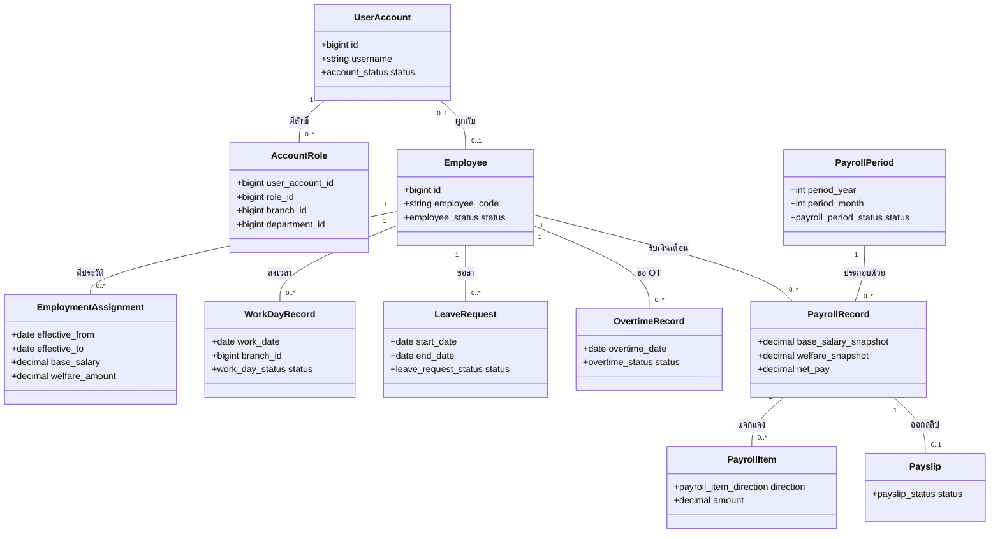

ภาพที่ 5.1 แสดง attribute สำคัญเท่านั้น ตารางเชื่อมอื่น เช่น `leave_request_days`, `leave_quotas`, `loan_installments`, `payroll_adjustments` และ `audit_logs` แสดงใน ER Diagram และ Data Dictionary บทที่ 4 โดยมีความหมายดังนี้

| ความสัมพันธ์ | หลักเกณฑ์ที่ต้องรักษา | ผลต่อ Use Case |
|---|---|---|
| `employees` → `employment_assignments` | พนักงานมีหลายช่วงได้ แต่ช่วงวันที่มีผลห้ามทับกัน; เมื่อย้ายสาขาหรือเปลี่ยนค่าจ้างให้ปิดช่วงเดิมและเพิ่มช่วงใหม่ | UC04, UC10 |
| `employees` → `work_day_records` | หนึ่งคนมีได้หนึ่งระเบียนต่อวัน; `branch_id` เป็นภาพข้อมูล ณ วันทำงาน ไม่คำนวณย้อนหลังจากสังกัดปัจจุบัน | UC05, UC10 |
| `leave_requests` → `leave_request_days` และ `leave_approval_actions` | วันลาและผลอนุมัติต้องสอดคล้องกัน; action ใช้เก็บลำดับการพิจารณา | UC06, UC10 |
| `overtime_records` → `overtime_approval_actions` | OT จะนับเป็นค่าจ้างเมื่ออนุมัติแล้ว; บันทึกผู้ตัดสินและเวลา | UC07, UC10 |
| `payroll_periods` → `payroll_records` → `payroll_items` | หนึ่งพนักงานมีผลเงินเดือนหนึ่งระเบียนต่อรอบ; รายการย่อยอธิบายที่มาของยอดรวม | UC09–UC11 |
| `payroll_records` → `payslips` | ผลเงินเดือนหนึ่งระเบียนมีสลิปได้ไม่เกินหนึ่งรายการ | UC12 |

ค่าที่เกี่ยวกับเงินต้องเป็น decimal ตาม schema และกฎการปัดเศษของชั้นคำนวณเงินเดือน การแสดงความสัมพันธ์ใน Class Diagram จึงมีจุดประสงค์เพื่ออธิบายความรับผิดชอบของข้อมูล ไม่ให้แอปพลิเคชันคำนวณเงินด้วยจำนวนทศนิยมแบบ floating point โดยตรง

### 5.2 State Diagram

สถานะในหัวข้อนี้อิง enum ของ DBML และขั้นตอนในบริการ backend การมีสถานะใน enum ไม่ได้แปลว่าผู้ใช้ทุกบทบาทสามารถเปลี่ยนไปยังทุกสถานะได้ การเปลี่ยนสถานะต้องตรวจตัวตน ขอบเขต และข้อมูลที่เกี่ยวข้องก่อนเสมอ

#### 5.2.1 State Diagram ของคำขอลาและ OT

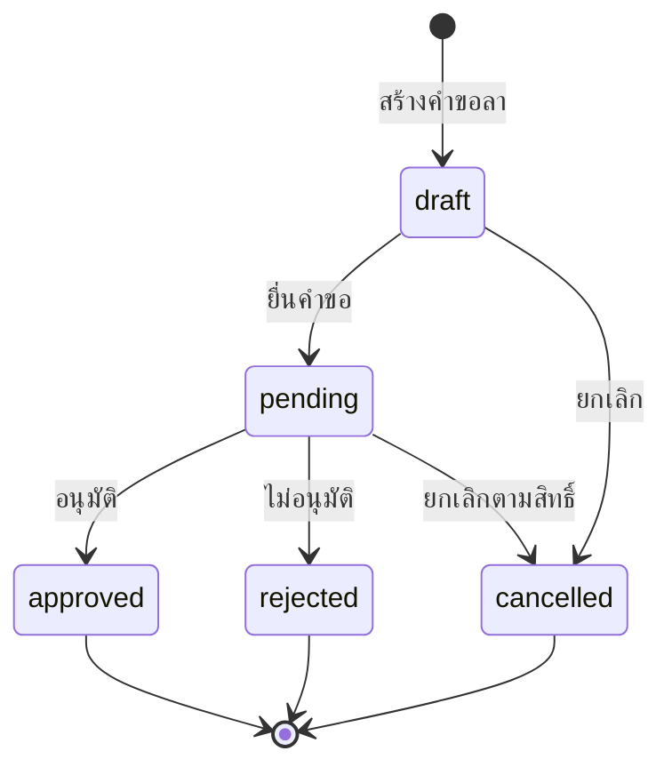

ภาพที่ 5.2 เป็นวงจรของ `leave_requests` คำขอเริ่มจาก `draft` และเข้าสู่ `pending` เมื่อส่งให้พิจารณา ผู้มีอำนาจอนุมัติหรือปฏิเสธต้องมีสิทธิ์ในสาขาหรือแผนกของพนักงาน หัวหน้าแผนกอนุมัติได้ไม่เกิน 3 วัน ส่วนผู้จัดการสาขาอนุมัติได้ทุกจำนวนวันภายในสาขา การอนุมัติใช้ธุรกรรมเดียวกับการปรับโควตาและบันทึกวันลาที่มีผลต่อการลงเวลา การเปลี่ยนประเภทลาระหว่างพิจารณาต้องเก็บ `from_leave_type_id` และ `to_leave_type_id` ใน `leave_approval_actions`

`overtime_records` เริ่มที่ `pending` และเปลี่ยนเป็น `approved`, `rejected` หรือ `cancelled` ตามสิทธิ์และเงื่อนไขของคำขอ โดยมี `overtime_approval_actions` เก็บการตัดสินใจแยกจากสถานะล่าสุด ระบบไม่ตีความเวลาออกงานหลังเวลาเลิกงานว่าเป็น OT ที่จ่ายได้ทันที เพราะต้องมีคำขอและการอนุมัติ

| กรณี | การตรวจเงื่อนไขก่อนเปลี่ยนสถานะ | หลักฐานที่ต้องเก็บ |
|---|---|---|
| ยื่นใบลา | วันลาไม่ทับซ้อน ตรวจประเภทลา จำนวนวัน และสิทธิ์ผู้ยื่น | `leave_requests`, `leave_approval_actions` |
| อนุมัติใบลา | ตรวจบทบาท ขอบเขต เพดาน 3 วันของ Supervisor และโควตา | action, วันลา, ยอดโควตา และผลต่อ attendance |
| พิจารณา OT | ตรวจคำขอเดิม ขอบเขตผู้อนุมัติและชนิด OT | `overtime_approval_actions` |
| ยกเลิก | ตรวจว่ารายการยังยกเลิกได้และไม่กระทบรอบที่ล็อกแล้ว | action และ audit log |

#### 5.2.2 State Diagram ของรอบเงินเดือน

```mermaid
stateDiagram-v2
    [*] --> draft: เปิดรอบ
    draft --> previewed: คำนวณตัวอย่าง
    previewed --> previewed: คำนวณใหม่
    previewed --> locked: ตรวจครบและล็อก
    locked --> [*]
```

ภาพที่ 5.3 แสดงสถานะ `payroll_periods` รอบใหม่อยู่ใน `draft` การ preview อ่านข้อมูลต้นทางตามช่วงวันที่และสร้างหรือปรับผลคำนวณที่ยังแก้ได้ เมื่ออยู่ใน `previewed` ผู้รับผิดชอบต้องตรวจจำนวนพนักงาน รายได้ รายการหัก และข้อผิดพลาดก่อนล็อก ระบบปฏิเสธการล็อกหาก attendance ไม่ครบ มีคำขอค้างอนุมัติ หรือยอดสุทธิติดลบ จากนั้นบันทึก snapshot ค่าจ้าง สวัสดิการ และรายการคำนวณที่เกี่ยวข้องเพื่อรักษาที่มาของยอด

หลังเป็น `locked` ไม่แก้ `payroll_records` หรือ `payroll_items` ย้อนหลังผ่านขั้นตอนปกติ หากตรวจพบค่าคลาดเคลื่อน ให้ขอ `payroll_adjustments` ที่ระบุผลเงินเดือนเดิม เหตุผล ทิศทางจำนวนเงิน และรอบที่จะนำไปใช้ การอนุมัติและนำรายการปรับปรุงไปใช้มีสถานะของตัวเอง (`pending`, `approved`, `rejected`, `applied`) ซึ่งไม่ใช่การปลดล็อกรอบเดิม

#### 5.2.3 State Diagram ของสลิปและการบันทึกการส่ง

```mermaid
stateDiagram-v2
    [*] --> generated: ออกจากรายการเงินเดือนที่ล็อกแล้ว
    generated --> generated: เพิ่มประวัติการส่งหนึ่งครั้ง
    generated --> voided: เพิกถอนตามสิทธิ์
    voided --> [*]
```

ภาพที่ 5.4 แสดง `payslips` ซึ่งมี `generated` และ `voided` การสร้างต้องอ้าง `payroll_record` ที่ล็อกแล้วและไม่สร้างสลิปซ้ำให้ record เดียวกัน ส่วน `email_delivery_logs` มีสถานะ `pending`, `sent`, `failed` แยกหนึ่งแถวต่อหนึ่งครั้งที่พยายามส่ง บริการในโค้ดปัจจุบันเป็น **mock delivery** จึงใช้ประวัติการส่งเพื่อทดสอบ workflow แต่ยังไม่ใช่หลักฐานว่าอีเมลถึงผู้รับจริง และยังไม่มีไฟล์ PDF ที่ผู้ใช้ดาวน์โหลดได้

### 5.3 Data Flow Diagram

DFD ระดับบริบทแสดงผู้ส่งข้อมูลเข้าระบบและผลลัพธ์ที่ได้รับ ไม่แสดงว่าผู้ใช้ภายนอกเข้าถึง data store ได้โดยตรง

```mermaid
flowchart LR
    E[พนักงาน] -->|ข้อมูลตน คำขอลา/OT| P((Haris Payroll))
    S[หัวหน้า/ผู้จัดการสาขา] -->|บันทึกเวลา ผลอนุมัติ| P
    H[HR/บัญชี] -->|ข้อมูลจ้าง รายการการเงิน คำสั่งคำนวณ| P
    O[เจ้าของร้าน] -->|ข้อมูลตั้งต้น นโยบาย การตรวจผล| P
    P -->|สถานะคำขอ สลิปตนเอง| E
    P -->|รายการในขอบเขตและผลอนุมัติ| S
    P -->|ผลเงินเดือนและ CSV| H
    P -->|ภาพรวมและประวัติการกระทำ| O
```

ภาพที่ 5.5 เป็น DFD ระดับบริบท โดยระบบเป็นกระบวนการเดียว ขอบเขตจริงตรวจที่ backend ทุกคำขอ เช่น Employee ดูเฉพาะของตน Supervisor ดูเฉพาะแผนก และ Branch Manager ดูเฉพาะสาขา

DFD ระดับที่ 1 แยกกระบวนการหลักและคลังข้อมูลตาม DBML

```mermaid
flowchart LR
    A[ผู้ใช้ที่ผ่านการยืนยันตัวตน] --> P1((1 จัดการองค์กรและพนักงาน))
    A --> P2((2 บันทึกงานและพิจารณาคำขอ))
    A --> P3((3 จัดการรายการการเงิน))
    A --> P4((4 คำนวณและล็อกรอบ))
    A --> P5((5 ออกผลและตรวจสอบ))
    P1 <--> D1[(D1 องค์กร บัญชี และประวัติการจ้าง)]
    P2 <--> D2[(D2 เวลา ลา และ OT)]
    P3 <--> D3[(D3 เงินทดรอง เงินกู้ และหนี้)]
    D1 --> P4
    D2 --> P4
    D3 --> P4
    P4 <--> D4[(D4 รอบ ผลเงินเดือน และรายการย่อย)]
    D4 --> P5
    P5 <--> D5[(D5 สลิปและประวัติการส่ง)]
    P1 --> D6[(D6 Audit)]
    P2 --> D6
    P3 --> D6
    P4 --> D6
    P5 --> D6
```

| คลังข้อมูล | ตารางหลักใน DBML | ข้อมูลที่ใช้ในกระบวนการ |
|---|---|---|
| D1 | `shops`, `branches`, `departments`, `positions`, `employees`, `user_accounts`, `user_account_roles`, `employment_assignments` | สังกัด สิทธิ์ และค่าตอบแทนตามวันที่มีผล |
| D2 | `work_day_records`, `leave_requests`, `leave_request_days`, `overtime_records` และตาราง approval | วันที่ทำงาน วันลา และ OT ที่ได้รับอนุมัติ |
| D3 | `advance_requests`, `loans`, `loan_installments`, `debt_transactions` | รายการรับล่วงหน้าและยอดหักที่สัมพันธ์กับรอบ |
| D4 | `payroll_configurations`, `payroll_periods`, `payroll_records`, `payroll_items`, `payroll_adjustments` | กฎคำนวณ ผลคำนวณ และประวัติปรับปรุง |
| D5 | `payslips`, `email_delivery_logs` | metadata สลิปและความพยายามส่ง |
| D6 | `audit_logs` | actor, action, target, เวลา และค่าที่เปลี่ยนโดยปกปิดข้อมูลลับ |

ภาพที่ 5.6 แสดงว่าการคำนวณเงินเดือนต้องอ่านข้อมูลต้นทางหลายกลุ่มและบันทึกผลใน D4 เมื่อรอบล็อกแล้ว P5 อ่านผลที่ยืนยันแล้วเพื่อสร้างสลิปหรือส่งออก CSV ไม่คำนวณยอดใหม่อย่างเงียบ ๆ ระหว่างสร้างเอกสาร

## บทที่ 6 Software Development Platform

### 6.1 Frontend Development

ส่วนติดต่อผู้ใช้เป็นเว็บแอป Next.js 16 และ React 19 เขียนด้วย TypeScript จัดรูปแบบด้วย Tailwind CSS และองค์ประกอบ UI ใน `frontend/components/` มี TanStack Query เป็น dependency สำหรับจัดการข้อมูลที่เรียกจาก API หน้าหลักอยู่ใน `frontend/app/(dashboard)/` ส่วน `/login` แยกออกจากพื้นที่งาน เพื่อให้การเข้าสู่ระบบและหน้าที่ตามบทบาทมีเส้นทางชัดเจน

| ส่วนประกอบ | หน้าที่ในระบบ | หลักฐานโครงการ |
|---|---|---|
| Next.js App Router | กำหนด route, layout และหน้าแต่ละงาน | `frontend/app/` |
| React + TypeScript | จัดสถานะฟอร์ม ตาราง และข้อมูลจาก API | ไฟล์ `page.tsx` และ `frontend/lib/` |
| Tailwind CSS + UI components | จัดโครงหน้า ข้อความสถานะ ปุ่ม ฟอร์ม และตาราง | `frontend/components/` |
| API client | ส่งคำขอและแปลงข้อผิดพลาดเป็นข้อความให้ผู้ใช้เข้าใจ | `frontend/lib/api/` |

การซ่อนเมนูตามบทบาทช่วยให้ผู้ใช้เห็นงานที่เกี่ยวข้อง แต่ไม่ถือเป็นมาตรการอนุญาตหลัก เพราะผู้ใช้อาจเรียก URL หรือ API โดยตรงได้ การตรวจ role และ scope จึงต้องอยู่ที่ backend ด้วย

### 6.2 Backend Development

Backend ใช้ Bun เป็น runtime, Elysia เป็น HTTP framework และ TypeScript สำหรับโค้ด Drizzle ORM ติดต่อ PostgreSQL 16 ผ่าน `pg` โดยแยกงานเป็น feature เช่น employee, attendance, leave, overtime, advance, payroll, payslip และ reports ชั้นงานหลักไหลจาก route → controller → service → repository → database

| ชั้นงาน | ความรับผิดชอบ | ตัวอย่างความสัมพันธ์กับรายงาน |
|---|---|---|
| Route | กำหนด path, method, schema ของคำขอ และการยืนยันตัวตน | `/api/v1/payslips`, `/api/v1/reports` |
| Controller | รับค่าจาก HTTP และจัดรูปผลลัพธ์ผ่าน mapper | รับ `record_id` แล้วเรียกบริการสร้างสลิป |
| Service | บังคับสิทธิ์ กฎธุรกิจ การคำนวณ และ transaction | อนุมัติใบลา ล็อกรอบเงินเดือน |
| Repository | อ่านและเขียนฐานข้อมูลตามเจตนาของบริการ | อ่าน assignment ที่มีผล หรือบันทึก payroll item |
| Database | บังคับ FK, unique, check และเก็บข้อมูลย้อนหลัง | PostgreSQL 16 และ Drizzle schema |

โครงสร้างนี้ทำให้ UC ในรายงานโยงจากพฤติกรรมผู้ใช้ไปยัง API และตารางได้ เช่น UC06 ต้องตรวจสิทธิ์ผู้อนุมัติใน service และบันทึกหลายตารางภายใต้ transaction เดียว ข้อมูลเงินใช้ชนิด decimal ในฐานข้อมูลและชั้นคำนวณ การยืนยันตัวตนใช้ session/cookie ตามโค้ดปัจจุบัน; ห้ามเก็บรหัสผ่านหรือ token ใน audit log

### 6.3 User Interface Design and Development

FigJam ใช้เป็นต้นทางของ Business Process, Use Case Diagram และ ERD เชิงวิเคราะห์ ส่วนหน้าจอที่ใช้งานจริงตรวจได้จากโค้ดใน `frontend/app/` หลักการออกแบบคือให้ผู้ใช้ทำงานตามบทบาท แสดงข้อมูลที่จำเป็นต่อการตัดสินใจและอธิบายเหตุที่ทำรายการไม่ได้ เช่น วันลาทับซ้อน คำขออยู่นอกขอบเขต หรือรอบเงินเดือนยังมีข้อมูลค้างตรวจ

คำศัพท์ที่ใช้ในหน้าจอควรสอดคล้องกันทั้งรายงานและ API: “รอบเงินเดือน” ใช้กับ `payroll_periods`, “ผลเงินเดือนรายคน” ใช้กับ `payroll_records`, “รายการเงินเดือน” ใช้กับ `payroll_items` และ “รายการปรับปรุง” ใช้กับ `payroll_adjustments` การอธิบายเช่นนี้ช่วยแยกยอดที่คำนวณใหม่ก่อนล็อกจากยอดประวัติที่ล็อกแล้ว

### 6.4 เครื่องมือและการตรวจสอบ

Git ใช้ติดตามการแก้ไขโครงการ โดย `frontend/` และ `backend/` เป็น submodule Docker Compose กำหนดบริการ PostgreSQL สำหรับการพัฒนา คำสั่งที่โครงการกำหนด ได้แก่ `bun run typecheck`, `bun test` ใน backend และ `bun run lint`, `bun run build`, `bun test` ใน frontend ชุดทดสอบที่พึ่งฐานข้อมูลต้องใช้ PostgreSQL ที่ migrate แล้วและ `TEST_DATABASE_URL` ซึ่งชี้ไปฐานข้อมูลทดสอบที่ลบทิ้งได้

เอกสาร `specs/012-system-completion/tasks.md` ระบุว่า backend workflow และหน้า dashboard หลักมีแล้ว แต่การทดลองครบทุกบทบาทด้วยข้อมูลทดสอบชุดเดียว การเก็บ screenshot และผลทดสอบรับรองระบบจริงยังเป็นงานที่ต้องทำ การระบุเครื่องมือในบทนี้จึงเป็นการบอก platform ของโครงการ มิใช่การอ้างว่าระบบพร้อมใช้กับข้อมูลเงินจริงแล้ว

## บทที่ 7 การออกแบบส่วนติดต่อผู้ใช้

### 7.1 UI Structure

ผู้ใช้เริ่มที่ `/login` เมื่อเข้าสู่ระบบจึงใช้ `/dashboard` และเมนูของ role ที่ได้รับ เส้นทาง dashboard ที่พบในโค้ดแสดงในตาราง โดย route เดียวอาจให้ข้อมูลหรือคำสั่งต่างกันตาม actor

| กลุ่มหน้า | Route ที่มีในโค้ด | ผู้ใช้หลัก | Use Case และข้อสังเกต |
|---|---|---|---|
| เข้าสู่ระบบ/ภาพรวม | `/login`, `/dashboard` | ทุกบทบาท | UC01; การนำทางหลัง login ยังอยู่ในแผนปรับ UX |
| บัญชีและองค์กร | `/accounts`, `/accounts/new`, `/accounts/[accountId]`, `/organization`, `/settings` | HR, Owner ตามสิทธิ์ | UC02–UC03; หน้า settings จำกัด Owner |
| พนักงาน | `/employees`, `/employees/new`, `/employees/[employeeId]`, `/employees/[employeeId]/employment`, `/bank`, `/weekly-holidays`, `/documents` | HR, Owner, ผู้จัดการตาม scope; พนักงานดูของตน | UC04; `/documents` ยังเป็นงานที่ต้องเติม upload/download |
| งานประจำวัน | `/attendance`, `/leave`, `/overtime` | พนักงาน หัวหน้า ผู้จัดการตามสิทธิ์ | UC05–UC07; ประวัติการตัดสินใจใน UI ยังต้องเติม |
| การเงินและเงินเดือน | `/finance`, `/payroll` | HR, Owner; ผู้จัดการดู payroll เฉพาะสาขา | UC08–UC11; employee advance ผ่าน UI ยังอยู่ในแผนปรับ |
| ผลลัพธ์และตรวจสอบ | `/payslips`, `/reports`, `/audit` | พนักงานดูสลิปตน, HR, Owner | UC12–UC14; report page มี CSV สองชนิด |

เส้นทางจริงของ Next.js ในตารางเขียนโดยละ prefix กลุ่ม `(dashboard)` เพราะชื่อกลุ่ม route ไม่เป็นส่วนหนึ่งของ URL การเข้า route โดยพิมพ์ที่อยู่เองยังต้องผ่านการยืนยันตัวตนและ backend scope เช่นเดียวกับการกดเมนู

### 7.2 User Interface Design

ส่วนนี้อธิบายหน้าจอหนึ่งกรณีใช้ต่อหนึ่งหัวข้อ โดยใช้ route ที่พบใน `frontend/app/` และพฤติกรรมที่อ่านได้จากหน้าจอปัจจุบัน คำว่า “ควร” หมายถึงข้อเสนอในแบบ To be ที่ยังต้องตรวจหรือพัฒนาเพิ่ม ส่วนสิทธิ์ในการอ่านและแก้ข้อมูลต้องยืนยันที่ backend ทุกครั้ง แม้หน้าจอจะซ่อนปุ่มตามบทบาทแล้ว ภาพประกอบฉบับส่งควรถ่ายจาก build ด้วยข้อมูลสาธิตที่ไม่ระบุตัวบุคคลจริง

#### 7.2.1 หน้าจอเข้าสู่ระบบ (UC01)

ผู้ใช้เปิด `/login` และกรอกชื่อผู้ใช้กับรหัสผ่าน เมื่อส่งฟอร์ม ระบบเรียก API ยืนยันตัวตนและนำผู้ใช้เข้าสู่พื้นที่งานตาม session หน้าแสดงข้อความเมื่อข้อมูลไม่ครบหรือเข้าสู่ระบบไม่สำเร็จโดยไม่เปิดเผยว่าชื่อผู้ใช้มีอยู่จริงหรือไม่ หากบัญชีถูกล็อกหรือปิดใช้งาน ผู้ใช้ต้องเห็นข้อความที่บอกขั้นตอนถัดไปโดยไม่เปิดเผยรายละเอียดด้านความปลอดภัย เส้นทาง `/dashboard` เป็นหน้าเริ่มต้นของพื้นที่งานหลังเข้าสู่ระบบ

แบบ To be ควรนำผู้ใช้ไปยังงานแรกที่บทบาทเข้าถึงได้จริง ขณะที่ completion plan ระบุว่ายังต้องปรับการเปลี่ยนหน้าหลัง login เพื่อไม่ส่งทุกบัญชีไป `/payroll` และต้องเพิ่มการเปลี่ยนรหัสผ่านชั่วคราวด้วยตนเอง ดังนั้นภาพรายงานควรแสดงเฉพาะหน้าจอที่ build ปัจจุบันทำได้

#### 7.2.2 หน้าจอจัดการบัญชีและสิทธิ์ (UC02)

ผู้มีสิทธิ์ใช้ `/accounts` เพื่อค้นบัญชีและตรวจสถานะ เปิด `/accounts/new` เพื่อสร้างบัญชี และเปิด `/accounts/[accountId]` เพื่อดูรายละเอียดบัญชีที่มีอยู่ ข้อมูลที่แสดงควรแยก “บัญชีผู้ใช้” ออกจาก “พนักงานที่ผูกกับบัญชี” เพราะอาจมีบัญชีผู้ดูแลที่ทำรายการให้ผู้อื่น หน้าแก้ไขมีบทบาทและขอบเขตสาขาหรือแผนกสำหรับ role grant รวมทั้งคำสั่งเปิด/ปิดบัญชีและปลดล็อกตามสิทธิ์

ก่อนบันทึกต้องตรวจรูปแบบข้อมูลและแจ้งผลจาก server เช่น ชื่อผู้ใช้ซ้ำ ขอบเขตไม่ตรงประเภท role หรือการถอน Owner คนสุดท้าย ระบบต้องไม่เผยรหัสผ่านชั่วคราวซ้ำหลังสร้างบัญชีและไม่แสดง hash ใน UI การกำหนดสิทธิ์ที่เห็นในหน้านี้เป็นการจัดการสิทธิ์จริงผ่าน backend ไม่ใช่เพียงการเลือกเมนูที่แสดงใน sidebar

#### 7.2.3 หน้าจอข้อมูลร้านและโครงสร้างองค์กร (UC03)

หน้า `/organization` ใช้ดูและจัดข้อมูลร้าน สาขา แผนก และตำแหน่ง โดยแสดงความสัมพันธ์ว่าข้อมูลแต่ละรายการอยู่ภายใต้ร้านหรือสาขาใด ส่วน `/settings` มีขั้นตอนเตรียมข้อมูลตั้งต้นสำหรับ Owner ได้แก่ ร้าน สาขา บัญชี และบทบาท ผู้ใช้ควรเห็นชื่อและรหัสอ้างอิงพร้อมสถานะเปิดใช้ และเมื่อปิดข้อมูลที่มีผู้ใช้งานอยู่ต้องได้รับคำอธิบายผลกระทบก่อนยืนยัน

การแก้ข้อมูลต้นทางต้องรักษาประวัติการจ้างที่อ้างข้อมูลนั้นอยู่ จึงไม่ควรมีปุ่มลบถาวรสำหรับรายการที่ส่งผลต่อ payroll ส่วนการจัดตารางเวลาสาขาและวันหยุดราชการมี API ใน backend แต่ completion plan ระบุว่ายังไม่มี workspace ที่พร้อมใช้งานผ่านเมนู จึงไม่แสดงว่าเป็นหน้าจอของ UC03 ที่ส่งมอบแล้ว

#### 7.2.4 หน้าจอจัดการพนักงานและประวัติการจ้าง (UC04)

หน้า `/employees` แสดงรายชื่อ ค้นหา และเปิด `/employees/[employeeId]` เพื่อดูรายละเอียด ผู้มีสิทธิ์ใช้ `/employees/new` เพิ่มพนักงาน หน้าย่อย `/employment` แสดงประวัติสังกัด ตำแหน่ง ฐานเงินเดือน สวัสดิการ และช่วงวันที่มีผล; `/bank` จัดบัญชีธนาคาร; `/weekly-holidays` จัดวันหยุดประจำสัปดาห์ การเพิ่มหรือย้ายสังกัดควรให้ระบุวันที่เริ่มมีผลและแสดงช่วงเดิมเพื่อให้ตรวจว่าช่วงไม่ทับกัน

หน้าจอต้องจำกัดรายละเอียดตาม role: Employee เห็นเฉพาะข้อมูลตนเอง Supervisor และ Branch Manager เห็นเฉพาะขอบเขต โดยไม่เผยค่าจ้างหรือเลขบัญชีเต็มแก่ผู้ไม่มีหน้าที่ หน้า `/employees/[employeeId]/documents` มี route อยู่ แต่การอัปโหลด/ดาวน์โหลดเอกสารพร้อมนโยบายเก็บรักษายังเป็นงานใน completion plan จึงไม่ควรใช้ภาพหน้านี้เป็นหลักฐานว่าจัดเอกสารได้ครบแล้ว

#### 7.2.5 หน้าจอบันทึกเวลาทำงาน (UC05)

หน้า `/attendance` ให้เลือกพนักงานและช่วงวันแล้วกด “โหลดรายการ” ตารางแสดงวันที่ สาขา สถานะ เวลาเข้า–ออก นาทีสาย สถานะหักเงิน และแหล่งที่มา ผู้มีสิทธิ์ใช้ฟอร์ม “บันทึกวันทำงาน” เพื่อเลือกสาขา วันที่ สถานะ เวลาเข้า–ออก นาทีสาย และหมายเหตุ ส่วนฟอร์ม “แก้ไขรายการ” ให้เลือกระเบียนเดิมและกรอกเหตุผลก่อนบันทึก

ระบบต้องแจ้งรายการว่างหรือข้อผิดพลาดจาก API อย่างชัดเจน และ backend ต้องปฏิเสธวันซ้ำ ข้อมูลนอก scope และการแก้วันที่อยู่ในรอบที่ล็อกแล้ว สาขาที่แสดงในตารางเป็นข้อมูล ณ วันทำงาน ไม่เปลี่ยนตามสังกัดปัจจุบัน ปัจจุบันฟอร์มบางจุดยังใช้รหัสสาขาและรหัสอ้างอิงโดยตรง การเปลี่ยนเป็นตัวเลือกชื่อสาขาตามสิทธิ์เป็นงานปรับ UX ที่ยังอยู่ใน completion plan

#### 7.2.6 หน้าจอคำขอลาและการพิจารณา (UC06)

หน้า `/leave` แสดงคำขอตามพนักงาน ช่วงวัน จำนวนวัน ประเภทลา เหตุผล และสถานะ พนักงานเห็นคำขอของตนและใช้ฟอร์ม “ส่งคำขอลาใหม่” ผู้มีสิทธิ์ในสาขาหรือแผนกโหลดคำขอของพนักงานที่ดูแล คำขอ `pending` มีแบบฟอร์มแก้ไขตามสิทธิ์ ผู้อนุมัติเห็นตัวเลือกเปลี่ยนประเภทลาและช่องหมายเหตุ พร้อมปุ่ม “อนุมัติ” หรือ “ไม่อนุมัติ”

เมื่อวันลาทับซ้อน โควตาไม่เพียงพอ สถานะเปลี่ยนไปแล้ว หรือ Supervisor อนุมัติเกิน 3 วัน หน้าแสดงข้อผิดพลาดจาก server และไม่สมมติว่าการซ่อนปุ่มเพียงอย่างเดียวป้องกันการทำรายการได้ ประวัติการตัดสินใจและประเภทลาที่ผู้อนุมัติแก้มีใน backend แต่ completion plan ระบุว่ายังต้องแสดงประวัตินี้ใน workspace อย่างครบถ้วน

#### 7.2.7 หน้าจอคำขอ OT และการพิจารณา (UC07)

หน้า `/overtime` แสดงรายการ OT ของพนักงานที่เลือก วันที่ ชนิด OT จำนวนชั่วโมงหรือหน่วยวัน เหตุผล และสถานะ ผู้มีสิทธิ์ใช้ฟอร์มส่งคำขอใหม่และปุ่มอนุมัติหรือไม่อนุมัติสำหรับคำขอ `pending` การออกงานช้ากว่าเวลาเลิกงานไม่ทำให้รายการนั้นเป็น OT ที่จ่ายได้โดยอัตโนมัติ ผู้ใช้จึงต้องเห็นสถานะอนุมัติก่อนนำไปคิดเงินเดือน

กรณีคำขออยู่นอกขอบเขต คำขอถูกพิจารณาแล้ว หรือข้อมูลชนิด OT ไม่ครบ หน้าแสดงข้อผิดพลาดจาก API และไม่แก้รายการที่รอบเงินเดือนล็อกแล้ว ประวัติ approval action ใน backend ยังต้องแสดงในหน้าจอให้ครบก่อนถือว่า UX การตรวจย้อนหลังสมบูรณ์

#### 7.2.8 หน้าจอเงินทดรอง เงินกู้ และหนี้ (UC08)

หน้า `/finance` ให้เลือกพนักงานแล้วกด “โหลดข้อมูลการเงิน” ภายในหน้าแบ่งเป็นสามส่วน: คำขอเงินทดรองพร้อมยอดและสถานะ; เงินกู้พร้อมเงินต้น ยอดคงเหลือ และงวดชำระ; บัญชีหนี้พร้อมยอดคงเหลือและธุรกรรมแต่ละครั้ง ฟอร์มเงินทดรองรับจำนวนเงินและแสดงปุ่มอนุมัติ/ไม่อนุมัติเมื่อคำขอรอพิจารณา ฟอร์มเงินกู้รับยอด จำนวนงวด เดือนเริ่มชำระและเหตุผล ส่วนฟอร์มหนี้รับประเภท จำนวนเงินและคำอธิบาย หากบันทึกผิดให้สร้างรายการกลับรายการพร้อมเหตุผลแทนการลบรายการเดิม

Backend ตรวจเงื่อนไขเงินทดรอง เช่น วันที่ยื่น การทำงานครบตามเกณฑ์ เพดานครึ่งหนึ่งของฐานเงินเดือน และเงินสุทธิหลังหักต้องไม่ติดลบ แต่หน้าจอปัจจุบันยังรวมงานหลายบทบาทใน workspace เดียว และบางช่องใช้รหัสประเภทหนี้โดยตรง Completion plan กำหนดให้แยก Employee self-service ออกจากงานอนุมัติของ HR/Owner และเปลี่ยนรหัสเป็นตัวเลือกชื่อที่เข้าใจง่าย

#### 7.2.9 หน้าจอตั้งค่าเงินเดือนและเปิดรอบ (UC09)

หน้า `/payroll` ให้ผู้มีสิทธิ์เลือกร้านและกด “เปิดสมุดงาน” ก่อนทำรายการ ส่วน “เพิ่มค่าคำนวณแบบ effective-dated” รับชนิดค่าคำนวณ ค่า หน่วย วันเริ่มมีผล และสาขาหรือทั้งร้าน ส่วน “เปิดรอบเงินเดือน” ให้เลือกเดือน แล้วระบบสร้างช่วงวันของเดือนนั้น แถบรอบเงินเดือนแสดงเดือน ปี ช่วงวันที่ และสถานะ; หนึ่งร้านมีได้หนึ่งรอบต่อเดือน

หากไม่มีร้านหรือค่าคำนวณที่จำเป็น หน้าแสดงความพร้อมของข้อมูลก่อน preview; หากรอบซ้ำหรือช่วง config ทับกัน backend ต้องปฏิเสธ ผู้จัดการสาขาเห็นสมุดงานในโหมดอ่านอย่างเดียวตามสาขา ส่วน Employee และ Supervisor ไม่ใช้หน้า payroll ปัจจุบัน การกรอกค่า config ต้องไม่ตีความว่าเป็นนโยบายที่ใช้ย้อนหลังทุกเดือน เพราะมีวันที่เริ่มและสิ้นสุดผลบังคับ

#### 7.2.10 หน้าจอคำนวณตัวอย่างเงินเดือน (UC10)

ผู้มีสิทธิ์เลือกหนึ่งรอบใน `/payroll` แล้วกด “คำนวณตัวอย่าง” หน้าแสดงตารางรายพนักงาน ได้แก่ รายได้รวม รายการหักรวม และเงินสุทธิ พร้อมปุ่ม “ดูรายการ” เพื่อเปิดหลักฐานค่าฐานเงินเดือน สวัสดิการ รายการย่อย ทิศทางจำนวนเงิน และแหล่งข้อมูลที่ใช้คำนวณ ส่วนบนแสดง blocker เมื่อข้อมูลลงเวลาไม่ครบ มีคำขอค้าง หรือเงื่อนไขอื่นทำให้ล็อกไม่ได้

การกด preview อีกครั้งก่อนล็อกต้องอ่านข้อมูลที่มีผลตามวันและแสดงผลใหม่ จึงควรระบุสถานะเป็นผลคำนวณตัวอย่าง ไม่เรียกว่าเงินเดือนที่จ่ายแล้ว ปัจจุบัน UI แสดงรหัสพนักงานหรือสาขาบางตำแหน่งแทนชื่อ และ completion plan ระบุให้ปรับเป็นตัวเลือกและป้ายชื่อที่อ่านง่ายยิ่งขึ้น

#### 7.2.11 หน้าจอล็อกรอบและรายการปรับปรุง (UC11)

หน้า `/payroll` แสดงปุ่ม “ล็อกรอบ” สำหรับผู้มีสิทธิ์เมื่อเลือกรอบที่ยังไม่ล็อก ก่อนส่งคำขอมีหน้าต่างยืนยันว่าผลคำนวณและรายการหักจะถูกตรึงเป็นประวัติ หาก backend พบ blocker หน้าแสดงเหตุที่ยังล็อกไม่ได้และให้ผู้ใช้กลับไปแก้ข้อมูลต้นทาง เมื่อสำเร็จสถานะรอบเปลี่ยนเป็น `locked` และปุ่ม preview/lock ถูกปิดสำหรับรอบนั้น

ส่วน “Adjustment หลังล็อกรอบ” รับรหัส payroll record เดิม รหัสรอบปลายทาง ทิศทาง จำนวนเงิน และเหตุผล แล้วส่งคำขอปรับปรุงโดยไม่แก้ยอดเดิม ปัจจุบัน UI ยังไม่มีหน้ารายการ pending/ย้อนหลังและการอนุมัติ adjustment ครบตาม completion plan จึงไม่ควรอธิบายว่าผู้ใช้ทำวงจรการปรับปรุงทั้งหมดได้จากหน้านี้แล้ว

#### 7.2.12 หน้าจอสลิปเงินเดือน (UC12)

หน้า `/payslips` แสดงสองมุมมอง: พนักงานเห็นรายการสลิปของตนพร้อมวันออกและยอดสุทธิ; HR/Owner มีฟอร์ม “ออกสลิปใหม่” จาก locked payroll record ID, ฟอร์มเปิดสลิปจาก payslip ID, ส่วนยอดสรุป และประวัติการส่ง ผู้ดูแลใช้ปุ่ม “ยกเลิกสลิป” เมื่อสถานะยังเป็น `generated` และใช้ฟอร์มบันทึกอีเมลผู้รับเพื่อเพิ่มประวัติหนึ่งครั้งต่อหนึ่งความพยายาม

Backend ต้องปฏิเสธการออกสลิปซ้ำ การออกจาก record ที่ยังไม่ล็อก และการอ่านสลิปพนักงานอื่น หน้าแสดงข้อความผิดพลาดเมื่อทำรายการไม่ได้ ปัจจุบันพนักงานยังเปิดรายละเอียดหรือดาวน์โหลด PDF ผ่าน UI ไม่ได้ และปุ่มบันทึกการส่งเป็น mock delivery ไม่ใช่การส่งอีเมลจริง รายงานควรใช้คำว่า “บันทึกประวัติการส่งแบบจำลอง” อย่างชัดเจน

#### 7.2.13 หน้าจอรายงานส่งออก (UC13)

หน้า `/reports` รับรหัสรอบเงินเดือนและมีปุ่ม “ไฟล์โอนเงินธนาคาร (CSV)” กับ “รายงานประกันสังคม (CSV)” เมื่อคลิก หน้าเปิดคำขอไฟล์จาก API ในหน้าต่างใหม่ หากไม่ระบุรอบ ระบบแจ้งให้กรอกก่อน Query ใน backend อ่านเฉพาะข้อมูลรอบที่ล็อกแล้ว แต่กรณีเลือกรอบที่ยังไม่ล็อกจะได้ CSV ที่มีเพียงหัวตาราง จึงควรแจ้งสถานะรอบให้ชัดเจนก่อนดาวน์โหลด ข้อมูล CSV ธนาคารมีเลขบัญชีเต็ม จึงให้เฉพาะผู้มีสิทธิ์และต้องดูแลไฟล์หลังดาวน์โหลดอย่างเหมาะสม

ปัจจุบันหน้าใช้ `period_id` ที่ผู้ใช้กรอกเอง ยังไม่เลือกจากรายชื่อรอบที่มีสิทธิ์ และรายงานบริหารด้าน attendance, leave, OT, debt หรือ payroll summary ยังเป็นงานเพิ่มตาม completion plan ทางเลือกจ่ายผ่าน QR PromptPay ที่ปรากฏใน Business Process แบบ To be ยังไม่ใช่ปุ่มจ่ายเงินที่มีอยู่จริงในหน้านี้

#### 7.2.14 หน้าจอตรวจสอบประวัติการทำรายการ (UC14)

หน้า `/audit` ให้ผู้มีสิทธิ์ค้นและอ่านรายการเปลี่ยนแปลง ระบบแสดงเวลา actor การกระทำ ชนิดข้อมูลและระเบียนที่เกี่ยวข้อง พร้อมสถานะเมื่อไม่พบรายการหรือโหลดข้อมูลไม่สำเร็จ ข้อมูลเก่าหรือใหม่ที่เปิดอ่านได้ต้องผ่านการปกปิดรหัสผ่าน token เลขบัญชีเต็ม และข้อมูลอ่อนไหวอื่นก่อนแสดงผล

หน้าจอนี้ช่วยย้อนจากผลเงินเดือนที่ผิดปกติไปยังผู้บันทึกหรือผู้อนุมัติรายการต้นทาง แต่ audit log ไม่ใช่สิทธิ์แก้ผลที่ล็อกแล้ว การตรวจสอบต้องใช้ร่วมกับประวัติการอนุมัติและรายการปรับปรุงใน UC06, UC07 และ UC11 ภาพตัวอย่างที่ใส่รายงานฉบับส่งต้องใช้ actor และข้อมูลสาธิต ไม่ใช้ข้อมูลบุคคลจริงจากเอกสารอ้างอิง

## บทที่ 8 ผลลัพธ์ คำสั่งข้อมูล และการทดสอบ

### 8.1 Output Design (Report)

ผลลัพธ์ของระบบมีทั้งข้อมูลที่แสดงบนหน้าจอและไฟล์ส่งออก ข้อมูลที่แสดงก่อนล็อกรอบเป็นผลคำนวณตัวอย่างที่ยังเปลี่ยนได้ ส่วนผลจากรอบที่ล็อกแล้วเป็นหลักฐานเงินเดือนที่ต้องตรวจย้อนหลังได้ การออกแบบ output จึงแสดงร้าน/รอบ พนักงาน รายการรายได้ รายการหัก ยอดสุทธิ และสถานะของรอบอย่างชัดเจน โดยผู้ใช้แต่ละบทบาทเห็นเฉพาะรายการในขอบเขต

| ผลลัพธ์ | รูปแบบและข้อมูลสำคัญ | แหล่งข้อมูล/เงื่อนไข | สถานะที่ตรวจได้ |
|---|---|---|---|
| ผลคำนวณรายคน | รายได้รวม รายการหักรวม สุทธิ และรายการย่อยพร้อมประเภท/จำนวนเงิน | `payroll_periods`, `payroll_records`, `payroll_items`; preview ก่อน lock | Backend และหน้า payroll มี workflow |
| สลิปเงินเดือน | เลขอ้างอิงผลเงินเดือน วันที่ออก สถานะ และยอดหลัก | `payslips` หนึ่งรายการต่อ `payroll_record` ที่ล็อกแล้ว | มี metadata/API; ยังไม่มี PDF ดาวน์โหลดจาก UI |
| ประวัติส่งสลิป | ผู้รับ เวลา สถานะ และข้อผิดพลาดรายครั้ง | `email_delivery_logs` | เป็น mock delivery; ยังไม่ยืนยันการส่งอีเมลจริง |
| CSV โอนเงินธนาคาร | `bank_code`, `account_number`, `account_holder`, `net_pay` | รอบที่ล็อกและบัญชีธนาคารที่ใช้ ณ เวลา export; บัญชีไม่ได้ถูก snapshot ในรอบ | มี route ส่งออก; ต้องปกป้องไฟล์เพราะมีข้อมูลการเงิน |
| CSV ประกันสังคม | `employee_code`, `employee_name`, `base_salary` | รอบที่ล็อก; ฐานคำนวณใช้ base salary ไม่รวม welfare | มี route ส่งออก |
| ประวัติการทำรายการ | actor, action, target, เวลา และเหตุผลตามที่บันทึก | `audit_logs`; ปกปิด token/hash/เลขบัญชีเต็ม | มี API และหน้า audit |

CSV ใช้ `GET /api/v1/reports/bank-transfer.csv?period_id=...` และ `GET /api/v1/reports/social-security.csv?period_id=...` Query ปัจจุบันคืนเฉพาะหัวตารางเมื่อรอบยังไม่ล็อก การปฏิเสธพร้อมข้อความอธิบายเป็นงานที่ควรปรับปรุง ข้อมูลตัวอย่างที่ใส่รายงานฉบับส่งควรมาจาก fixture ที่ไม่ระบุบุคคลจริง และต้องตรวจ encoding, หัวคอลัมน์, หน่วยเงิน และยอดรวมกับผลเงินเดือนในรอบเดียวกัน

### 8.2 SQL Statement ใน Use Case Description

ตารางต่อไปจับคู่ Use Case กับการอ่านหรือเขียนข้อมูลหลัก เพื่อให้ตามจากคำอธิบาย UC ไปยัง DBML ได้ คำสั่ง SQL ที่แสดงเป็น **แบบจำลองเชิงอธิบาย**; โค้ดจริงใช้ Drizzle repository และ service ซึ่งตรวจสิทธิ์ กฎธุรกิจ และธุรกรรมก่อนเขียนข้อมูล จึงไม่ควรใช้ SQL ตัวอย่างเป็นช่องทางแก้ฐานข้อมูลโดยตรง

| Use Case | ตารางหลัก | การอ่าน/เขียนที่เป็นแกนของกรณีใช้ |
|---|---|---|
| UC01 เข้าสู่ระบบ | `user_accounts`, `user_account_roles`, `roles` | อ่านบัญชีและ role; ปรับสถานะ lockout ตามกฎ |
| UC02 บัญชีและสิทธิ์ | `user_accounts`, `user_account_roles`, `roles` | สร้าง/แก้บัญชีและ role grant; audit |
| UC03 องค์กร | `shops`, `branches`, `departments`, `positions` | อ่านและแก้ข้อมูลต้นทางพร้อมสถานะ |
| UC04 พนักงาน | `employees`, `employment_assignments`, `employee_bank_accounts` | อ่านช่วงที่มีผล; เพิ่มประวัติช่วงใหม่ |
| UC05 ลงเวลา | `work_day_records`, `employment_assignments` | อ่านสังกัดตามวัน; เพิ่มหรือแก้วันทำงานตามกฎ |
| UC06 ลา | `leave_requests`, `leave_request_days`, `leave_quotas`, `leave_approval_actions` | ตรวจวันทับซ้อนและโควตา; บันทึกผลอนุมัติใน transaction |
| UC07 OT | `overtime_records`, `overtime_approval_actions` | ตรวจคำขอและผลอนุมัติ |
| UC08 การเงิน | `advance_requests`, `loans`, `loan_installments`, `debt_transactions` | อ่านยอดคงค้างและรายการที่ใช้ในรอบ |
| UC09 ตั้งค่า/เปิดรอบ | `payroll_configurations`, `payroll_periods` | อ่าน config ตามวันที่และเพิ่มรอบที่ไม่ซ้ำ |
| UC10 Preview | `employment_assignments`, `work_day_records`, `leave_request_days`, `overtime_records`, `payroll_records`, `payroll_items` | รวมข้อมูลต้นทาง คำนวณ และบันทึกผลตัวอย่าง |
| UC11 Lock/ปรับปรุง | `payroll_periods`, `payroll_records`, `payroll_adjustments` | ตรวจ blocker; lock snapshot; เพิ่มคำขอปรับปรุง |
| UC12 สลิป | `payroll_records`, `payslips`, `email_delivery_logs` | อ่าน record ที่ล็อก; สร้างสลิปหรือบันทึกการส่ง |
| UC13 ส่งออก | `payroll_periods`, `payroll_records`, `employee_bank_accounts` | อ่านรอบที่ล็อกและจัด CSV |
| UC14 Audit | `audit_logs`, `user_accounts` | ค้นรายการที่ actor และเวลาสัมพันธ์กัน |

**Q01 — เลือกประวัติการจ้างที่มีผลในวันทำงาน (UC04–UC05, UC10)**

```sql
SELECT ea.id, ea.employee_id, ea.branch_id, ea.department_id,
       ea.position_id, ea.base_salary, ea.welfare_amount
FROM employment_assignments AS ea
WHERE ea.employee_id = :employee_id
  AND ea.effective_from <= :work_date
  AND (ea.effective_to IS NULL OR ea.effective_to >= :work_date);
```

ผลควรมีช่วงเดียวต่อวันตามกฎไม่ให้ช่วงของพนักงานทับกัน และต้องใช้ `branch_id` ที่บันทึกใน `work_day_records` เมื่อตรวจเหตุการณ์ย้อนหลัง ไม่แทนค่าด้วยสังกัดปัจจุบัน

**Q02 — ตรวจคำขอลาที่รอพิจารณาในขอบเขตสาขา (UC06)**

```sql
SELECT lr.id, lr.employee_id, lr.start_date, lr.end_date,
       lr.requested_days, lr.status
FROM leave_requests AS lr
JOIN employment_assignments AS ea
  ON ea.employee_id = lr.employee_id
 AND ea.effective_from <= lr.start_date
 AND (ea.effective_to IS NULL OR ea.effective_to >= lr.start_date)
WHERE lr.status = 'pending'
  AND ea.branch_id = :authorized_branch_id;
```

ตัวอย่างนี้สื่อขอบเขต Branch Manager เท่านั้น การตรวจจริงต้องใช้ role grant ของ actor ฝั่ง server และสำหรับ Supervisor ต้องกรองแผนกด้วย กรณีช่วงลาเหลื่อมกับการย้ายสังกัดยังต้องกำหนดเกณฑ์เลือกผู้อนุมัติให้ชัดก่อนใช้เป็น SQL จริง

**Q03 — อ่าน OT ที่อนุมัติแล้วในช่วงรอบเงินเดือน (UC07, UC10)**

```sql
SELECT ot.id, ot.employee_id, ot.overtime_date,
       ot.overtime_type, ot.hours, ot.day_units
FROM overtime_records AS ot
WHERE ot.employee_id = :employee_id
  AND ot.overtime_date BETWEEN :start_date AND :end_date
  AND ot.status = 'approved';
```

ผลต้องแยกชนิด `rest_day`, `hourly`, `public_holiday` เพื่อใช้กฎอัตราที่ตรงประเภท ไม่รวมรายการ `pending` หรือ `rejected` ในค่าจ้าง

**Q04 — ตรวจรอบที่ล็อกแล้วและรายการผลเงินเดือน (UC11–UC13)**

```sql
SELECT pr.id, pr.employee_id, pr.base_salary_snapshot,
       pr.welfare_snapshot, pr.total_earnings,
       pr.total_deductions, pr.net_pay,
       pi.item_type, pi.direction, pi.amount
FROM payroll_periods AS pp
JOIN payroll_records AS pr ON pr.payroll_period_id = pp.id
LEFT JOIN payroll_items AS pi ON pi.payroll_record_id = pr.id
WHERE pp.id = :period_id
  AND pp.status = 'locked'
ORDER BY pr.employee_id, pi.id;
```

การคืนข้อมูลให้ Employee ต้องเพิ่มเงื่อนไขพนักงานที่ได้จาก session ฝั่ง server และไม่รับ `employee_id` จาก client เป็นตัวตัดสินสิทธิ์ การส่งออกธนาคารต้องตรวจบัญชีธนาคาร ณ เวลา export อีกชั้นหนึ่ง

**Q05 — ตรวจรายการปรับปรุงที่รออนุมัติ (UC11)**

```sql
SELECT pa.id, pa.original_payroll_record_id,
       pa.applied_payroll_period_id, pa.direction,
       pa.amount, pa.reason, pa.status
FROM payroll_adjustments AS pa
WHERE pa.status = 'pending'
  AND pa.applied_payroll_period_id = :target_period_id;
```

การอนุมัติจริงต้องตรวจว่ารอบต้นทางล็อกแล้ว รอบปลายทางยังรับรายการได้ และไม่มีการนำรายการเดียวกันไปใช้ซ้ำ

**Q06 — ค้น audit ตามช่วงเวลา (UC14)**

```sql
SELECT al.actor_user_account_id, al.action, al.table_name,
       al.record_id, al.occurred_at, al.request_id
FROM audit_logs AS al
WHERE al.occurred_at >= :from_time
  AND al.occurred_at < :to_time
ORDER BY al.occurred_at DESC;
```

การจัดผลลัพธ์จริงต้องแบ่งหน้า ตรวจสิทธิ์ และปกปิด `old_data`/`new_data` ตามชนิดข้อมูล ไม่ส่ง password hash, token หรือเลขบัญชีเต็มไปยัง UI

### 8.3 การทดสอบโปรแกรมทำงานตาม Use Case Description

การทดสอบในตารางเป็น **เกณฑ์ตรวจรับ** ไม่ใช่ผลทดสอบที่ยืนยันแล้ว ชุดทดสอบอัตโนมัติที่พบใน `backend/src/` ใช้เป็นหลักฐานว่ามีกรณีตรวจบางส่วน แต่ก่อนส่งรายงานฉบับสมบูรณ์ต้องรันใน commit ที่ส่งงานและบันทึกผลจริงตาม test ID, input ที่ไม่ระบุตัวบุคคล, expected result, actual result, pass/fail, วันที่ และหลักฐาน log หรือ screenshot

| Use Case | กรณีปกติที่ต้องตรวจ | กรณีขอบเขต/ข้อผิดพลาดที่ต้องตรวจ | หลักฐานทดสอบในโครงการ |
|---|---|---|---|
| UC01 | บัญชีที่เปิดใช้งานเข้าสู่ระบบและเห็นเมนูตาม role | รหัสผ่านผิด บัญชี disabled/locked, session หมดอายุ | `auth.routes.test.ts`, `user-account.lockout.test.ts` |
| UC02 | Owner/HR สร้างบัญชีและกำหนด role grant | HR ให้ Owner ไม่ได้; ถอน Owner คนสุดท้ายไม่ได้; scope ไม่ถูกต้อง | `user-account.admin.test.ts`, `role.service.test.ts` |
| UC03 | สร้างและอ่านร้าน สาขา แผนก ตำแหน่ง | ปิดข้อมูลที่ยังถูกใช้อยู่; ผู้ไม่มีสิทธิ์แก้ | `organization.routes.test.ts`, `organization.deactivation.test.ts` |
| UC04 | เพิ่มพนักงานและสร้าง assignment ช่วงแรก | employee code ซ้ำ; ช่วงวันที่ทับกัน; แสดงเฉพาะข้อมูลตาม scope | `employee.onboarding.test.ts`, `employment-assignment.service.test.ts` |
| UC05 | บันทึกวันทำงานและอ่านตามวันที่ | วันทำงานซ้ำ; สาขาย้อนหลังไม่เปลี่ยน; ห้ามแก้เมื่อรอบล็อก | `attendance.test.ts`, `attendance-leave-effect.test.ts` |
| UC06 | ยื่นลาและอนุมัติพร้อม quota/attendance | วันทับซ้อน; quota ไม่พอ; Supervisor 3 วันผ่าน/4 วันถูกปฏิเสธ; ข้ามสาขา | `leave.test.ts`, `leave.database.test.ts` |
| UC07 | ยื่นและอนุมัติ OT ตามประเภท | pending ไม่ได้เงิน; อนุมัติข้าม scope ไม่ได้; ล็อกแล้วห้ามแก้ | `overtime.test.ts`, `overtime.database.test.ts` |
| UC08 | เงินทดรอง เงินกู้ งวด และหนี้ถูกนำไปคำนวณ | ก่อนวันที่ 20, ทำงานไม่ครบ 20 วัน, เกินครึ่งเงินเดือน, สุทธิติดลบ, reversal ซ้ำ | `advance.test.ts`, `loan.test.ts`, `debt.test.ts` |
| UC09 | ตั้งค่าที่มีผลและเปิดรอบเดือน | รอบร้าน/ปี/เดือนซ้ำ; ช่วง config ทับกัน; ผู้ไม่มีสิทธิ์เปิดรอบ | `payroll.service.test.ts`, `payroll.routes.test.ts` |
| UC10 | preview แสดงฐาน สวัสดิการ รายได้ หัก และสุทธิ | attendance ไม่ครบ; pending approval; decimal rounding; ประกันสังคมไม่รวม welfare | `payroll.preview.test.ts`, `payroll-calculator.test.ts` |
| UC11 | ล็อกเมื่อครบและบันทึก snapshot; ขอ adjustment | negative net pay; lock ซ้ำ; ห้ามแก้ record เดิม; adjustment นำไปใช้ครั้งเดียว | `payroll.lock.test.ts`, `payroll.adjustment.test.ts` |
| UC12 | ออกสลิปจาก record ที่ล็อกและดูของตน | สลิปซ้ำ; อ่านของผู้อื่น; เพิกถอน; mock delivery แยกแต่ละครั้ง | `payslip.service.test.ts`, `payslip.routes.test.ts` |
| UC13 | CSV จากรอบล็อกมียอดตรงผลเงินเดือน | รอบยังไม่ล็อก; บัญชีธนาคารขาด; ข้อมูลข้าม scope; ฐานประกันสังคมผิด | `report.service.test.ts`, `report.routes.test.ts` |
| UC14 | ค้น audit พบ actor, action, target และเวลา | ผู้ไม่มีสิทธิ์อ่าน; password/token/เลขบัญชีเต็มไม่ปรากฏ | `audit.routes.test.ts`, `audit.secret-scan.test.ts` |

การตรวจ constraint ของ PostgreSQL เช่น FK, unique ของผลเงินเดือนและหนึ่งสลิปต่อหนึ่ง record ต้องรันกับฐานข้อมูลที่ migrate แล้ว Unit test อย่างเดียวไม่พิสูจน์ constraint เหล่านี้ ขณะเดียวกันการผ่าน backend test ไม่ได้พิสูจน์ว่า workflow ผ่านทางหน้าจอครบทุกบทบาท จึงต้องมีการสาธิต Employee, Supervisor, Branch Manager, HR และ Owner ด้วยข้อมูลทดสอบชุดเดียวตาม completion plan

### ประเด็นรอตรวจยืนยันก่อนจัดทำรายงานฉบับส่ง

1. ตรวจชื่อและขอบเขต UC01–UC14 กับ Use Case Diagram ฉบับล่าสุดใน FigJam หากมีการเปลี่ยนให้แก้ตารางบทที่ 3, Class/DFD, UI และการทดสอบให้ตรงกัน
2. กำหนดเกณฑ์ผู้อนุมัติเมื่อใบลาคร่อมวันย้ายสาขาหรือแผนก และยืนยันความหมายของ `effective_to` ในทุก workflow ก่อนใช้ Q02 เป็นคำสั่งจริง
3. จับภาพ UI จาก build และข้อมูลสาธิตที่ไม่มีข้อมูลบุคคลจริง; บันทึก commit วันที่ ทดสอบจริง และผล pass/fail แยกจากแผนทดสอบในบทนี้
4. ยืนยันงานที่ยังอยู่ในแผน: PDF/ดาวน์โหลดสลิป, ผู้ให้บริการอีเมลจริง, การจ่ายผ่าน QR, รายงานบริหารเพิ่มเติม, เอกสารแนบ และ UX ที่ยังต้องปรับ ก่อนระบุว่าเป็นความสามารถของระบบที่ส่งมอบแล้ว
