# แหล่งข้อความแผนภาพเชิงแนวคิด

## 1 ลำดับงานเงินเดือนหลังปรับปรุง

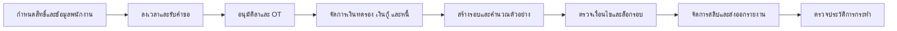

## 2 การส่งต่อข้อมูลในกระบวนการเดิม

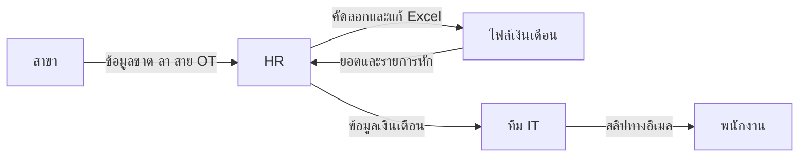

## 3 บทบาทและกลุ่มงานในระบบใหม่

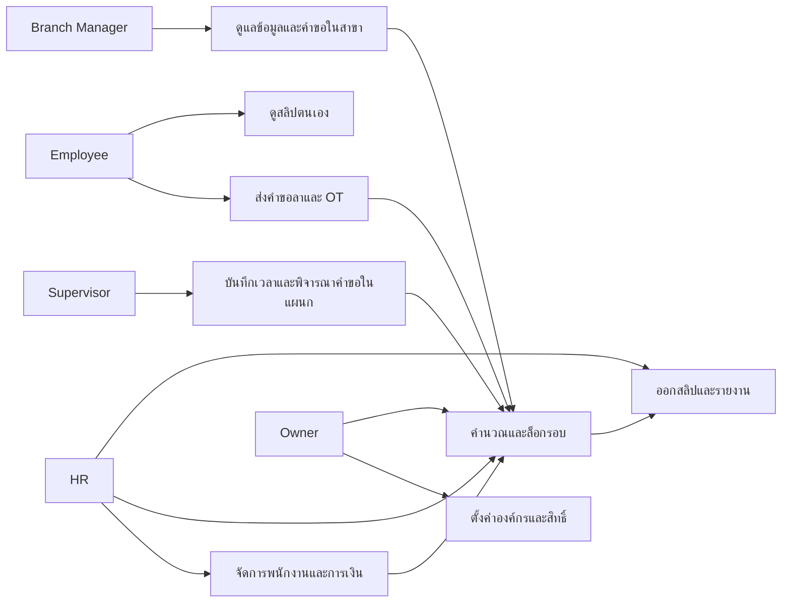

## 4 เส้นทางข้อมูลสำหรับคำนวณเงินเดือน

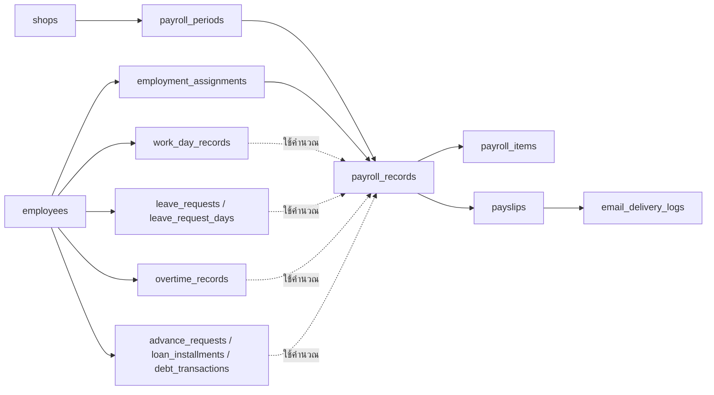

## 5 Class Diagram ของข้อมูลหลัก

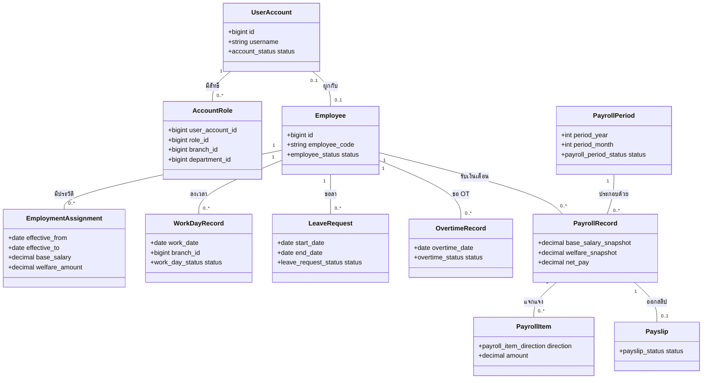

## 6 สถานะคำขอลาที่เปิดใช้จริง

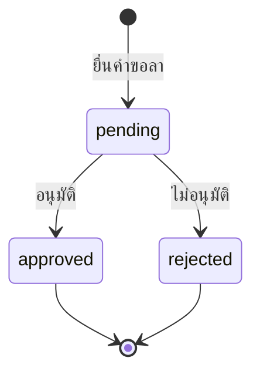

## 7 สถานะรอบเงินเดือน

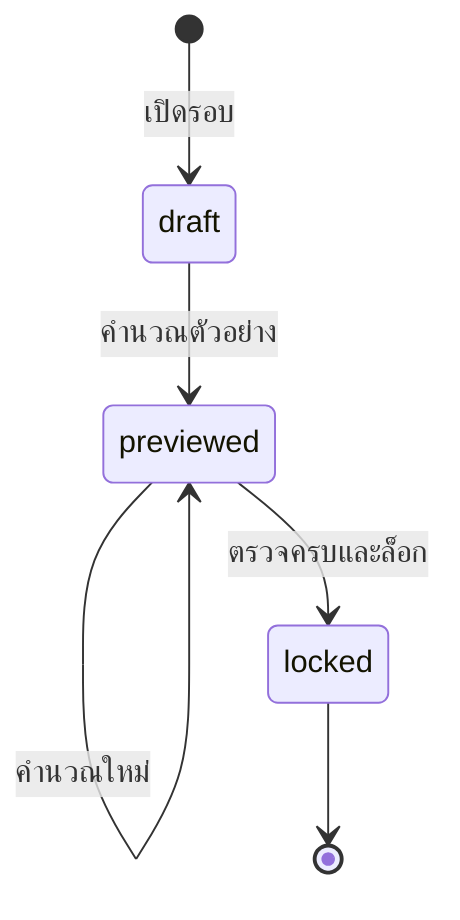

## 8 สถานะสลิปเงินเดือน

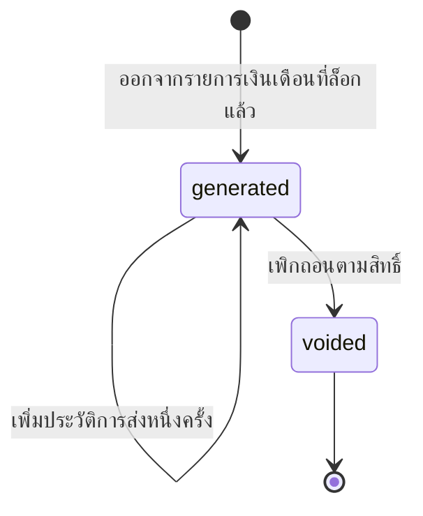

## 9 DFD ภาพรวมระบบ

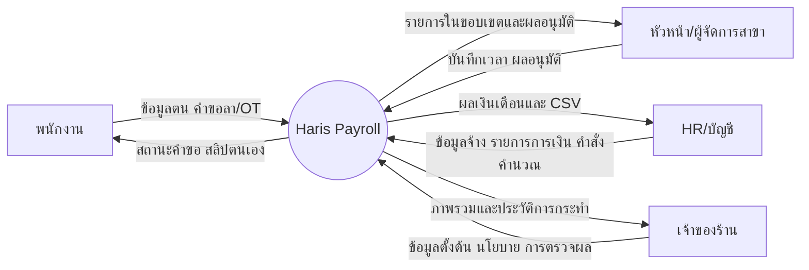

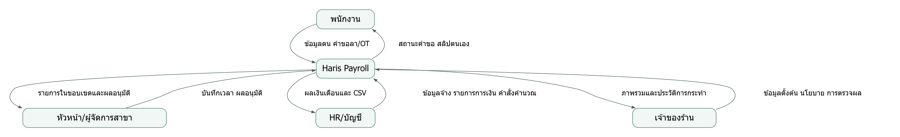

## 10 DFD กระบวนการเงินเดือน

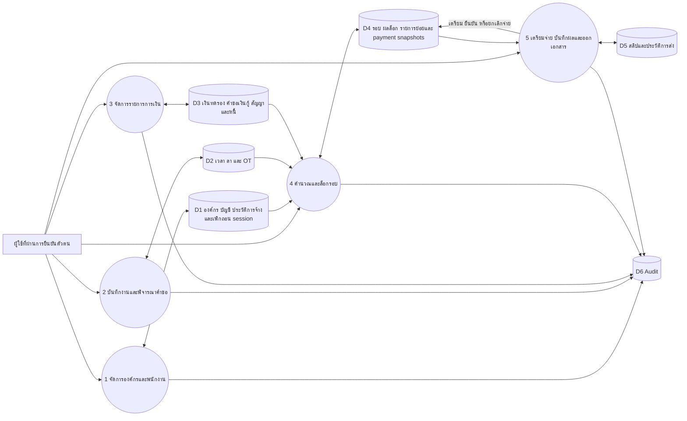

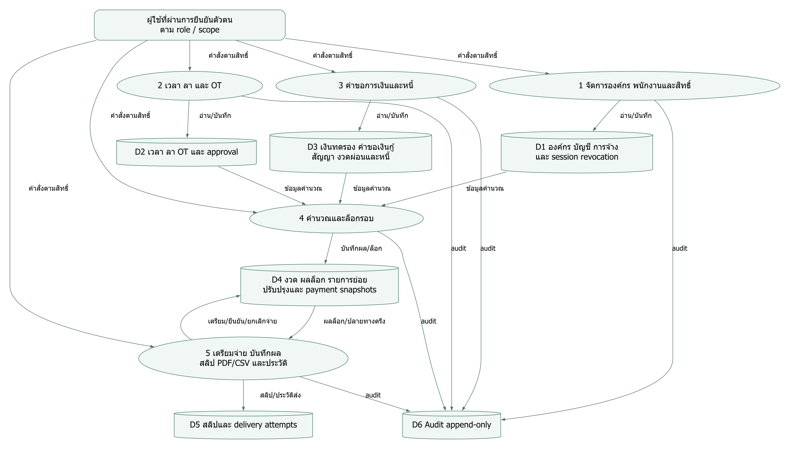
