# Sequence Diagram ของระบบ Haris Payroll

แผนภาพขยายรายละเอียดทางเทคนิคของ Use Case โดยใช้ชื่อ object ตามโครงสร้างของโครงการ เลขข้อความใน Sequence และ Collaboration ใช้ชุดเดียวกัน

## SEQ-01 เข้าสู่ระบบและจัดการรหัสผ่าน

~~~mermaid
sequenceDiagram
    actor User as User
    participant LoginPage as LoginPage
    participant UserAccountController as UserAccountController
    participant UserAccountService as UserAccountService
    participant UserAccountRepository as UserAccountRepository
    participant DatabaseConnection as DatabaseConnection
    User->>LoginPage: 1 เลือกงาน เข้าสู่ระบบและจัดการรหัสผ่าน
    LoginPage->>UserAccountController: 2 ส่งข้อมูลที่ผู้ใช้ตรวจทาน
    UserAccountController->>UserAccountService: 3 ตรวจ request shape แล้วส่ง command
    UserAccountService->>UserAccountService: 4 ตรวจสิทธิ์ ขอบเขต และกฎของ use case
    UserAccountService->>UserAccountRepository: 5 ใช้ public persistence operation ตาม code mapping
    UserAccountRepository->>DatabaseConnection: 6 execute parameterized SQL / transaction ตามงาน
    DatabaseConnection-->>UserAccountRepository: 7 คืนผล query
    UserAccountRepository-->>UserAccountService: 8 คืน domain data
    UserAccountService-->>UserAccountController: 9 คืนผลการดำเนินการ
    UserAccountController-->>LoginPage: 10 map response และแสดงผล
~~~

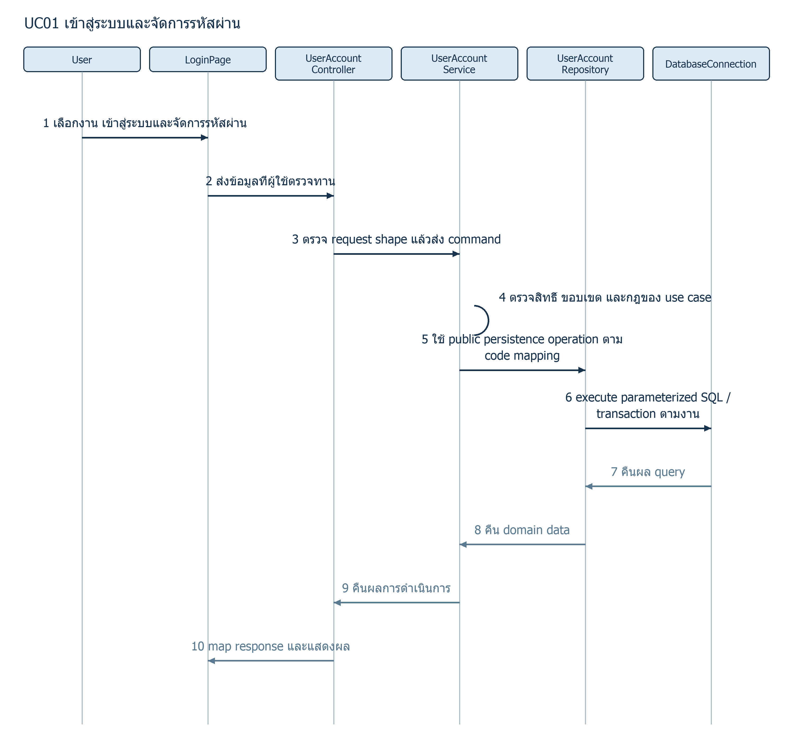

## SEQ-02 จัดการโครงสร้างองค์กร

~~~mermaid
sequenceDiagram
    actor User as User
    participant OrganizationPage as OrganizationPage
    participant ShopController as ShopController
    participant ShopService as ShopService
    participant ShopRepository as ShopRepository
    participant DatabaseConnection as DatabaseConnection
    User->>OrganizationPage: 1 เลือกงาน จัดการโครงสร้างองค์กร
    OrganizationPage->>ShopController: 2 ส่งข้อมูลที่ผู้ใช้ตรวจทาน
    ShopController->>ShopService: 3 ตรวจ request shape แล้วส่ง command
    ShopService->>ShopService: 4 ตรวจสิทธิ์ ขอบเขต และกฎของ use case
    ShopService->>ShopRepository: 5 ใช้ public persistence operation ตาม code mapping
    ShopRepository->>DatabaseConnection: 6 execute parameterized SQL / transaction ตามงาน
    DatabaseConnection-->>ShopRepository: 7 คืนผล query
    ShopRepository-->>ShopService: 8 คืน domain data
    ShopService-->>ShopController: 9 คืนผลการดำเนินการ
    ShopController-->>OrganizationPage: 10 map response และแสดงผล
~~~

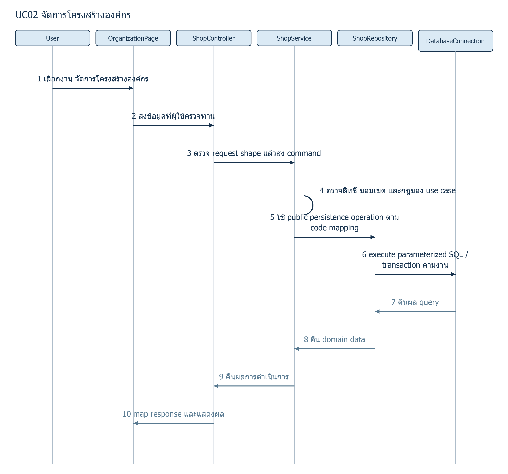

## SEQ-03 จัดการบัญชีและสิทธิ์ผู้ใช้

~~~mermaid
sequenceDiagram
    actor User as User
    participant AccountsPage as AccountsPage
    participant UserAccountAdminController as UserAccountAdminController
    participant UserAccountAdminService as UserAccountAdminService
    participant UserAccountAdminRepository as UserAccountAdminRepository
    participant DatabaseConnection as DatabaseConnection
    User->>AccountsPage: 1 เลือกงาน จัดการบัญชีและบทบาทตามขอบเขต
    AccountsPage->>UserAccountAdminController: 2 ส่งข้อมูลที่ผู้ใช้ตรวจทาน
    UserAccountAdminController->>UserAccountAdminService: 3 ตรวจ request shape แล้วส่ง command
    UserAccountAdminService->>UserAccountAdminService: 4 ตรวจสิทธิ์ ขอบเขต และกฎของ use case
    UserAccountAdminService->>UserAccountAdminRepository: 5 ใช้ public persistence operation ตาม code mapping
    UserAccountAdminRepository->>DatabaseConnection: 6 execute parameterized SQL / transaction ตามงาน
    DatabaseConnection-->>UserAccountAdminRepository: 7 คืนผล query
    UserAccountAdminRepository-->>UserAccountAdminService: 8 คืน domain data
    UserAccountAdminService-->>UserAccountAdminController: 9 คืนผลการดำเนินการ
    UserAccountAdminController-->>AccountsPage: 10 map response และแสดงผล
~~~

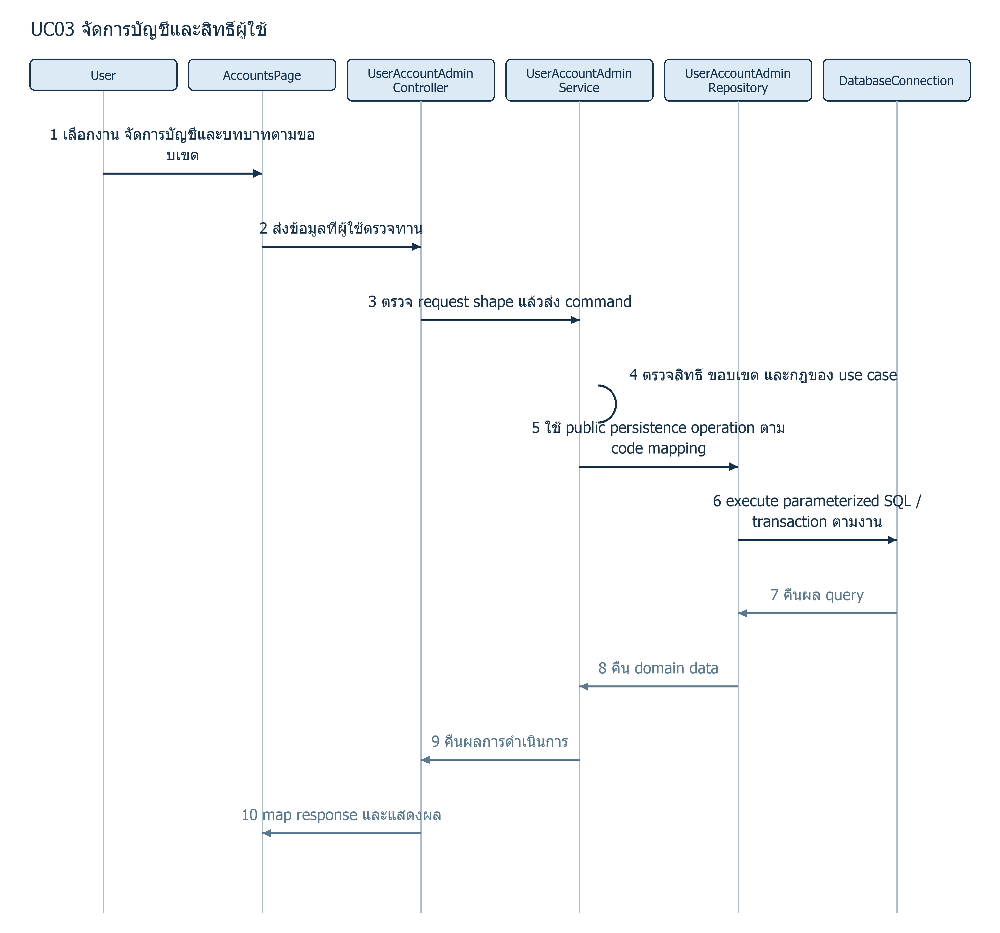

## SEQ-04 จัดการข้อมูลและประวัติพนักงาน กรณีเพิ่มพนักงาน

~~~mermaid
sequenceDiagram
    actor HR as HR
    participant NewEmployeePage as NewEmployeePage
    participant EmployeeController as EmployeeController
    participant EmployeeService as EmployeeService
    participant EmployeeRepository as EmployeeRepository
    participant DatabaseConnection as DatabaseConnection
    HR->>NewEmployeePage: 1 กรอกข้อมูลพนักงานใหม่และกดบันทึก
    NewEmployeePage->>NewEmployeePage: 2 ตรวจชื่อ รหัสพนักงาน วันที่เริ่มงาน และค่าจ้างที่ต้องกรอก รวมถึงรูปแบบจำนวนเงิน
    NewEmployeePage->>EmployeeController: 3 ส่งคำขอรับพนักงานเข้าระบบ
    EmployeeController->>EmployeeController: 4 ตรวจชนิดข้อมูลและพารามิเตอร์คำขอ
    EmployeeController->>EmployeeService: 5 เรียก onboardEmployee(employeeData) ของ EmployeeService
    EmployeeService->>EmployeeService: 6 ตรวจสิทธิ์ของผู้ดำเนินการตามขอบเขต
    EmployeeService->>EmployeeRepository: 7 อ่านรหัสและสาขา
    EmployeeRepository->>DatabaseConnection: 8 execute SQL ตาม Query Registry และ transaction ของ service
    EmployeeService->>EmployeeService: 9 ตรวจรหัสซ้ำและช่วงการจ้างเริ่มต้น
    EmployeeService->>EmployeeRepository: 10 สร้างพนักงานใหม่
    EmployeeRepository->>DatabaseConnection: 11 execute SQL ตาม Query Registry และ transaction ของ service
    EmployeeService-->>EmployeeController: 12 ส่งพนักงานใหม่พร้อมประวัติการจ้างแรก
    EmployeeController-->>NewEmployeePage: 13 ส่งพนักงานใหม่พร้อมประวัติการจ้างแรกให้หน้าจอ
    NewEmployeePage-->>HR: 14 แสดงพนักงานใหม่พร้อมประวัติการจ้างแรก
~~~

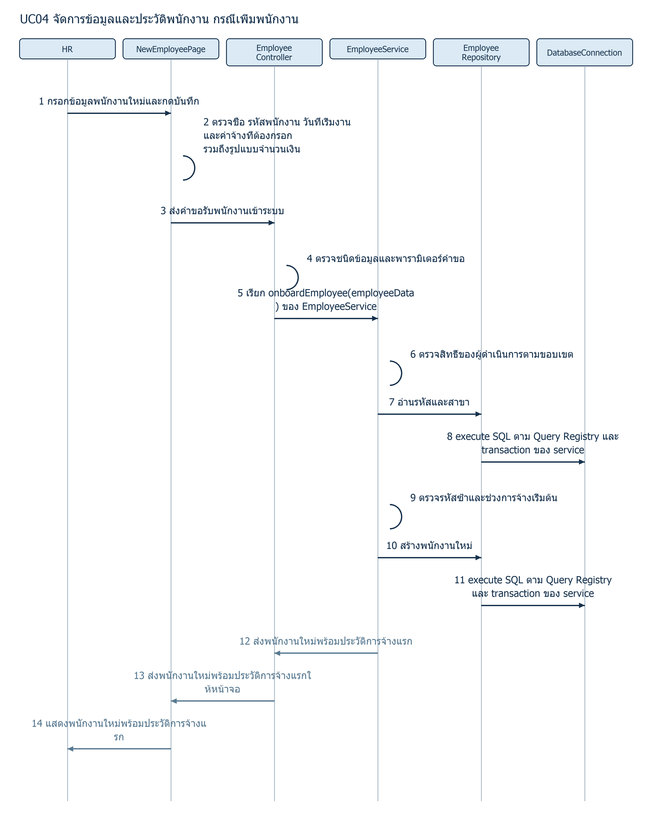

## SEQ-05 กำหนดตารางทำงานและวันหยุดสาขา

~~~mermaid
sequenceDiagram
    actor User as User
    participant SchedulesPage as SchedulesPage
    participant BranchScheduleController as BranchScheduleController
    participant BranchScheduleService as BranchScheduleService
    participant BranchScheduleRepository as BranchScheduleRepository
    participant DatabaseConnection as DatabaseConnection
    User->>SchedulesPage: 1 เลือกงาน จัดการตารางสาขาและวันหยุด
    SchedulesPage->>BranchScheduleController: 2 ส่งข้อมูลที่ผู้ใช้ตรวจทาน
    BranchScheduleController->>BranchScheduleService: 3 ตรวจ request shape แล้วส่ง command
    BranchScheduleService->>BranchScheduleService: 4 ตรวจสิทธิ์ ขอบเขต และกฎของ use case
    BranchScheduleService->>BranchScheduleRepository: 5 ใช้ public persistence operation ตาม code mapping
    BranchScheduleRepository->>DatabaseConnection: 6 execute parameterized SQL / transaction ตามงาน
    DatabaseConnection-->>BranchScheduleRepository: 7 คืนผล query
    BranchScheduleRepository-->>BranchScheduleService: 8 คืน domain data
    BranchScheduleService-->>BranchScheduleController: 9 คืนผลการดำเนินการ
    BranchScheduleController-->>SchedulesPage: 10 map response และแสดงผล
~~~

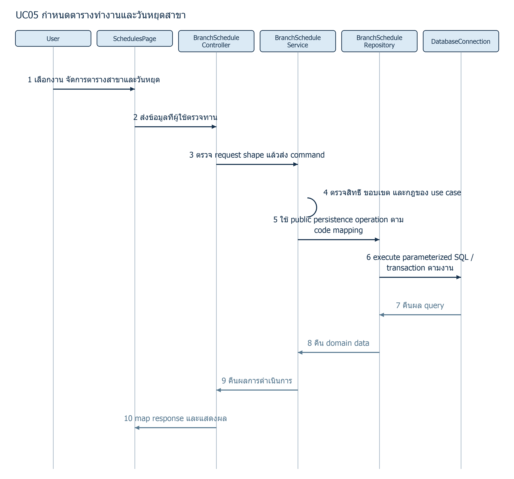

## SEQ-06 กำหนดนโยบายเงินเดือนและการลา กรณีกำหนดค่าคำนวณเงินเดือน

~~~mermaid
sequenceDiagram
    actor HR as HR
    participant PayrollPage as PayrollPage
    participant PayrollController as PayrollController
    participant PayrollService as PayrollService
    participant PayrollRepository as PayrollRepository
    participant DatabaseConnection as DatabaseConnection
    HR->>PayrollPage: 1 เลือกค่ากำหนดเงินเดือนและกดบันทึก
    PayrollPage->>PayrollPage: 2 ตรวจว่าร้าน ชนิดค่า จำนวนเงิน และวันที่ไม่ว่าง และจำนวนเงินเป็นตัวเลข
    PayrollPage->>PayrollController: 3 ส่งคำขอสร้างค่ากำหนดเงินเดือน
    PayrollController->>PayrollController: 4 ตรวจชนิดข้อมูลและพารามิเตอร์คำขอ
    PayrollController->>PayrollService: 5 เรียก createPayrollConfiguration(shopId, configKey, amount) ของ PayrollService
    PayrollService->>PayrollService: 6 ตรวจสิทธิ์ของผู้ดำเนินการตามขอบเขต
    PayrollService->>PayrollRepository: 7 อ่านค่ากำหนดเดิม
    PayrollRepository->>DatabaseConnection: 8 execute SQL ตาม Query Registry และ transaction ของ service
    PayrollService->>PayrollService: 9 ตรวจช่วงวันที่มีผลไม่ทับซ้อนกัน
    PayrollService->>PayrollRepository: 10 บันทึกค่ากำหนด
    PayrollRepository->>DatabaseConnection: 11 execute SQL ตาม Query Registry และ transaction ของ service
    PayrollService-->>PayrollController: 12 ส่งรายการตั้งค่าเงินเดือนที่บันทึก
    PayrollController-->>PayrollPage: 13 ส่งรายการตั้งค่าเงินเดือนที่บันทึกให้หน้าจอ
    PayrollPage-->>HR: 14 แสดงรายการตั้งค่าเงินเดือนที่บันทึก
~~~

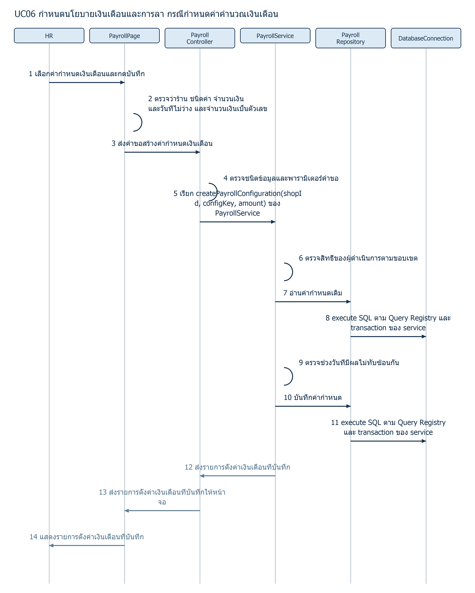

## SEQ-07 บันทึกและแก้ไขข้อมูลลงเวลา

~~~mermaid
sequenceDiagram
    actor HR as HR
    participant AttendancePage as AttendancePage
    participant AttendanceController as AttendanceController
    participant AttendanceService as AttendanceService
    participant AttendanceRepository as AttendanceRepository
    participant DatabaseConnection as DatabaseConnection
    HR->>AttendancePage: 1 กรอกข้อมูลวันทำงานตามสิทธิ์หรือการขาดงาน
    AttendancePage->>AttendancePage: 2 ตรวจว่าพนักงาน วันทำงาน และสถานะไม่ว่าง และวันที่มีรูปแบบถูกต้อง
    AttendancePage->>AttendanceController: 3 ส่งคำขอสร้างบันทึกวันทำงาน
    AttendanceController->>AttendanceController: 4 ตรวจชนิดข้อมูลและพารามิเตอร์คำขอ
    AttendanceController->>AttendanceService: 5 เรียก createManualWorkDay(employeeId, date, status) ของ AttendanceService
    AttendanceService->>AttendanceService: 6 ตรวจสิทธิ์ของผู้ดำเนินการตามขอบเขต
    AttendanceService->>AttendanceRepository: 7 อ่านวันทำงานเดิม
    AttendanceRepository->>DatabaseConnection: 8 execute SQL ตาม Query Registry และ transaction ของ service
    AttendanceService->>AttendanceService: 9 ตรวจวันทำงานซ้ำและสถานะที่บันทึก
    AttendanceService->>AttendanceRepository: 10 บันทึกวันทำงาน
    AttendanceRepository->>DatabaseConnection: 11 execute SQL ตาม Query Registry และ transaction ของ service
    AttendanceService-->>AttendanceController: 12 ส่งบันทึกวันทำงานใหม่
    AttendanceController-->>AttendancePage: 13 ส่งบันทึกวันทำงานใหม่ให้หน้าจอ
    AttendancePage-->>HR: 14 แสดงบันทึกวันทำงานใหม่
~~~

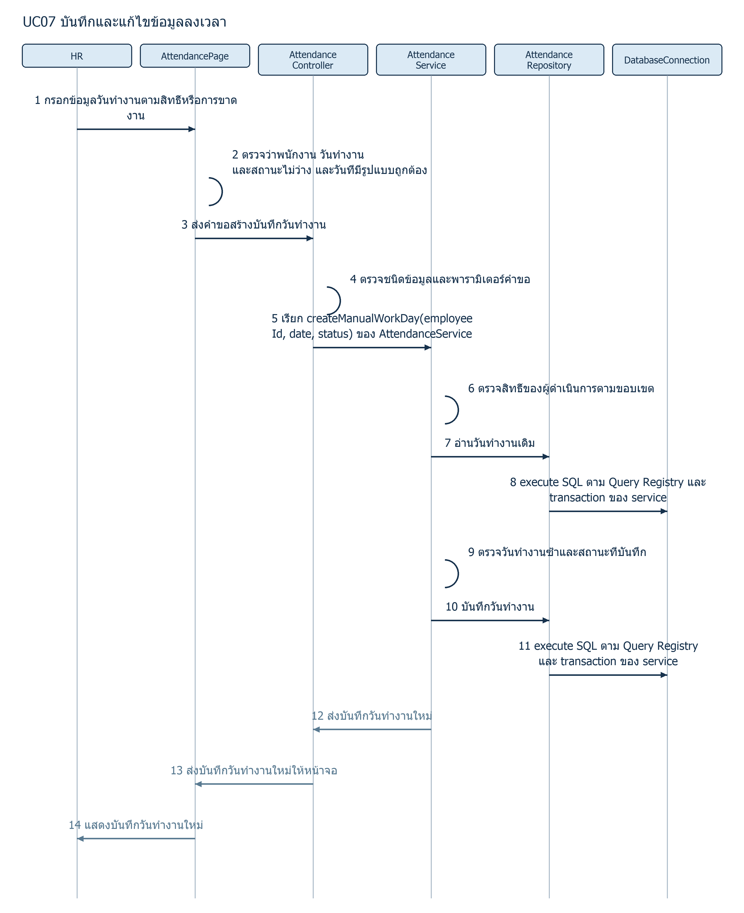

## SEQ-08 ยื่นคำขอลา

~~~mermaid
sequenceDiagram
    actor Employee as Employee
    participant LeavePage as LeavePage
    participant LeaveController as LeaveController
    participant LeaveService as LeaveService
    participant LeaveRepository as LeaveRepository
    participant DatabaseConnection as DatabaseConnection
    Employee->>LeavePage: 1 กรอกประเภท วัน และเหตุผลแล้วกดยื่นลา
    LeavePage->>LeavePage: 2 ตรวจประเภทลา วันที่เริ่ม วันสิ้นสุด และเหตุผลว่าไม่ว่างและวันที่มีรูปแบบถูกต้อง
    LeavePage->>LeaveController: 3 ส่งคำขอยื่นการลา
    LeaveController->>LeaveController: 4 ตรวจชนิดข้อมูลและพารามิเตอร์คำขอ
    LeaveController->>LeaveService: 5 เรียก submitLeave(employeeId, dates, leaveType) ของ LeaveService
    LeaveService->>LeaveService: 6 ตรวจสิทธิ์ของผู้ดำเนินการตามขอบเขต
    LeaveService->>LeaveRepository: 7 อ่านประเภทและโควตา
    LeaveRepository->>DatabaseConnection: 8 execute SQL ตาม Query Registry และ transaction ของ service
    LeaveService->>LeaveService: 9 ตรวจวันทับซ้อน จำนวนวัน และโควตา
    LeaveService->>LeaveRepository: 10 บันทึกคำขอลา
    LeaveRepository->>DatabaseConnection: 11 execute SQL ตาม Query Registry และ transaction ของ service
    LeaveService-->>LeaveController: 12 ส่งคำขอลาสถานะรอพิจารณา
    LeaveController-->>LeavePage: 13 ส่งคำขอลาสถานะรอพิจารณาให้หน้าจอ
    LeavePage-->>Employee: 14 แสดงคำขอลาสถานะรอพิจารณา
~~~

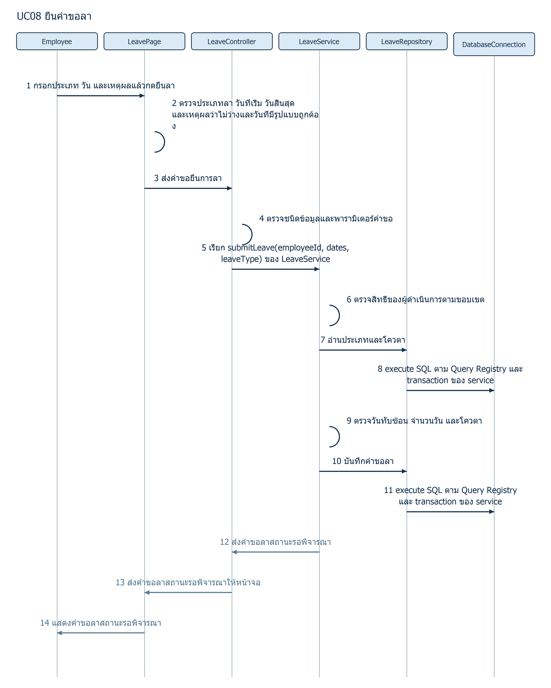

## SEQ-09 พิจารณาคำขอลา

~~~mermaid
sequenceDiagram
    actor Manager as Manager
    participant LeavePage as LeavePage
    participant LeaveController as LeaveController
    participant LeaveService as LeaveService
    participant LeaveRepository as LeaveRepository
    participant DatabaseConnection as DatabaseConnection
    Manager->>LeavePage: 1 เลือกคำขอลาแล้วอนุมัติหรือปฏิเสธ
    LeavePage->>LeavePage: 2 ตรวจว่ามีรหัสคำขอที่เลือกและเป็นสตริงตัวเลขที่ไม่ว่าง
    LeavePage->>LeaveController: 3 ส่งคำขอพิจารณาการลา
    LeaveController->>LeaveController: 4 ตรวจชนิดข้อมูลและพารามิเตอร์คำขอ
    LeaveController->>LeaveService: 5 เรียก approveLeave(requestId) ของ LeaveService
    LeaveService->>LeaveService: 6 ตรวจสิทธิ์ของผู้ดำเนินการตามขอบเขต
    LeaveService->>LeaveRepository: 7 อ่านคำขอและโควตา
    LeaveRepository->>DatabaseConnection: 8 execute SQL ตาม Query Registry และ transaction ของ service
    LeaveService->>LeaveService: 9 ตรวจเพดานสามวัน โควตา และขอบเขตสิทธิ์
    LeaveService->>LeaveRepository: 10 บันทึกผลพิจารณา
    LeaveRepository->>DatabaseConnection: 11 execute SQL ตาม Query Registry และ transaction ของ service
    LeaveService-->>LeaveController: 12 ส่งผลพิจารณาการลาพร้อมประวัติ
    LeaveController-->>LeavePage: 13 ส่งผลพิจารณาการลาพร้อมประวัติให้หน้าจอ
    LeavePage-->>Manager: 14 แสดงผลพิจารณาการลาพร้อมประวัติ
~~~

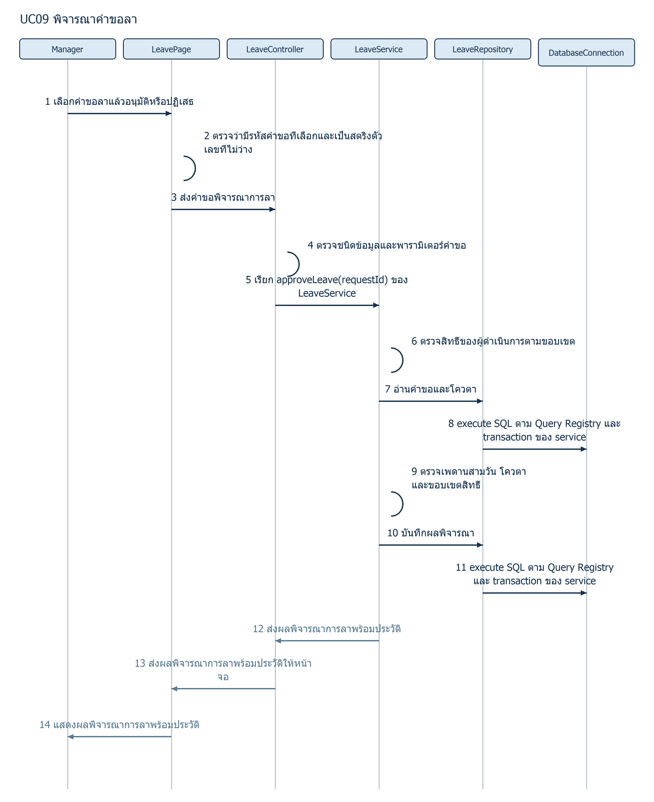

## SEQ-10 ยื่นและแก้ไขคำขอทำงานล่วงเวลา

~~~mermaid
sequenceDiagram
    actor Employee as Employee
    participant OvertimePage as OvertimePage
    participant OvertimeController as OvertimeController
    participant OvertimeService as OvertimeService
    participant OvertimeRepository as OvertimeRepository
    participant DatabaseConnection as DatabaseConnection
    Employee->>OvertimePage: 1 กรอกวัน ประเภท และชั่วโมง OT แล้วกดยื่น
    OvertimePage->>OvertimePage: 2 ตรวจว่าวัน ประเภท และจำนวนชั่วโมงไม่ว่าง และจำนวนชั่วโมงเป็นตัวเลข
    OvertimePage->>OvertimeController: 3 ส่งคำขอ OT ที่ระบุประเภท
    OvertimeController->>OvertimeController: 4 ตรวจชนิดข้อมูลและพารามิเตอร์คำขอ
    OvertimeController->>OvertimeService: 5 เรียก submitOvertime(employeeId, date, type, hours) ของ OvertimeService
    OvertimeService->>OvertimeService: 6 ตรวจสิทธิ์ของผู้ดำเนินการตามขอบเขต
    OvertimeService->>OvertimeRepository: 7 อ่านข้อมูลพนักงาน
    OvertimeRepository->>DatabaseConnection: 8 execute SQL ตาม Query Registry และ transaction ของ service
    OvertimeService->>OvertimeService: 9 ตรวจประเภท OT และคำขอที่ซ้ำหรือขัดกัน
    OvertimeService->>OvertimeRepository: 10 บันทึกคำขอ OT
    OvertimeRepository->>DatabaseConnection: 11 execute SQL ตาม Query Registry และ transaction ของ service
    OvertimeService-->>OvertimeController: 12 ส่งคำขอ OT สถานะรออนุมัติ
    OvertimeController-->>OvertimePage: 13 ส่งคำขอ OT สถานะรออนุมัติให้หน้าจอ
    OvertimePage-->>Employee: 14 แสดงคำขอ OT สถานะรออนุมัติ
~~~

## SEQ-11 พิจารณาคำขอทำงานล่วงเวลา

~~~mermaid
sequenceDiagram
    actor Manager as Manager
    participant OvertimePage as OvertimePage
    participant OvertimeController as OvertimeController
    participant OvertimeService as OvertimeService
    participant OvertimeRepository as OvertimeRepository
    participant DatabaseConnection as DatabaseConnection
    Manager->>OvertimePage: 1 เลือกคำขอ OT แล้วกดอนุมัติ
    OvertimePage->>OvertimePage: 2 ตรวจว่ามีคำขอที่เลือกและรหัสคำขอเป็นสตริงตัวเลขที่ไม่ว่าง
    OvertimePage->>OvertimeController: 3 ส่งคำขออนุมัติ OT
    OvertimeController->>OvertimeController: 4 ตรวจชนิดข้อมูลและพารามิเตอร์คำขอ
    OvertimeController->>OvertimeService: 5 เรียก approveOvertime(requestId) ของ OvertimeService
    OvertimeService->>OvertimeService: 6 ตรวจสิทธิ์ของผู้ดำเนินการตามขอบเขต
    OvertimeService->>OvertimeRepository: 7 อ่านคำขอ OT
    OvertimeRepository->>DatabaseConnection: 8 execute SQL ตาม Query Registry และ transaction ของ service
    OvertimeService->>OvertimeService: 9 ตรวจสิทธิ์ตามสาขาหรือแผนกและสถานะคำขอ
    OvertimeService->>OvertimeRepository: 10 บันทึกผลอนุมัติ
    OvertimeRepository->>DatabaseConnection: 11 execute SQL ตาม Query Registry และ transaction ของ service
    OvertimeService-->>OvertimeController: 12 ส่งผลอนุมัติ OT พร้อมประวัติ
    OvertimeController-->>OvertimePage: 13 ส่งผลอนุมัติ OT พร้อมประวัติให้หน้าจอ
    OvertimePage-->>Manager: 14 แสดงผลอนุมัติ OT พร้อมประวัติ
~~~

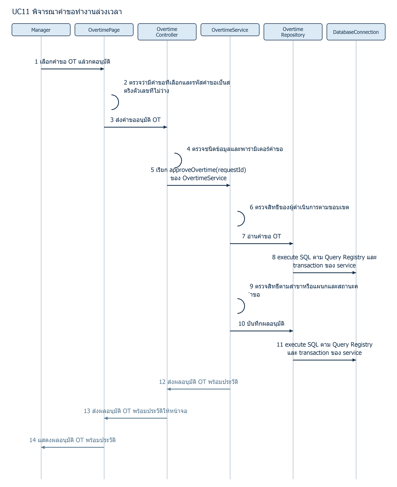

## SEQ-12 จัดการคำขอเงินทดรองและเงินกู้ กรณีเงินทดรอง

~~~mermaid
sequenceDiagram
    actor HR as HR
    participant FinancePage as FinancePage
    participant AdvanceController as AdvanceController
    participant AdvanceService as AdvanceService
    participant AdvanceRepository as AdvanceRepository
    participant DatabaseConnection as DatabaseConnection
    HR->>FinancePage: 1 กรอกจำนวนเงินทดรองแล้วกดยื่น
    FinancePage->>FinancePage: 2 ตรวจช่องที่ต้องกรอกและชนิดข้อมูลเบื้องต้น
    FinancePage->>AdvanceController: 3 ส่งคำขอเงินทดรอง
    AdvanceController->>AdvanceService: 4 เรียก submitAdvance(employeeId, amount) ของ AdvanceService
    AdvanceService->>AdvanceRepository: 5 อ่านเงินเดือนฐานและจำนวนวันทำงาน
    AdvanceRepository->>DatabaseConnection: 6 execute SQL ตาม Query Registry และ transaction ของ service
    AdvanceService->>AdvanceService: 7 ตรวจสิทธิ์ วันที่ยื่น วันทำงาน และวงเงิน
    AdvanceService->>AdvanceRepository: 8 บันทึกคำขอเงินทดรอง
    AdvanceRepository->>DatabaseConnection: 9 execute SQL ตาม Query Registry และ transaction ของ service
    AdvanceService-->>AdvanceController: 10 ส่งคำขอเงินทดรองใหม่
    AdvanceController-->>FinancePage: 11 ส่งคำขอเงินทดรองใหม่ให้หน้าจอ
    FinancePage-->>HR: 12 แสดงคำขอเงินทดรองใหม่
~~~

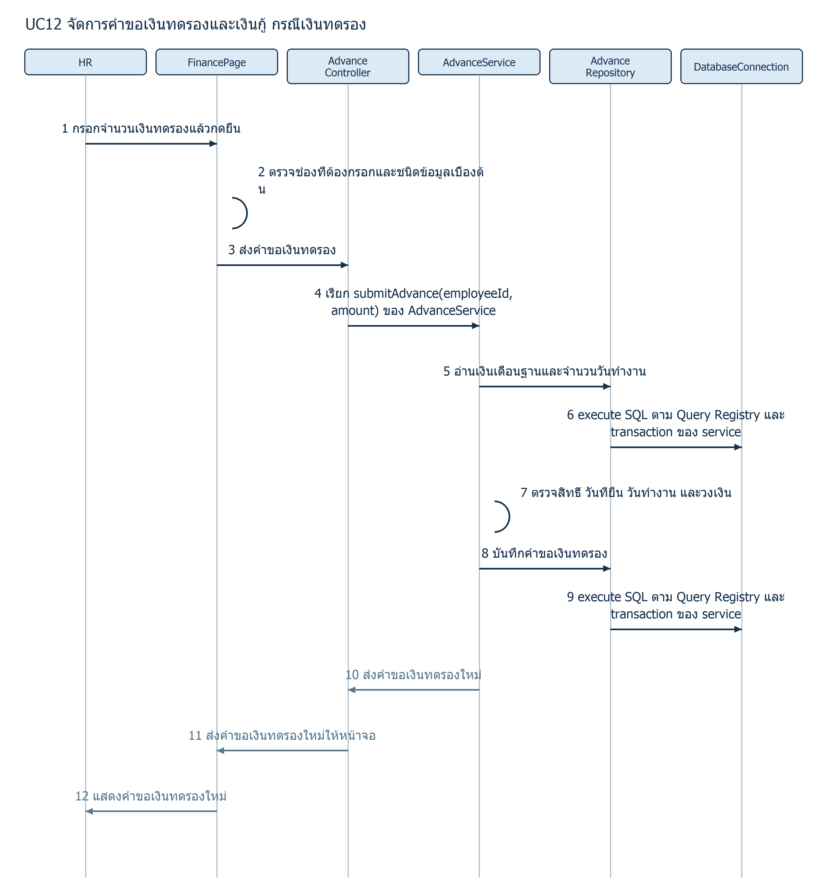

## SEQ-13 บันทึกหนี้และรายการปรับปรุงเงินเดือน กรณีบันทึกหนี้

~~~mermaid
sequenceDiagram
    actor HR as HR
    participant FinancePage as FinancePage
    participant DebtController as DebtController
    participant DebtService as DebtService
    participant DebtRepository as DebtRepository
    participant DatabaseConnection as DatabaseConnection
    HR->>FinancePage: 1 กรอกธุรกรรมหนี้ของพนักงานแล้วบันทึก
    FinancePage->>FinancePage: 2 ตรวจว่าพนักงาน ชนิดรายการ จำนวนเงิน และเหตุผลไม่ว่าง และจำนวนเงินเป็นตัวเลข
    FinancePage->>DebtController: 3 ส่งคำขอบันทึกธุรกรรมหนี้
    DebtController->>DebtController: 4 ตรวจชนิดข้อมูลและพารามิเตอร์คำขอ
    DebtController->>DebtService: 5 เรียก record(employeeId, type, amount) ของ DebtService
    DebtService->>DebtService: 6 ตรวจสิทธิ์ของผู้ดำเนินการตามขอบเขต
    DebtService->>DebtRepository: 7 อ่านข้อมูลพนักงาน
    DebtRepository->>DatabaseConnection: 8 execute SQL ตาม Query Registry และ transaction ของ service
    DebtService->>DebtService: 9 ตรวจชนิดธุรกรรมและจำนวนเงิน
    DebtService->>DebtRepository: 10 บันทึกธุรกรรมหนี้
    DebtRepository->>DatabaseConnection: 11 execute SQL ตาม Query Registry และ transaction ของ service
    DebtService-->>DebtController: 12 ส่งธุรกรรมหนี้ใหม่และประวัติ
    DebtController-->>FinancePage: 13 ส่งธุรกรรมหนี้ใหม่และประวัติให้หน้าจอ
    FinancePage-->>HR: 14 แสดงธุรกรรมหนี้ใหม่และประวัติ
~~~

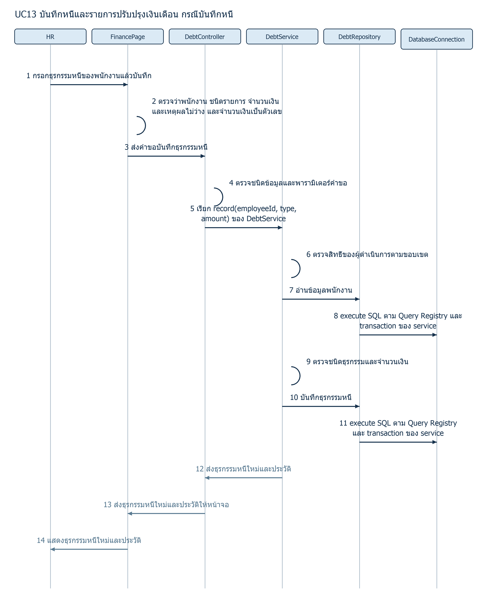

## SEQ-14 เปิดงวดเงินเดือน

~~~mermaid
sequenceDiagram
    actor HR as HR
    participant PayrollPage as PayrollPage
    participant PayrollController as PayrollController
    participant PayrollService as PayrollService
    participant PayrollRepository as PayrollRepository
    participant DatabaseConnection as DatabaseConnection
    HR->>PayrollPage: 1 เลือกร้านและช่วงวันเพื่อสร้างรอบเงินเดือน
    PayrollPage->>PayrollPage: 2 ตรวจว่าร้าน เดือน ปี และวันเริ่มกับวันสิ้นสุดไม่ว่างและมีรูปแบบถูกต้อง
    PayrollPage->>PayrollController: 3 ส่งคำขอสร้างรอบเงินเดือน
    PayrollController->>PayrollController: 4 ตรวจชนิดข้อมูลและพารามิเตอร์คำขอ
    PayrollController->>PayrollService: 5 เรียก createPayrollPeriod(shopId, startDate, endDate) ของ PayrollService
    PayrollService->>PayrollService: 6 ตรวจสิทธิ์ของผู้ดำเนินการตามขอบเขต
    PayrollService->>PayrollRepository: 7 อ่านร้านและรอบเดิม
    PayrollRepository->>DatabaseConnection: 8 execute SQL ตาม Query Registry และ transaction ของ service
    PayrollService->>PayrollService: 9 ตรวจร้าน ช่วงวัน และรอบที่ซ้ำ
    PayrollService->>PayrollRepository: 10 สร้างรอบเงินเดือน
    PayrollRepository->>DatabaseConnection: 11 execute SQL ตาม Query Registry และ transaction ของ service
    PayrollService-->>PayrollController: 12 ส่งรอบเงินเดือนสถานะฉบับร่าง
    PayrollController-->>PayrollPage: 13 ส่งรอบเงินเดือนสถานะฉบับร่างให้หน้าจอ
    PayrollPage-->>HR: 14 แสดงรอบเงินเดือนสถานะฉบับร่าง
~~~

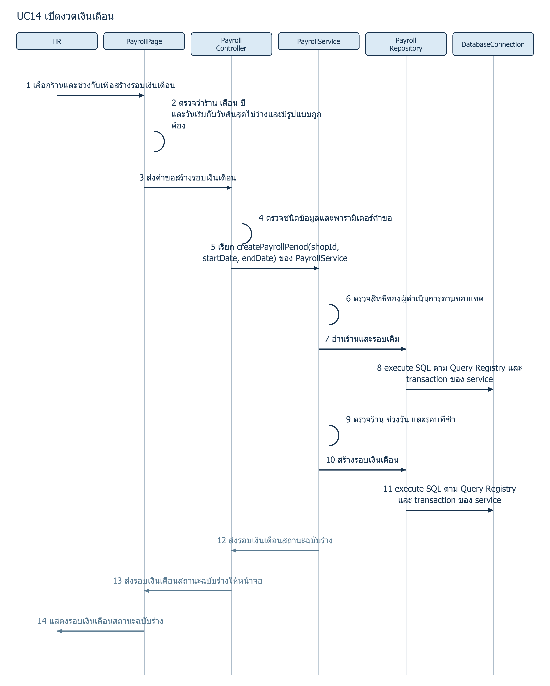

## SEQ-15 คำนวณและตรวจสอบเงินเดือน

~~~mermaid
sequenceDiagram
    actor HR as HR
    participant PayrollPage as PayrollPage
    participant PayrollController as PayrollController
    participant PayrollService as PayrollService
    participant PayrollRepository as PayrollRepository
    participant DatabaseConnection as DatabaseConnection
    HR->>PayrollPage: 1 เลือกรอบเพื่อคำนวณค่า OT ในเงินเดือน
    PayrollPage->>PayrollPage: 2 ตรวจว่ามีรอบที่เลือกและรหัสรอบเป็นสตริงตัวเลขที่ไม่ว่าง
    PayrollPage->>PayrollController: 3 ส่งคำขอคำนวณตัวอย่างเงินเดือน
    PayrollController->>PayrollController: 4 ตรวจชนิดข้อมูลและพารามิเตอร์คำขอ
    PayrollController->>PayrollService: 5 เรียก previewPayrollPeriod(periodId) ของ PayrollService
    PayrollService->>PayrollService: 6 ตรวจสิทธิ์ของผู้ดำเนินการตามขอบเขต
    PayrollService->>PayrollRepository: 7 อ่าน OT ที่อนุมัติ
    PayrollRepository->>DatabaseConnection: 8 execute SQL ตาม Query Registry และ transaction ของ service
    PayrollService->>PayrollService: 9 คำนวณเฉพาะ OT ที่อนุมัติแล้วตามอัตราที่มีผล
    PayrollService->>PayrollRepository: 10 บันทึกผล preview
    PayrollRepository->>DatabaseConnection: 11 execute SQL ตาม Query Registry และ transaction ของ service
    PayrollService-->>PayrollController: 12 ส่งยอด OT ในตัวอย่างเงินเดือน
    PayrollController-->>PayrollPage: 13 ส่งยอด OT ในตัวอย่างเงินเดือนให้หน้าจอ
    PayrollPage-->>HR: 14 แสดงยอด OT ในตัวอย่างเงินเดือน
~~~

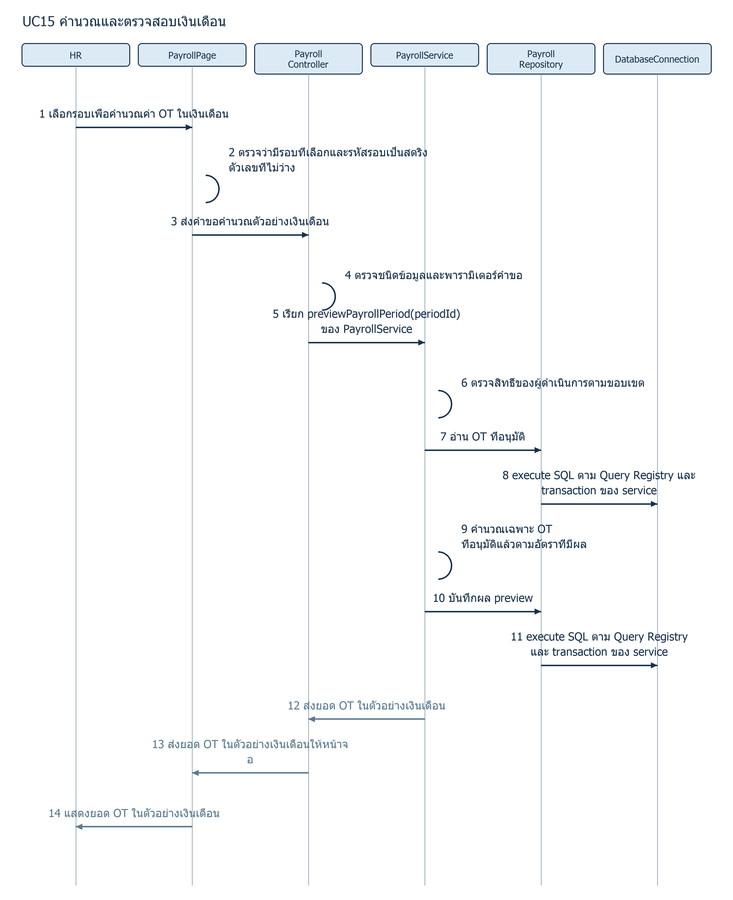

## SEQ-16 ตรวจความพร้อมและล็อกรอบเงินเดือน

~~~mermaid
sequenceDiagram
    actor HR as HR
    participant PayrollPage as PayrollPage
    participant PayrollController as PayrollController
    participant PayrollService as PayrollService
    participant PayrollRepository as PayrollRepository
    participant DatabaseConnection as DatabaseConnection
    HR->>PayrollPage: 1 เลือกรอบที่ตรวจแล้วและกดล็อกรอบ
    PayrollPage->>PayrollPage: 2 ตรวจว่ามีรอบที่เลือกและรหัสรอบเป็นสตริงตัวเลขที่ไม่ว่าง
    PayrollPage->>PayrollController: 3 ส่งคำขอล็อกรอบเงินเดือน
    PayrollController->>PayrollController: 4 ตรวจชนิดข้อมูลและพารามิเตอร์คำขอ
    PayrollController->>PayrollService: 5 เรียก lockPayrollPeriod(periodId) ของ PayrollService
    PayrollService->>PayrollService: 6 ตรวจสิทธิ์ของผู้ดำเนินการตามขอบเขต
    PayrollService->>PayrollRepository: 7 อ่านข้อมูลก่อนล็อก
    PayrollRepository->>DatabaseConnection: 8 execute SQL ตาม Query Registry และ transaction ของ service
    PayrollService->>PayrollService: 9 ตรวจวันทำงาน คำขอค้าง ยอดสุทธิ และผลรวม
    PayrollService->>PayrollRepository: 10 ล็อกรอบและบันทึกค่า
    PayrollRepository->>DatabaseConnection: 11 execute SQL ตาม Query Registry และ transaction ของ service
    PayrollService-->>PayrollController: 12 ส่งรอบที่ล็อกพร้อมข้อมูลตรวจสอบย้อนหลัง
    PayrollController-->>PayrollPage: 13 ส่งรอบที่ล็อกพร้อมข้อมูลตรวจสอบย้อนหลังให้หน้าจอ
    PayrollPage-->>HR: 14 แสดงรอบที่ล็อกพร้อมข้อมูลตรวจสอบย้อนหลัง
~~~

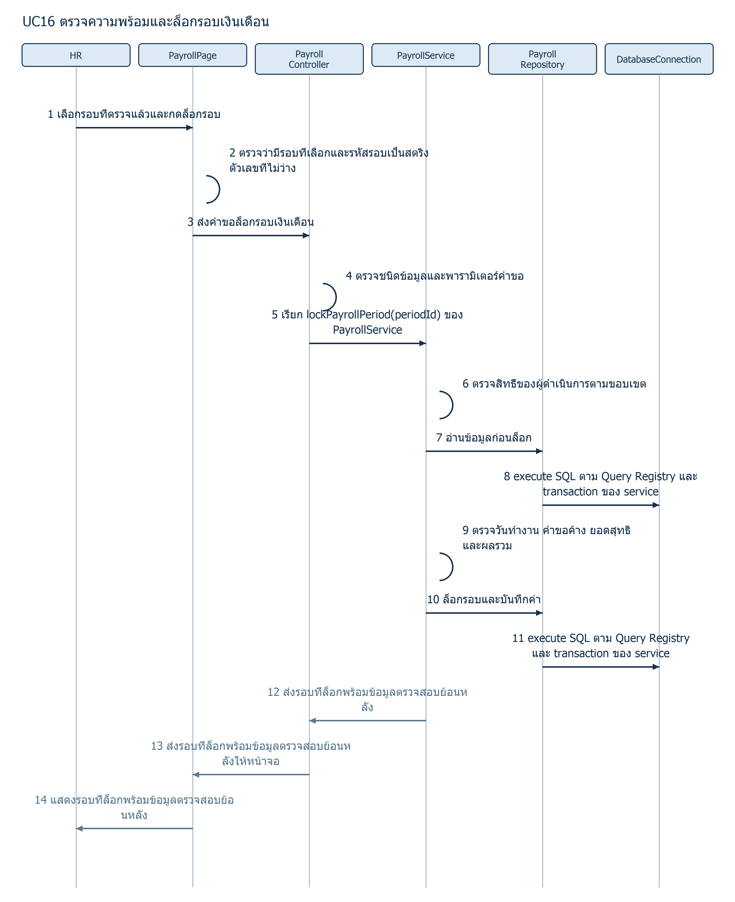

## SEQ-17 UC17 ออกสลิป PDF

~~~mermaid
sequenceDiagram
    actor HR as HR
    participant PayslipsPage as PayslipsPage
    participant PayslipController as PayslipController
    participant PayslipService as PayslipService
    participant PayslipRepository as PayslipRepository
    participant DocumentStorage as DocumentStorage
    HR->>PayslipsPage: 1 เลือกผลเงินเดือนและขอออก PDF
    PayslipsPage->>PayslipController: 2 ส่ง recordId
    PayslipController->>PayslipService: 3 generate(actor, recordId, requestId)
    PayslipService->>PayslipRepository: 4 อ่าน locked payroll snapshot และสลิปเดิม
    PayslipService->>PayslipService: 5 ตรวจ role/scope/locked; ถ้ามี PDF เดิมให้คืนรายการเดิม
    PayslipService->>DocumentStorage: 6 เก็บ PDF ภาษาไทยที่สร้างจาก snapshot พร้อม SHA256
    PayslipService->>PayslipRepository: 7 บันทึกสลิปและ audit ใน transaction
    PayslipService-->>PayslipController: 8 ส่งสลิปใหม่หรือรายการเดิม
    PayslipController-->>PayslipsPage: 9 map response และแสดงสลิป
~~~

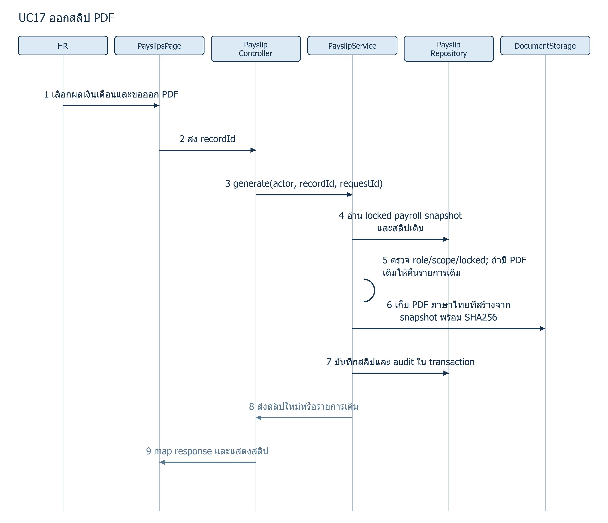

## SEQ-17a UC17 ส่งสลิปทางอีเมล

~~~mermaid
sequenceDiagram
    actor HR as HR
    participant PayslipsPage as PayslipsPage
    participant PayslipController as PayslipController
    participant PayslipService as PayslipService
    participant PayslipRepository as PayslipRepository
    participant DocumentStorage as DocumentStorage
    participant SmtpMailer as SmtpMailer
    HR->>PayslipsPage: 1 ขอส่งสลิปไปอีเมลพนักงาน
    PayslipsPage->>PayslipController: 2 ขอส่งสลิปที่เลือก
    PayslipController->>PayslipService: 3 deliver(actor, payslipId, requestId)
    PayslipService->>PayslipRepository: 4 ตรวจผู้รับและบันทึก delivery attempt pending
    PayslipService->>DocumentStorage: 5 อ่าน PDF และตรวจ hash
    PayslipService->>SmtpMailer: 6 send(recipient, attemptId, bytes, filename)
    SmtpMailer-->>PayslipService: 7 คืน provider receipt หรือข้อผิดพลาด
    PayslipService->>PayslipRepository: 8 บันทึก sent/failed ของ attempt นอกการส่ง SMTP
    PayslipService-->>PayslipController: 9 ส่งผล delivery attempt
    PayslipController-->>PayslipsPage: 10 แสดงผลส่งและประวัติ
~~~

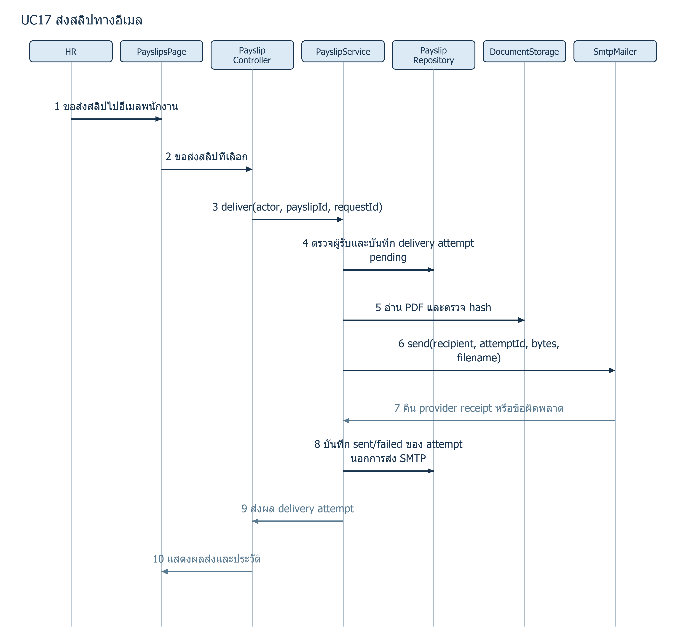

## SEQ-17b UC17 ดาวน์โหลดสลิปตามสิทธิ์

~~~mermaid
sequenceDiagram
    actor HR as HR
    participant PayslipsPage as PayslipsPage
    participant PayslipController as PayslipController
    participant PayslipService as PayslipService
    participant DocumentStorage as DocumentStorage
    HR->>PayslipsPage: 1 เลือกดาวน์โหลด (พนักงานทำได้เฉพาะสลิปตน)
    PayslipsPage->>PayslipController: 2 ขอไฟล์สลิป
    PayslipController->>PayslipService: 3 download(actor, payslipId, requestId)
    PayslipService->>PayslipService: 4 ตรวจ own-only/role scope และสถานะสลิป
    PayslipService->>DocumentStorage: 5 read(storageKey, sha256)
    DocumentStorage-->>PayslipService: 6 คืน bytes เมื่อ hash ถูกต้อง
    PayslipService-->>PayslipController: 7 คืน bytes และ filename
    PayslipController-->>PayslipsPage: 8 ส่งไฟล์ PDF ให้ดาวน์โหลด
~~~

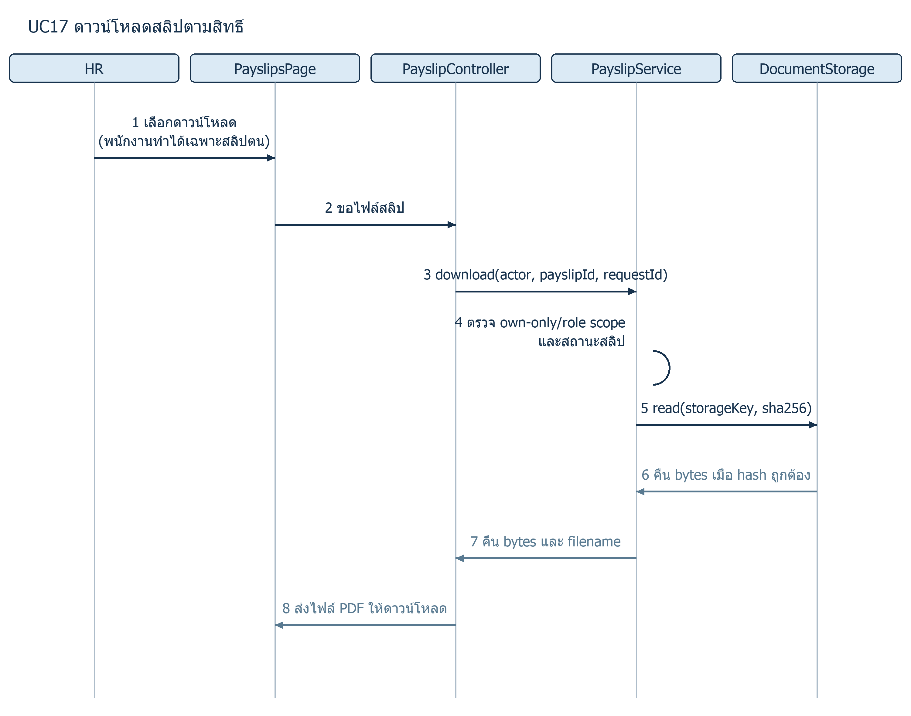

## SEQ-18 เตรียมและบันทึกการจ่ายเงินเดือน พร้อมรายงานและไฟล์จ่าย กรณีส่งออกไฟล์ธนาคาร

~~~mermaid
sequenceDiagram
    actor HR as HR
    participant ReportsPage as ReportsPage
    participant ReportController as ReportController
    participant ReportService as ReportService
    participant ReportRepository as ReportRepository
    participant DatabaseConnection as DatabaseConnection
    HR->>ReportsPage: 1 เลือกรอบเพื่อส่งออกไฟล์โอนเงิน
    ReportsPage->>ReportsPage: 2 ตรวจว่ามีรอบที่เลือกและรหัสรอบเป็นสตริงตัวเลขที่ไม่ว่าง
    ReportsPage->>ReportController: 3 ขอไฟล์ CSV สำหรับธนาคาร
    ReportController->>ReportController: 4 ตรวจชนิดข้อมูลและพารามิเตอร์คำขอ
    ReportController->>ReportService: 5 เรียก bankTransfer(periodId) ของ ReportService
    ReportService->>ReportService: 6 ตรวจสิทธิ์ของผู้ดำเนินการตามขอบเขต
    ReportService->>ReportRepository: 7 อ่านยอดและบัญชี
    ReportRepository->>DatabaseConnection: 8 execute SQL ตาม Query Registry และ transaction ของ service
    ReportService->>ReportService: 9 ตรวจ locked และบัญชีหลักครบทุกคน ไม่ครบปฏิเสธทั้ง export
    ReportService-->>ReportController: 10 ส่งไฟล์ CSV สำหรับธนาคาร
    ReportController-->>ReportsPage: 11 ส่งไฟล์ CSV สำหรับธนาคารให้หน้าจอ
    ReportsPage-->>HR: 12 แสดงไฟล์ CSV สำหรับธนาคาร
~~~

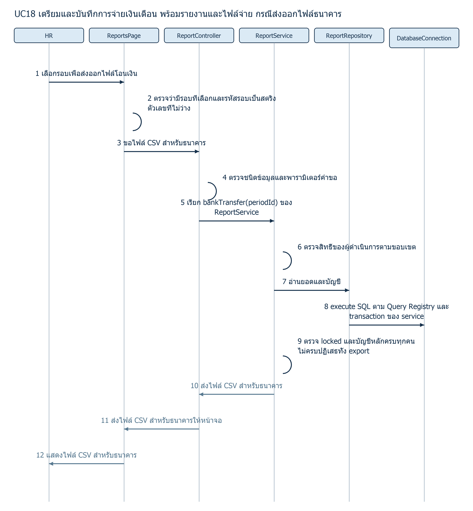

## SEQ-18a เตรียมจ่าย QR ยืนยันและยกเลิกพร้อมประวัติ

~~~mermaid
sequenceDiagram
    actor Finance as HR หรือ OWNER
    participant PaymentsPage as PayrollPayments
    participant PaymentController as PaymentController
    participant PaymentService as PayrollPaymentService
    participant PaymentRepository as PaymentRepository
    participant DatabaseConnection as DatabaseConnection
    Finance->>PaymentsPage: 1 เลือกงวดล็อกและเตรียมจ่าย
    PaymentsPage->>PaymentController: 2 ส่ง periodId พร้อม actor
    PaymentController->>PaymentService: 3 preparePayrollPayments(command)
    PaymentService->>PaymentService: 4 ตรวจ HR/OWNER, locked, snapshot, exclusive branch groups
    PaymentService->>PaymentRepository: 5 transaction เตรียมยอดเต็มสุทธิและปลายทาง immutable
    PaymentRepository->>DatabaseConnection: 6 insert unique payroll payment และ append audit
    DatabaseConnection-->>PaymentRepository: 7 คืนรายการเตรียมจ่ายและกลุ่ม
    PaymentRepository-->>PaymentService: 8 คืน frozen destination และยอด
    PaymentService-->>PaymentController: 9 คืนกลุ่ม paid/outstanding ตาม exact decimal
    PaymentController-->>PaymentsPage: 10 map response และแสดงรายการ
    Finance->>PaymentsPage: 11 ขอ QR โทรศัพท์ผู้รับที่ลงทะเบียน
    PaymentsPage->>PaymentController: 12 ขอ QR ของ paymentId
    PaymentController->>PaymentService: 13 ตรวจ scope และสร้าง payload จาก snapshot
    PaymentService-->>PaymentController: 14 คืน QR; การสแกนไม่เปลี่ยนสถานะ paid
    Finance->>PaymentsPage: 15 จ่ายภายนอกแล้วเลือกยืนยัน หรือยกเลิกพร้อมเหตุผล
    PaymentsPage->>PaymentController: 16 ส่ง confirm หรือ cancel command
    PaymentController->>PaymentService: 17 ตรวจ state และ lock รายการ
    PaymentService->>PaymentRepository: 18 บันทึกผลและ append-only audit history แบบ atomic
    PaymentRepository->>DatabaseConnection: 19 update guarded state และ insert audit
    PaymentService-->>PaymentController: 20 คืนผลและยอดจ่ายแล้วหรือคงค้างล่าสุด
    PaymentController-->>PaymentsPage: 21 แสดงประวัติและยอดรายสาขา
~~~

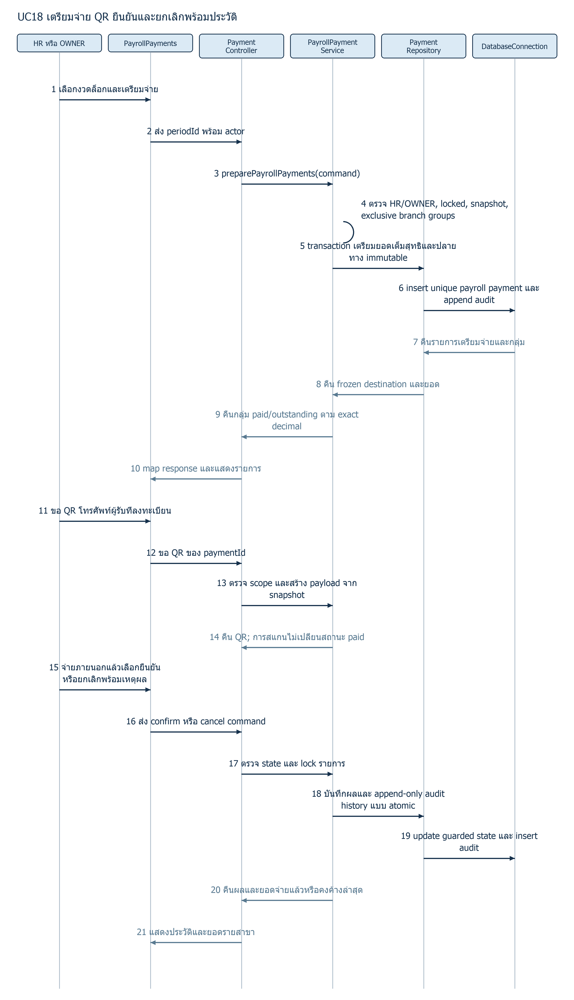

## SEQ-19 ดูภาพรวมและรายงานตามสิทธิ์

~~~mermaid
sequenceDiagram
    actor User as User
    participant ReportsPage as ReportsPage
    participant ReportController as ReportController
    participant ReportService as ReportService
    participant ReportRepository as ReportRepository
    participant DatabaseConnection as DatabaseConnection
    User->>ReportsPage: 1 เลือกงาน ดูภาพรวมและรายงานรายละเอียด
    ReportsPage->>ReportController: 2 ส่งข้อมูลที่ผู้ใช้ตรวจทาน
    ReportController->>ReportService: 3 ตรวจ request shape แล้วส่ง command
    ReportService->>ReportService: 4 ตรวจสิทธิ์ ขอบเขต และกฎของ use case
    ReportService->>ReportRepository: 5 ใช้ public persistence operation ตาม code mapping
    ReportRepository->>DatabaseConnection: 6 execute parameterized SQL / transaction ตามงาน
    DatabaseConnection-->>ReportRepository: 7 คืนผล query
    ReportRepository-->>ReportService: 8 คืน domain data
    ReportService-->>ReportController: 9 คืนผลการดำเนินการ
    ReportController-->>ReportsPage: 10 map response และแสดงผล
~~~

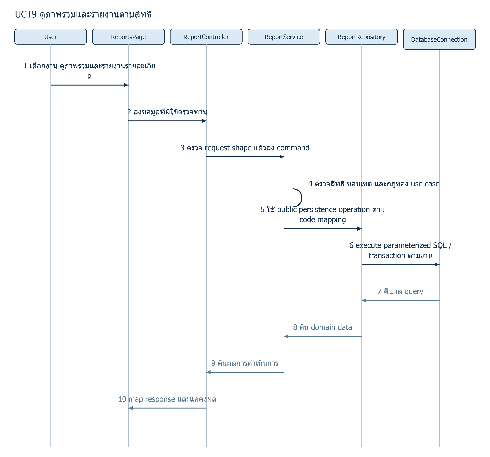

## SEQ-20 ตรวจสอบประวัติการดำเนินงาน

~~~mermaid
sequenceDiagram
    actor User as User
    participant AuditPage as AuditPage
    participant AuditController as AuditController
    participant AuditService as AuditService
    participant AuditRepository as AuditRepository
    participant DatabaseConnection as DatabaseConnection
    User->>AuditPage: 1 เลือกงาน ค้นประวัติการกระทำ
    AuditPage->>AuditController: 2 ส่งข้อมูลที่ผู้ใช้ตรวจทาน
    AuditController->>AuditService: 3 ตรวจ request shape แล้วส่ง command
    AuditService->>AuditService: 4 ตรวจสิทธิ์ ขอบเขต และกฎของ use case
    AuditService->>AuditRepository: 5 ใช้ public persistence operation ตาม code mapping
    AuditRepository->>DatabaseConnection: 6 execute parameterized SQL / transaction ตามงาน
    DatabaseConnection-->>AuditRepository: 7 คืนผล query
    AuditRepository-->>AuditService: 8 คืน domain data
    AuditService-->>AuditController: 9 คืนผลการดำเนินการ
    AuditController-->>AuditPage: 10 map response และแสดงผล
~~~

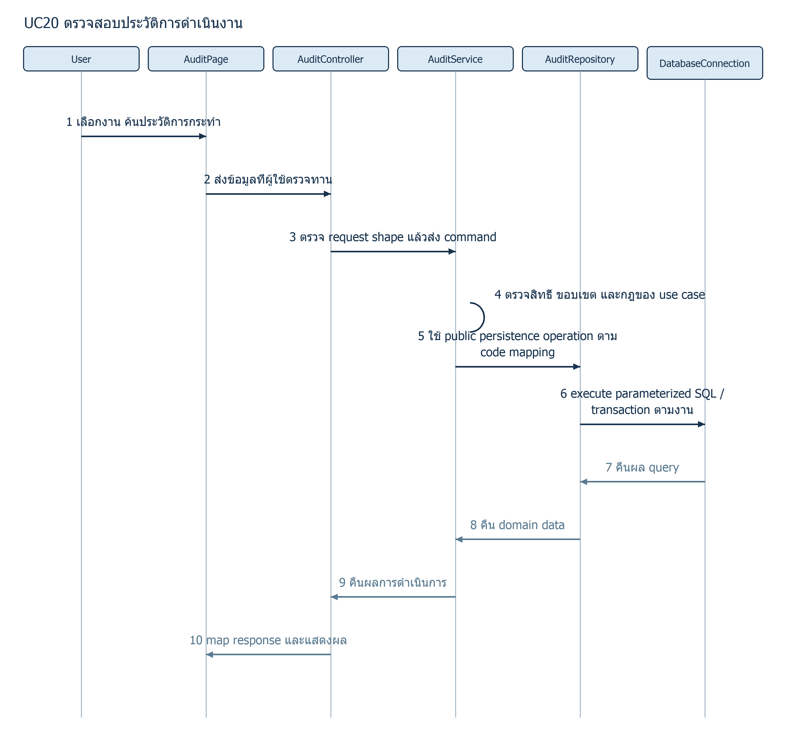
